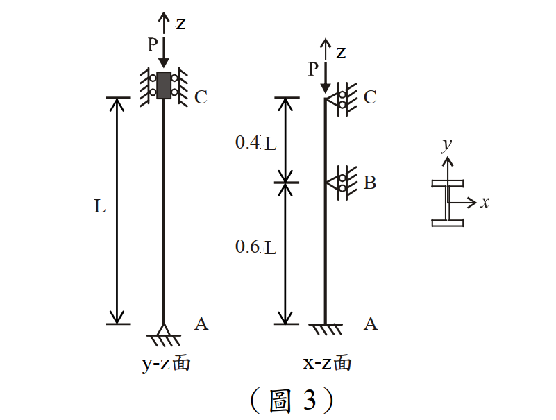

# SS-2013-3 題目正本

> 本檔只記錄**考卷上寫了什麼、圖上畫了什麼**，不含任何解法。解析見同資料夾 `SS-2013-3.md`。
> 判讀清單經使用者確認前，狀態為「待確認」；確認後本檔原則上不再修改（改動須回考卷原圖並記 log）。

| 項目 | 內容 |
|------|------|
| 考卷 | `raw/exams/SS-2013_鋼結構設計.pdf` 第 2 頁（全一張之背面），第三題 |
| 考年 | 民國 102 年（2013） |
| 配分 | 25 分（㈠ 15、㈡ 10） |
| 附圖 | 1 張（圖 3：y-z 面、x-z 面、斷面），`SS-2013-3-fig-1.png`；K 值表照錄於 §2 |
| 判讀狀態 | **已確認**（2026-11-02 使用者確認，含「不確定」項之解讀；轉錄同日，PyMuPDF 110 dpi 全頁＋圖 3 500 dpi 局部目視，盲讀後才比對既有解析） |

## 1. 考卷原文（逐字）

> 三、如圖 3 所示之一受軸壓力 P 作用之鋼柱，已知鋼柱總長度為 16 m，柱底 A 點處及柱頂 C 點處之邊界條件，如圖 3 所示；另於柱中 B 點處的 x-z 面上有一鉸接之側向支撐。若此鋼柱採用 W14×61 型鋼，材料性質及相關斷面尺寸為：$E = 2{,}040$ tf/cm²，$F_y = 2.5$ tf/cm²；$A = 116$ cm²，$d = 35.3$ cm，$t_w = 0.952$ cm，$b_f = 25.4$ cm，$t_f = 1.64$ cm，$I_x = 26{,}700$ cm⁴，$I_y = 4{,}480$ cm⁴。
> ㈠試以容許應力設計法（ASD），求解該柱之容許壓力強度 $P_a$＝？（15 分）
> ㈡試以極限設計法（LRFD），求解該柱之設計壓力強度 $\phi_cP_n$＝？（10 分）

## 2. 考卷給的公式、附表與參數

題下附表照錄：

| 條件 | 邊界無側位移 | | | 邊界有側位移* | | |
|------|------|------|------|------|------|------|
| 端點型式 | 固接-固接 | 鉸接-固接 | 鉸接-鉸接 | 固接*-固接 | 固接*-鉸接 | 自由端*-固接 |
| 理論 K 值 | 0.5 | 0.7 | 1.0 | 1.0 | 2.0 | 2.0 |
| 設計 K 值 | 0.65 | 0.8 | 1.0 | 1.2 | 2.0 | 2.1 |

- 本卷**沒給** ASD／LRFD 柱公式與 $\phi_c$（卷內公式只有第二題萊梅厥公式、第四題 $B_1$、$B_2$、$C_m$、$P_{eK}$）；注意事項只有㈠㈡。

## 3. 附圖

*圖面文字照錄：z；P；C；L；A；y-z面；z；P；C；0.4 L；B；0.6 L；A；x-z面；y；x；（圖 3）。*

## 4. 判讀清單

「把握」標**不確定**者請優先確認；解讀類項目（題目用字的意思）另標「解讀」。

| # | 項目 | 判讀 | 圖上／題文依據 | 把握 |
|---|------|------|---------------|------|
| 1 | K 取理論或設計值 | 取表中**設計值**（2026-11-01 使用者已決定主答 $K = 0.8$，見 log FIX-SS-已勘誤抽樣） | 附表（解讀） | 確定 |
| 2 | 柱公式與 $\phi_c$ | 考卷未給，依規範（ASD $F_a$、LRFD $F_{cr}$、$\phi_c = 0.85$） | 卷面（解讀） | 確定 |
| 3 | 斷面方向 | 翼板水平、腹板垂直；$x$ 軸水平＝強軸、$y$ 軸垂直＝弱軸 | 斷面示意（500 dpi） | 確定 |
| 4 | 平面與軸 | y-z 面（變位沿 $y$）＝繞 $x$ 軸＝**強軸**；x-z 面（變位沿 $x$）＝繞 $y$ 軸＝**弱軸** | 座標＋斷面（解讀） | 確定 |
| 5 | y-z 面 A | 三角形 → **鉸支** | 圖 3 左（500 dpi） | 確定 |
| 6 | y-z 面 C | 方塊夾在兩側滾輪牆之間 → 不可側移、**不可轉動**、可沿 z 滑動 | 圖 3 左（500 dpi） | 確定 |
| 7 | x-z 面 A | 斜線、無三角形 → **固接** | 圖 3 中（500 dpi） | 確定 |
| 8 | x-z 面 B | 三角形尖端貼柱＋滾輪＋斜線牆 → 鉸接側撐（不可側移、可轉）；距 A 0.6L、距 C 0.4L | 圖 3 中＋尺寸線 | 確定 |
| 9 | x-z 面 C | 同 B 之鉸接側撐 | 圖 3 中 | 確定 |
| 10 | 柱長 | $L = 16$ m（兩平面同） | 題文 | 確定 |
| 11 | B 側撐所在平面 | 只在 x-z 面，y-z 面全長無中間支撐 | 題文＋圖 3 左 | 確定 |

---

*轉錄：2026-11-02（SS-U1-1 題目正本推廣・批 2）｜確認：2026-11-02 使用者確認*
