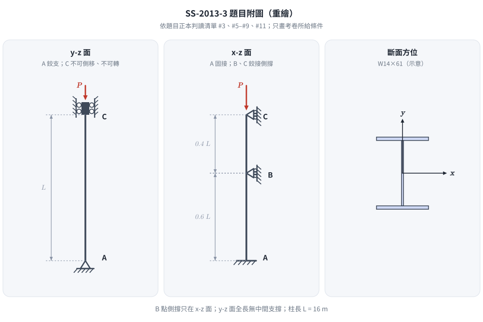
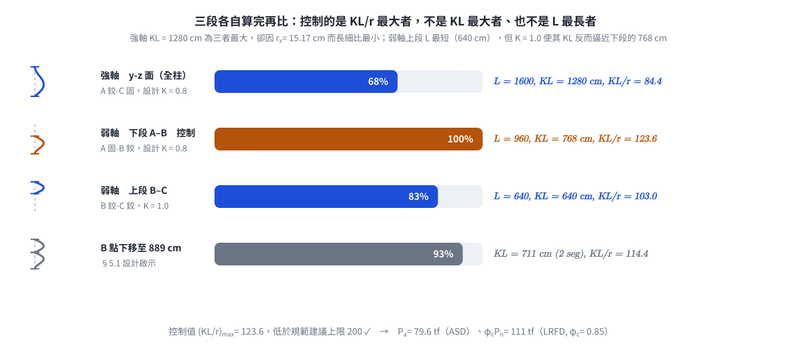

# 考題編號：SS-2013-3

**主分類：** `SS-U1-1` 拉力及壓力桿件
**副分類：** 無
**設計法：** 混合（ASD + LRFD）
**標籤：** `壓力桿件` `有效長度` `弱軸挫屈` `強軸挫屈` `分段側撐` `迴旋半徑` `ASD容許應力` `LRFD設計強度` `兩平面邊界不同` `Cc判斷` `λc` `設計K值`

---

## 1. 題目（考卷原文見題目正本）

> 考卷原文、公式／附表、附圖與判讀清單（已確認）見 [`SS-2013-3-problem.md`](SS-2013-3-problem.md)。本節只列**解題時最容易讀錯的地方**與本解使用的記號；題意以題目正本為準。



*圖 1　題目附圖重繪（依題目正本判讀清單 #3、#5–#9、#11）。兩個平面並排，柱底條件相反（y-z 鉸、x-z 固）且 B 側撐只在 x-z 面，攔下把 B 側撐用來切割強軸或兩平面邊界讀成同一組；解題用的有效長度見圖 2。*

### 常見誤讀

| 項目 | 正確判讀 | 常見誤讀 |
|------|---------|---------|
| 兩平面柱底 | 強軸（y-z 面）A 鉸；弱軸（x-z 面）A 固 | 兩平面當成同一種支承 |
| y-z 面柱頂 C | 不可側移、不可轉 → 鉸-固，設計 $K = 0.8$ | 當成鉸接 |
| B 側撐 | 只在 x-z 面，距 A 0.6L | 拿去切割強軸 |
| K 值 | 取附表**設計值** | 用理論值 0.7（舊版主答） |

**本解記號：** W14×61：$A = 116$ cm²、$I_x = 26{,}700$、$I_y = 4{,}480$ cm⁴；$L = 1600$ cm；$F_y = 2.5$、$E = 2040$ tf/cm²。

### 判讀圖解（解析自繪）


*圖 2　同一根柱在兩個正交平面各自的邊界條件與挫屈模態；圖上的 $KL$ 就是該平面內兩個彎矩零點（鉸端或反曲點）之間的距離，反曲點位置由挫屈特徵方程 $\tan u = u$ 解出而非目測。**攔錯：** 把兩平面的柱底當成同一種支承（強軸實為鉸、弱軸實為固），或誤把 B 點側撐拿去切割強軸。*

---

## 2. 考題核心精神與出題者意圖 (Core Concepts & Examiner's Intent)

**核心觀念：兩個正交平面各自獨立判斷邊界與分段，把三個 $KL/r$ 都算出來，取最大者控制；再以同一個 $KL/r$ 分別跑 ASD 與 LRFD 兩套公式。**

| 步驟 | ASD | LRFD |
|------|-----|------|
| 1 | 計算 $(KL/r)_{\max}$（三段比較） | 計算 $(KL/r)_{\max}$（同一值） |
| 2 | 算 $C_c = \sqrt{2\pi^2E/F_y}$，判斷彈性／非彈性 | 算 $\lambda_c = \dfrac{KL/r}{\pi}\sqrt{F_y/E}$，判斷 $\lambda_c \lessgtr 1.5$ |
| 3 | 代入 $F_a$（含變動安全係數 FS） | 代入 $F_{cr} = 0.658^{\lambda_c^2}F_y$ |
| 4 | $P_a = F_a A$ | $\phi_c P_n = \phi_c F_{cr} A$ |

**出題者測驗重點：**

1. **兩平面邊界不同**：強軸平面柱底是**鉸**、弱軸平面柱底是**固**——粗心者會兩個平面用同一組邊界
2. **弱軸要分段**：B 點側向支撐把弱軸切成 0.6L 與 0.4L 兩段，兩段的 $K$ 值還不一樣
3. **強軸不分段**：B 點的支撐只在 x-z 面，對強軸（y-z 面）完全無效，強軸仍用全長 1600 cm
4. ASD 非彈性段的安全係數 FS 是 $KL/r$ 的三次函數，不是常數
5. LRFD 的 $\lambda_c$ 定義與 $0.658^{\lambda_c^2}$ 的指數運算

---

## 3. 解題戰略地圖與陷阱分析 (Strategic Roadmap & Trap Analysis)

**作戰計畫：**
```
Step 1  計算 rx, ry
Step 2  強軸（y-z面，全長1600cm）：A鉸 - C固（無側位移）→ 設計 K=0.8（理論 0.7）→ KL/rx
Step 3  弱軸（x-z面，分兩段）：
        下段 A-B（A固 - B鉸，960cm）→ 設計 K=0.8（理論 0.7）→ KL/ry,下
        上段 B-C（B鉸 - C鉸，640cm）→ K=1.0 → KL/ry,上
Step 4  取最大值 (KL/r)_max → 判斷設計區段
Step 5  ASD: Cc → FS → Fa → Pa
Step 6  LRFD: λc → Fcr → φcPn
```

**關鍵陷阱：**

> ⚠️ **陷阱 1（本題最主要）：兩個平面的柱底條件相反**
> 左圖（y-z 面／強軸）A 是**三角形鉸支承**；右圖（x-z 面／弱軸）A 是**斜線陰影固定端**。
> 若把兩個平面都當成「A 固接」或都當成「A 鉸接」，強軸的 $K$ 就會取錯。
> （本題碰巧強軸「鉸-固」與弱軸下段「固-鉸」的 $K$ 同為 0.8（理論 0.7），**答案不變但敘述會錯**——
> 若考官改動任一端條件，這個誤讀就會直接吃分。）

> ⚠️ **陷阱 2：柱頂 C 在 y-z 面是「固接」不是「鉸接」**
> 圖上 C 是一個**實心方塊夾在兩排滾輪導軌之間**：滾輪允許沿軸向（z）滑動，但方塊被兩片牆夾住，
> **轉動與側向位移都被拘束** → 屬「固接（無側位移）」。若誤判為鉸接（鉸-鉸），$K$ 會變成 1.0，
> $KL/r_x = 105.5$，雖仍不控制，但推理已錯。

> ⚠️ **陷阱 3：B 點側向支撐只影響弱軸**
> B 點的支撐畫在 **x-z 面**，只拘束 $x$ 向位移 → 只切割弱軸。強軸（y-z 面）中間無支撐，
> 有效長度仍為全長 1600 cm。誤把強軸也分段會嚴重高估承載力。

> ⚠️ **陷阱 4：弱軸兩段的 $K$ 值不同，且「短的那段不一定控制」**
> 下段 $K = 0.8$、$L = 960$ → $KL = 768$ cm；上段 $K = 1.0$、$L = 640$ → $KL = 640$ cm。
> 下段雖然 $K$ 較小，但長度較長，$KL$ 反而較大 → **下段控制**。必須比 $KL$ 而非比 $L$。

> ⚠️ **陷阱 5：ASD 的安全係數 FS 是三項式**
> 非彈性區 $\text{FS} = \dfrac{5}{3} + \dfrac{3(KL/r)}{8C_c} - \dfrac{(KL/r)^3}{8C_c^3}$，
> 隨 $KL/r$ 由 1.667 變化到 1.917，**不可用固定值 5/3 或 23/12**。

> ⚠️ **陷阱 6：理論 K 值 vs 設計 K 值**
> 考卷同時給了兩列。本解主答採**設計 K**（0.8／1.0，AISC 建議值、偏保守）：$P_a = 79.6$ tf、$\phi_cP_n = 111$ tf；
> 若採**理論 K**（0.7／1.0）則為 96.8 tf、134 tf，高 18～21%（詳見 §5.2）。
> 作答時**務必寫明採用哪一列**。

## 3.5 變數層次分析（Variable Hierarchy Analysis）

> 複習提示：解題後，在每個卡住的知識點「卡關?」欄標記 `⚠`；第二次複習時只看有 `⚠` 的項目。

**最終目標：** W14×61 柱（兩平面邊界不同、弱軸分段）→ $(KL/r)_{\max}$ → ASD 容許壓力 $P_a$ 及 LRFD 設計強度 $\phi_c P_n$

### 主要公式（$\boxed{\phantom{x}}$ = 未知，待推導）

$$\boxed{r_x} = \sqrt{I_x/A}, \qquad \boxed{r_y} = \sqrt{I_y/A}$$

$$\boxed{\left(\frac{KL}{r}\right)_{\max}} = \max\!\left[\underbrace{\frac{0.8(1600)}{\boxed{r_x}}}_{\text{強軸全柱}},\;\underbrace{\frac{0.8(960)}{\boxed{r_y}}}_{\text{弱軸下段}},\;\underbrace{\frac{1.0(640)}{\boxed{r_y}}}_{\text{弱軸上段}}\right]$$

$$C_c = \sqrt{\frac{2\pi^2 E}{F_y}} \quad \text{(ASD 彈性／非彈性分界)}$$

$$\boxed{\text{FS}} = \frac{5}{3} + \frac{3\boxed{(KL/r)}}{8C_c} - \frac{\boxed{(KL/r)}^3}{8C_c^3}$$

$$\boxed{F_a} = \frac{\left[1 - \dfrac{\boxed{(KL/r)}^2}{2C_c^2}\right] F_y}{\boxed{\text{FS}}}, \qquad \boxed{P_a} = \boxed{F_a} \times A$$

$$\boxed{\lambda_c} = \frac{\boxed{(KL/r)}}{\pi}\sqrt{\frac{F_y}{E}}, \qquad \boxed{F_{cr}} = 0.658^{\boxed{\lambda_c}^2} F_y, \qquad \boxed{\phi_c P_n} = 0.85\,\boxed{F_{cr}}\,A$$

### L1：題目直接給定

_看到題目就能讀出的數字，不需要任何公式。_

| 符號 | 數值 | 說明 |
|:---:|:---|:---|
| $E$ | 2,040 tf/cm² | 彈性模數 |
| $F_y$ | 2.5 tf/cm² | 降伏強度 |
| $A$ | 116 cm² | 斷面積 |
| $I_x$ | 26,700 cm⁴ | 強軸慣性矩 |
| $I_y$ | 4,480 cm⁴ | 弱軸慣性矩 |
| $L$ | 1,600 cm | 柱總長 |
| B 點位置 | $0.6L = 960$ cm（距 A） | 弱軸側向支撐點 |
| A（y-z 面／強軸） | **鉸支承** | 三角形符號 |
| C（y-z 面／強軸） | **固接（可軸向滑動、無側位移）** | 方塊＋兩側滾輪導軌 |
| A（x-z 面／弱軸） | **固接** | 斜線陰影固定端 |
| B、C（x-z 面／弱軸） | **鉸接側向支撐** | 滾輪貼牆 |
| $K$ 值表 | 理論 0.5／0.7／1.0／…；設計 0.65／0.8／1.0／…（本解取設計值） | 考卷提供 |

### L2：需知識點推導

_需要知道公式名稱與適用條件，套入 L1 即可算出。_

**Step 1：斷面迴旋半徑**

| 符號 | 公式／來源 | 卡關? |
|:---:|:---|:---|
| $r_x$ | $\sqrt{26700/116} = 15.17$ cm | |
| $r_y$ | $\sqrt{4480/116} = 6.215$ cm | |

**Step 2：三個有效長細比（採設計 $K$ 值）**

| 符號 | 公式／來源 | 卡關? |
|:---:|:---|:---|
| $(KL/r)_x$ | $0.8(1600)/15.17 = 84.4$（強軸全柱；A 鉸-C 固，無側位移，設計 $K = 0.8$） | |
| $(KL/r)_{y,\text{下}}$ | $0.8(960)/6.215 = 123.6$（弱軸下段 A–B；A 固-B 鉸，設計 $K = 0.8$）← **控制** | |
| $(KL/r)_{y,\text{上}}$ | $1.0(640)/6.215 = 103.0$（弱軸上段 B–C；B 鉸-C 鉸，$K = 1.0$） | |
| $(KL/r)_{\max}$ | $123.6$ | |
| 細長比上限檢核 | $123.6 < 200$（規範建議上限）✓ | |

**Step 3：(一) ASD 容許壓力 $P_a$**

| 符號 | 公式／來源 | 卡關? |
|:---:|:---|:---|
| $C_c$ | $\sqrt{2\pi^2(2040)/2.5} = 126.9$ | |
| 區段判定 | $123.6 < 126.9$ → **非彈性挫屈** | |
| FS | $5/3 + 3(123.6)/(8 \times 126.9) - 123.6^3/(8 \times 126.9^3) = 1.916$ | |
| $F_a$ | $[1-123.6^2/(2 \times 126.9^2)](2.5)/1.916 = 0.686$ tf/cm² | |
| $P_a$ | $0.686 \times 116 = 79.6$ tf | |

**Step 4：(二) LRFD 設計強度 $\phi_c P_n$**

| 符號 | 公式／來源 | 卡關? |
|:---:|:---|:---|
| $\sqrt{E/F_y}$ | $\sqrt{2040/2.5} = 28.57$ | |
| $\lambda_c$ | $123.6/(\pi \times 28.57) = 1.377$ | |
| 區段判定 | $\lambda_c = 1.377 < 1.5$ → **非彈性挫屈** | |
| $F_{cr}$ | $0.658^{1.897} \times 2.5 = 1.130$ tf/cm² | |
| $\phi_c P_n$ | $0.85 \times 1.130 \times 116 = 111.4$ tf | |
| 局部挫屈檢核 | 翼板 $b_f/2t_f = 7.74 < 0.56\sqrt{E/F_y} = 16.0$；腹板 $h/t_w = 33.6 < 1.49\sqrt{E/F_y} = 42.6$ → 非細長 ✓ | |

### L3：深層知識（不懂就卡住）

| 知識點 | 說明 | 卡關? |
|:---|:---|:---|
| 兩正交平面須各自獨立判斷 | 同一根柱在兩個平面可以有完全不同的支承與分段；本題柱底一鉸一固 | |
| 「y-z 面」對應哪個軸 | 變位在 $y$ 向 → 繞 $x$ 軸彎曲 → 用 $I_x$、$r_x$（強軸）。判別靠斷面圖的軸向定義 | |
| 側向支撐只作用於其所在平面 | B 點畫在 x-z 面 → 只切弱軸；強軸仍是全長 | |
| 分段後應比較 $KL$ 而非 $L$ | 下段 $K$ 小但長，$KL = 768 >$ 上段 $KL = 640$ → 下段控制 | |
| 「固接可滑動」的 $K$ 判定 | 轉動被拘束＋側向位移被拘束＋僅軸向可滑動 → 屬「固接、無側位移」端 | |
| ASD 非彈性挫屈安全係數 FS | FS 隨 $KL/r$ 由 5/3（$=1.667$）變化到 23/12（$=1.917$），是三項式而非常數 | |
| LRFD $\lambda_c$ 的物理意義 | $\lambda_c = \sqrt{F_y/F_e}$；$\lambda_c \le 1.5$ 用 $0.658^{\lambda_c^2}$，$>1.5$ 用 $0.877/\lambda_c^2$ | |
| 殘留應力對非彈性挫屈的影響 | LRFD 的 $0.658$ 曲線與 ASD 的 $C_c$ 都隱含殘留應力（約 $0.5F_y$）效應 | |
| 理論 K 值與設計 K 值的取捨 | 實際支承難達理想固接／鉸接，AISC 建議用設計值（較大、偏保守）；本解主答採設計值 | ⚠ |

---

## 4. 步驟化詳細計算過程 (Step-by-Step Detailed Calculation)

### 一、斷面迴旋半徑

$$r_x = \sqrt{\frac{I_x}{A}} = \sqrt{\frac{26{,}700}{116}} = \sqrt{230.2} = 15.17 \ \text{cm}$$

$$r_y = \sqrt{\frac{I_y}{A}} = \sqrt{\frac{4{,}480}{116}} = \sqrt{38.62} = 6.215 \ \text{cm}$$

---

### 二、強軸（y-z 面）有效長度

**邊界：** 柱底 A **鉸支承**、柱頂 C **固接（可軸向滑動、側向位移被拘束）**，中間無支撐。

依考卷表：端點型式「**鉸接-固接**」、「**邊界無側位移**」→ 理論 $K = 0.7$、**設計 $K = 0.8$（本解採用）**

$$\left(\frac{KL}{r}\right)_x = \frac{0.8 \times 1600}{15.17} = \frac{1280}{15.17} = 84.4$$

> **策略註解：** 強軸用**全長 1600 cm**。B 點的側向支撐畫在 x-z 面，對本平面（y-z）沒有任何作用。

---

### 三、弱軸（x-z 面）有效長度（分段計算）

**邊界：** 柱底 A **固接**；B 點（距 A $= 0.6L = 960$ cm）與柱頂 C **鉸接側向支撐**。

**下段 A–B（長 $0.6L = 960$ cm）：** A 固接、B 鉸接 → 「鉸接-固接、無側位移」→ 設計 $K = 0.8$（理論 0.7）

$$\left(\frac{KL}{r}\right)_{y,\text{下}} = \frac{0.8 \times 960}{6.215} = \frac{768}{6.215} = \boxed{123.6}$$

**上段 B–C（長 $0.4L = 640$ cm）：** B 鉸接、C 鉸接 → 「鉸接-鉸接」→ $K = 1.0$（理論、設計值相同）

$$\left(\frac{KL}{r}\right)_{y,\text{上}} = \frac{1.0 \times 640}{6.215} = \frac{640}{6.215} = 103.0$$

---

### 四、控制長細比

$$\left(\frac{KL}{r}\right)_{\max} = \max(84.4,\; 123.6,\; 103.0) = \boxed{123.6}$$

**控制段：弱軸下段（A–B）**，$KL/r = 123.6$

$$123.6 < 200 \quad \text{（壓力桿件細長比上限）} \ \checkmark$$



*圖 3　三段各自算出 $KL/r$ 之後再比大小。**攔錯：** 拿物理長度 $L$ 或有效長度 $KL$ 互比而選錯控制段——強軸 $KL = 1280$ cm 為三者最大，卻因 $r_x$ 大而不控制；弱軸上段 $L = 640$ cm 最短，卻因 $K = 1.0$ 而 $KL$ 逼近下段。*

---

### 五、(一) ASD 容許壓力強度 $P_a$

**計算 $C_c$（彈性／非彈性界限長細比）：**

$$C_c = \sqrt{\frac{2\pi^2 E}{F_y}} = \sqrt{\frac{2 \times 9.8696 \times 2040}{2.5}} = \sqrt{\frac{40{,}268}{2.5}} = \sqrt{16{,}107} = 126.9$$

**判斷區段：** $KL/r = 123.6 < C_c = 126.9$ → **非彈性挫屈（Inelastic Buckling）**

**計算安全係數 FS（隨 $KL/r$ 變化）：**

$$\text{FS} = \frac{5}{3} + \frac{3(KL/r)}{8C_c} - \frac{(KL/r)^3}{8C_c^3}$$

$$= 1.6667 + \frac{3 \times 123.6}{8 \times 126.9} - \frac{123.6^3}{8 \times 126.9^3} = 1.6667 + \frac{370.8}{1015.2} - \frac{1{,}888{,}232}{16{,}348{,}385}$$

$$= 1.6667 + 0.3652 - 0.1155 = \boxed{1.916}$$

**計算容許應力 $F_a$：**

$$F_a = \frac{\left[1 - \dfrac{(KL/r)^2}{2C_c^2}\right] F_y}{\text{FS}} = \frac{\left[1 - \dfrac{123.6^2}{2(126.9)^2}\right] \times 2.5}{1.916}$$

$$= \frac{\left[1 - \dfrac{15{,}277}{32{,}207}\right] \times 2.5}{1.916} = \frac{(1 - 0.4743) \times 2.5}{1.916} = \frac{1.314}{1.916} = \boxed{0.686 \ \text{tf/cm}^2}$$

**容許壓力強度：**

$$\boxed{P_a = F_a \times A = 0.686 \times 116 = 79.6 \ \text{tf}}$$

---

### 六、(二) LRFD 設計壓力強度 $\phi_c P_n$

**計算 $\lambda_c$（無量綱長細參數）：**

$$\sqrt{\frac{E}{F_y}} = \sqrt{\frac{2040}{2.5}} = \sqrt{816} = 28.57$$

$$\lambda_c = \frac{KL/r}{\pi}\sqrt{\frac{F_y}{E}} = \frac{123.6}{\pi \times 28.57} = \frac{123.6}{89.73} = \boxed{1.377}$$

**判斷 $F_{cr}$ 公式：** $\lambda_c = 1.377 < 1.5$ → **非彈性挫屈**

$$\lambda_c^2 = 1.377^2 = 1.897$$

$$0.658^{1.897} = e^{1.897 \ln 0.658} = e^{1.897(-0.4187)} = e^{-0.7942} = 0.4520$$

$$F_{cr} = 0.4520 \times 2.5 = 1.130 \ \text{tf/cm}^2$$

**局部挫屈檢核（不可略）：**

$$\text{翼板（無側支撐板元）：}\ \frac{b_f}{2t_f} = \frac{25.4}{2(1.64)} = 7.74 \;<\; 0.56\sqrt{\frac{E}{F_y}} = 0.56(28.57) = 16.0 \ \checkmark$$

$$\text{腹板（有側支撐板元）：}\ \frac{h}{t_w} = \frac{35.3 - 2(1.64)}{0.952} = 33.6 \;<\; 1.49\sqrt{\frac{E}{F_y}} = 1.49(28.57) = 42.6 \ \checkmark$$

兩者均為**非細長斷面**，故無需折減（$Q = 1.0$），$F_{cr}$ 可直接採整體彎曲挫屈值。

**設計壓力強度（台灣現行規範 $\phi_c = 0.85$）：**

$$\boxed{\phi_c P_n = 0.85 \times F_{cr} \times A = 0.85 \times 1.130 \times 116 = 111.4 \approx 111 \ \text{tf}}$$

---

### 七、結果彙整

| 量 | 數值 |
|----|------|
| $r_x$ | 15.17 cm |
| $r_y$ | 6.215 cm |
| $(KL/r)_x$（強軸全柱，A 鉸-C 固，設計 $K = 0.8$） | 84.4 |
| $(KL/r)_{y,\text{下}}$（弱軸下段，A 固-B 鉸，設計 $K = 0.8$） | **123.6 ← 控制** |
| $(KL/r)_{y,\text{上}}$（弱軸上段，B 鉸-C 鉸，$K = 1.0$） | 103.0 |
| $C_c$ | 126.9 |
| FS | 1.916 |
| $F_a$ | 0.686 tf/cm² |
| **$P_a$（ASD）** | **79.6 tf** |
| $\lambda_c$ | 1.377 |
| $F_{cr}$ | 1.130 tf/cm² |
| **$\phi_c P_n$（LRFD，$\phi_c = 0.85$）** | **111 tf** |
| （對照：理論 K 0.7） | $P_a$ 96.8 tf、$\phi_cP_n$ 134 tf（§5.2） |

---

## 5. 關鍵爭議點與進階探討 (Critical Issues & Advanced Discussion)

### 5.1 為何弱軸下段控制？——比 $KL$，不比 $L$

| 段 | $K$ | $L$ (cm) | $KL$ (cm) | $KL/r_y$ |
|:---|:---:|:---:|:---:|:---:|
| 下段 A–B | 0.8 | 960 | **768** | **123.6 ← 控制** |
| 上段 B–C | 1.0 | 640 | 640 | 103.0 |

上段物理長度較短（640 < 960 cm），但兩端皆鉸（$K = 1.0$）；下段雖有固接底端（$K = 0.8$）卻長得多，
$KL$ 反而較大。**「短的那段不一定安全」是本題的設計直覺重點。**

**設計啟示：** 若要提升承載力，最有效的是把 B 點側撐往下移（讓兩段的 $KL$ 相等）。
令 $0.8a = 1.0(1600-a)$ 得 $a = 889$ cm，此時兩段 $KL = 711$ cm、$KL/r_y = 114.4$，$P_a$ 由 79.6 提升至 90.0 tf（約 13%）；
若在弱軸再加一道側撐（三分點），控制 $KL/r$ 降到 85.8（上兩段），$P_a \approx 118.9$ tf，提升約 49%。

### 5.2 理論 K 值 vs 設計 K 值：答案差 18%

考卷同時給出兩列 $K$ 值，因此必須交代採用哪一列：

| 採用 | $(KL/r)_x$ | $(KL/r)_{y,\text{下}}$ | $(KL/r)_{y,\text{上}}$ | 控制值 | $F_a$ | **$P_a$** | $\lambda_c$ | $F_{cr}$ | **$\phi_cP_n$** |
|:---|:---:|:---:|:---:|:---:|:---:|:---:|:---:|:---:|:---:|
| **設計 K**（0.8／0.8／1.0）← 本解主答 | 84.4 | **123.6** | 103.0 | 123.6 | 0.686 | **79.6 tf** | 1.377 | 1.130 | **111 tf** |
| 理論 K（0.7／0.7／1.0） | 73.8 | **108.1** | 103.0 | 108.1 | 0.834 | **96.8 tf** | 1.205 | 1.362 | **134 tf** |

**如何選？**

- 實際柱底不可能是完美固接（基礎必有轉動）、柱頂也難達完美束制；理論值會低估 $K$ → AISC 建議採**設計 K 值**，答案較保守。**本解主答採設計 K 值。**
- 若認為圖 3 的理想化符號（純鉸、純固定端、滾輪導軌）即代表理想條件，也有解答採**理論 K 值**（$P_a = 96.8$ tf、$\phi_cP_n = 134$ tf），比設計值高 18～21%，偏不保守。
- **考場作法：** 主答採設計 K 值，並在旁註明「若採理論 K 值（0.7）則 $P_a = 96.8$ tf、$\phi_cP_n = 134$ tf」。
  兩列都給了，兩種答案都應該被接受，但**不寫明依據**才會被扣分。

### 5.3 依最新規範計算的差異

| 項目 | 本題所用（台灣現行規範，民國 99 年版） | AISC 360-16／-22 | 本題影響 |
|:---|:---|:---|:---|
| **LRFD $\phi_c$** | **0.85** | **0.90** | $\phi_cP_n$：111 → **118 tf**（+6%） |
| LRFD 界限判準 | $\lambda_c \le 1.5$ | $KL/r \le 4.71\sqrt{E/F_y} = 134.5$ | 等價（$1.5\pi = 4.712$），本題 123.6 < 134.5，同屬非彈性 |
| LRFD $F_{cr}$ 式 | $0.658^{\lambda_c^2}F_y$ | $\left[0.658^{F_y/F_e}\right]F_y$ | **完全相同**（$F_y/F_e \equiv \lambda_c^2$）；$F_e = \pi^2E/(KL/r)^2 = 1.319$ tf/cm²，$F_y/F_e = 1.896$ → $F_{cr} = 1.130$ ✓ |
| ASD 架構 | $F_a$（$C_c$＋變動 FS） | 統一：$P_a = F_{cr}A/\Omega$，$\Omega = 1.67$ | $F_{cr}/\Omega = 1.130/1.67 = 0.677$ tf/cm² → $P_a = 78.5$ tf（比 79.6 低 1.4%） |
| 細長比上限 | 建議 $KL/r \le 200$ | 同（E2 條文說明） | 123.6 ✓ |

**結論：** 台灣現行有效版本仍為**民國 99 年（2010）修正版**，$\phi_c$ 仍是 **0.85**；參照 AISC 360-16 的修正草案
（建研所研究案）已完成但尚未發布施行。因此**考場請照 $\phi_c = 0.85$ 作答**（$\phi_c P_n = 111$ tf）；
若為實務設計並採 AISC 360-22，則為 118 tf。ASD 兩套架構的結果只差 1.4%，可互為驗算。

### 5.4 ASD 與 LRFD 結果的合理性交叉檢核

$$\frac{\phi_c P_n}{P_a} = \frac{111.4}{79.6} = 1.40$$

若以典型載重組合 $P_u \approx 1.4 P_{service}$（$D:L = 1:1$ 時 $\dfrac{1.2+1.6}{2} = 1.4$）反推：

$$P_{service,\text{允許}} = \frac{111.4}{1.4} = 79.6 \ \text{tf} \approx P_a = 79.6 \ \text{tf} \quad \checkmark$$

兩法給出幾乎相同的可用服務載重，代表計算沒有量級錯誤——這是考場上最快的自我檢查。

### 5.5 ASD 安全係數的設計哲學

$$\text{FS}\big|_{KL/r = 0} = \frac{5}{3} = 1.667, \qquad \text{FS}\big|_{KL/r = C_c} = \frac{23}{12} = 1.917$$

本題 FS = 1.916，已非常接近彈性挫屈邊界的 1.917（因 $KL/r = 123.6$ 已接近 $C_c = 126.9$）。
**物理意義：** 長柱的挫屈行為對初始缺陷與殘留應力更敏感、離散度更大，故規範給較大的安全係數。

*解析完成時間：2026-04-23*
*修正日期：2026-08-22（依考卷圖 3 逐一改正兩平面之邊界判讀：強軸為「A 鉸-C 固接可滑動」、弱軸柱底為「固接」；修正 $F_a$ 0.835→0.834、$P_a$ 96.9→96.8；補設計 K 值對照與最新規範 $\phi_c = 0.90$ 對照）*
*圖解補繪：2026-08-29（向量圖，腳本 `gen_SS-2013-3.py`，可重跑）*
*修正日期：2026-11-01（依使用者決定，主答改採考卷 K 值表之**設計 K 值**（強軸、弱軸下段 0.7 → 0.8，上段 1.0 不變）：控制 $KL/r$ 108.1 → **123.6**、FS 1.909 → 1.916、$F_a$ 0.834 → 0.686、**$P_a$ 96.8 → 79.6 tf**；$\lambda_c$ 1.205 → 1.377、$F_{cr}$ 1.362 → 1.130、**$\phi_cP_n$ 134 → 111 tf**；理論 K 結果移為 §5.2 對照，理由為 AISC 建議設計值、實際支承難達理想、偏保守；§5.1 最佳側撐位置 941 → 889 cm、§5.3 AISC 360 對照、§5.4 交叉檢核同步重算；圖 2、圖 3 與 `gen_SS-2013-3.py` 同步。驗證：Python 重算 ASD／LRFD 兩法、交叉檢核 $\phi_cP_n/1.4 = 79.6 \approx P_a$）*
*驗證狀態：unverified*

*修正日期：2026-11-02（§1 全文重述改為指向題目正本 `SS-2013-3-problem.md`（已確認）＋常見誤讀＋本解記號，§1 內自繪向量圖保留於「判讀圖解」；解題內容與答案不變）*

*修正日期：2026-11-03（§1 補入題目附圖重繪 `figs/SS-2013-3-fig-1-problem.svg`（依已確認的題目正本判讀清單，腳本 `gen_SS-2013-3.py`，可重跑）；解題內容與答案不變）*
