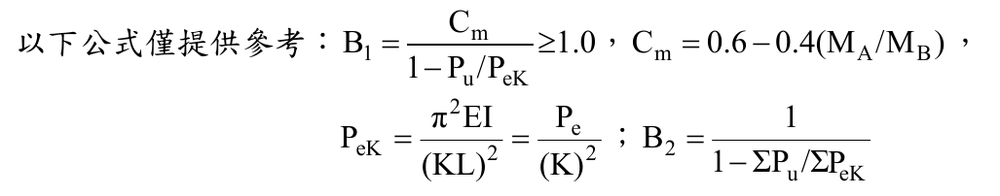
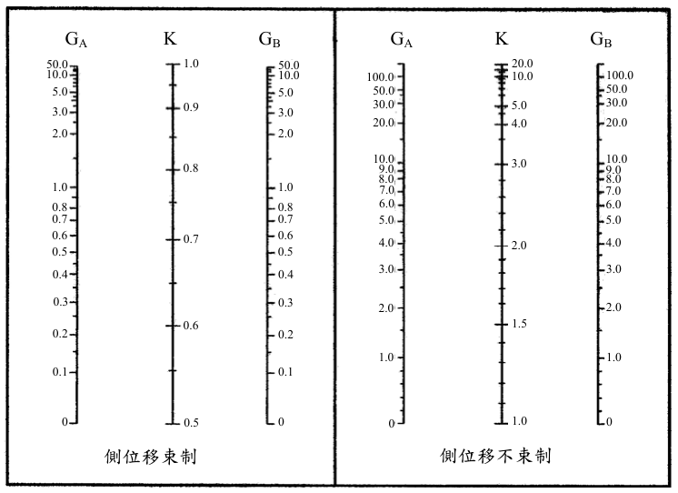
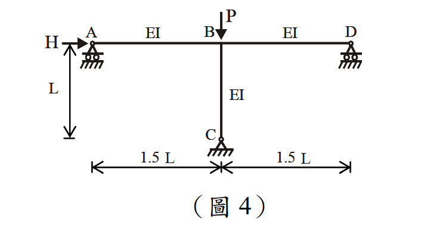

# SS-2013-4 題目正本

> 本檔只記錄**考卷上寫了什麼、圖上畫了什麼**，不含任何解法。解析見同資料夾 `SS-2013-4.md`。
> 判讀清單經使用者確認前，狀態為「待確認」；確認後本檔原則上不再修改（改動須回考卷原圖並記 log）。

| 項目 | 內容 |
|------|------|
| 考卷 | `raw/exams/SS-2013_鋼結構設計.pdf` 第 2 頁（全一張・背面），第四題；所引 Alignment Chart 在第 1 頁（題二） |
| 考年 | 民國 102 年（2013） |
| 配分 | 25 分 |
| 附圖 | 1 張（圖 4：無側撐剛架），`SS-2013-4-fig-1.png`；題內公式截圖 `SS-2013-4-eqn-1.png`；第 1 頁 Alignment Chart 截圖 `SS-2013-4-eqn-2.png` |
| 判讀狀態 | **待確認**（轉錄 2026-11-02，PyMuPDF 110 dpi 全頁＋附圖 500 dpi 局部目視（向量圖）＋PDF 向量座標核對，盲讀後才比對既有解析） |

## 1. 考卷原文（逐字）

> 四、如圖 4 所示一無側撐剛架，承受垂直軸壓力 $P$ 及水平力 $H$。試使用 LRFD 求解柱 BC 之二階設計彎矩（Second-order design moment）$M_u$ 及 $B_1$、$B_2$、$M_{nt}$、$M_{lt}$。（求解柱 BC 之有效長度係數時，請參考題二之 Alignment Chart。）（25 分）
>
> （柱邊界為固接（Fixed end）時 G 使用 1、為鉸接（hinged end）時 G 使用 10。）

## 2. 考卷給的公式、附表與參數

- 題文：只有符號 $P$、$H$、$L$、$EI$，**沒有任何數值**。
- 「以下公式僅提供參考」照錄：

$$B_1 = \frac{C_m}{1 - P_u/P_{eK}} \ge 1.0,\qquad C_m = 0.6 - 0.4(M_A/M_B),$$
$$P_{eK} = \frac{\pi^2EI}{(KL)^2} = \frac{P_e}{(K)^2}\;;\qquad B_2 = \frac{1}{1 - \Sigma P_u/\Sigma P_{eK}}$$

  

- 題二（第 1 頁）的 Alignment Chart（左：側位移束制；右：側位移不束制）：

  

- 同頁第三題下方的「理論／設計 K 值」表屬第三題。
- 公式未給 $M_u = B_1M_{nt} + B_2M_{lt}$ 式；未說明梁遠端鉸接時 Alignment Chart 是否須修正梁勁度。
- 卷首注意事項：㈠可以使用電子計算器；㈡不必抄題。

## 3. 附圖

*圖面文字照錄：H；A；EI；B；P；EI；D；L；EI；C；1.5 L；1.5 L；（圖 4）。*

## 4. 判讀清單

「把握」標**不確定**者請優先確認；解讀類項目（題目用字的意思）另標「解讀」。

| # | 項目 | 判讀 | 圖上／題文依據 | 把握 |
|---|------|------|---------------|------|
| 1 | A、D 支承 | 滾支承（只承垂直力、可水平移動），梁端以鉸接於支承 | 500 dpi：三角形下兩個圓輪＋三角形頂端小圓圈 | 確定 |
| 2 | C 支承 | 鉸支承 → $G_C$ = 10 | 三角形＋圓圈、無滾輪 | 確定 |
| 3 | B 節點 | 梁柱剛接（無鉸圓圈） | 圖上 B 點無圓圈 | 確定 |
| 4 | 側移 | 唯一水平束制在 C（鉸）→ 結構可側移，柱 BC 用「側位移不束制」圖 | 題文「無側撐剛架」＋支承 | 確定 |
| 5 | 尺寸 | 梁 AB = BD = 1.5 L；柱 BC = L；三者 EI 相同 | 尺寸線、EI 標註 | 確定 |
| 6 | 載重位置 | H 水平作用於 A（梁高程）、P 向下作用於 B | 圖 | 確定 |
| 7 | 梁遠端鉸接 | 梁 AB、BD 遠端（A、D）為鉸，計算 $G_B$ 時是否修正梁勁度題未說明 | 題文只說參考題二 Chart、G 取 1／10 | 不確定（解讀，影響答案，請確認） |
| 8 | 數值 | 全題無數值，答案以 $P$、$H$、$L$、$EI$ 表示 | 題文 | 確定 |

---

*轉錄：2026-11-02（SS-U1-3 題目正本推廣・批 2）*
