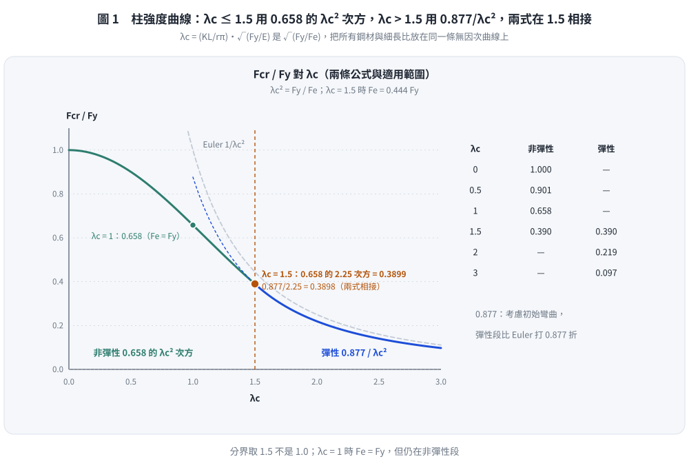
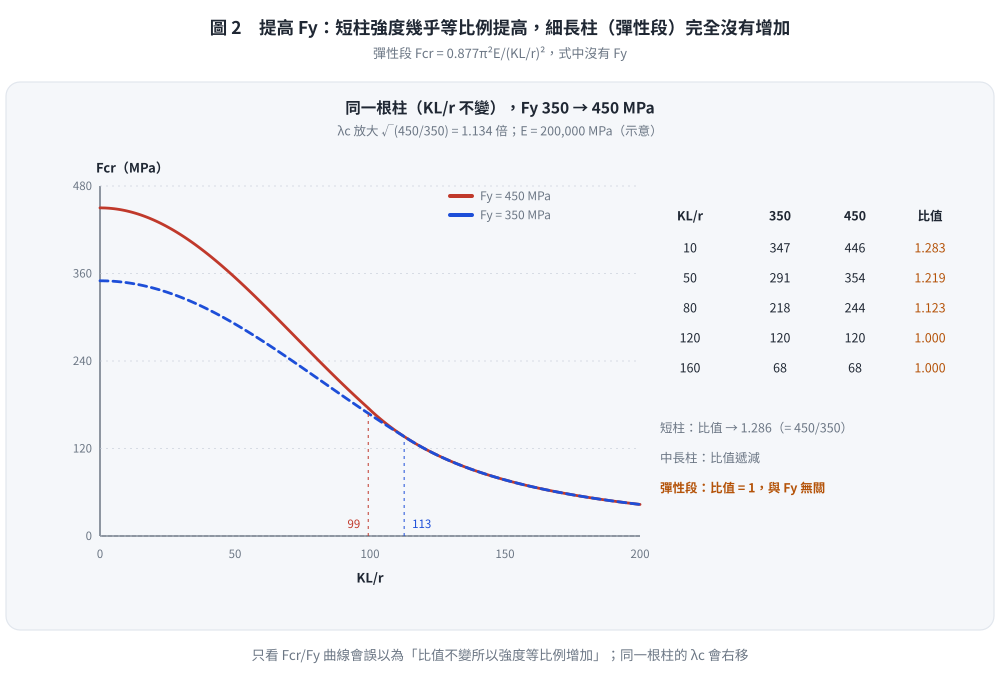
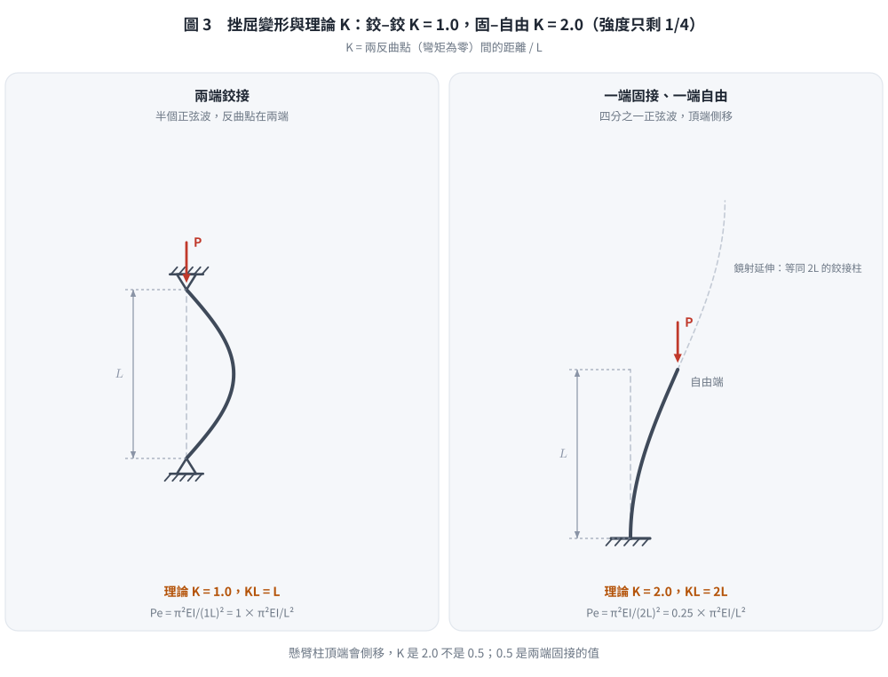

# 考題編號：SS-2014-1

**主分類：** `SS-U1-1` 拉力及壓力桿件
**副分類：** 無
**設計法：** LRFD
**標籤：** `壓力桿件` `整體挫屈` `柱強度曲線` `λc推導` `有效長度` `殘留應力` `非彈性挫屈` `彈性挫屈`

---

## 1. 題目（考卷原文見題目正本）

> 考卷原文、公式／附表、附圖與判讀清單（已確認）見 [`SS-2014-1-problem.md`](SS-2014-1-problem.md)。本節只列**解題時最容易讀錯的地方**與本解使用的記號；題意以題目正本為準。

### 常見誤讀

| 項目 | 正確判讀 | 常見誤讀 |
|------|---------|---------|
| 兩式適用範圍 | 考卷**未標**，㈡要求考生自行標示（$\lambda_c = 1.5$ 分界） | 當成題目已給 |
| ㈡「挫屈強度的變化」 | 同一根柱（$KL/r$ 不變）$F_{cr}$ 本身的變化 | 只比較 $F_{cr}/F_y$ |
| ㈢ | **理論** K 值 | 答設計值（如懸臂 2.1） |
| 曲線取值 | $\lambda_c = 0.5$ 時指數是 $\lambda_c^2 = 0.25$：$0.658^{0.25} = 0.901$ | 算成 0.878（本解析舊版的錯） |

**本解記號：** $\lambda_c$、$F_{cr}$、$F_y$、$E$；$F_y$ = 350、450 MPa。

---

## 2. 考題核心精神與出題者意圖 (Core Concepts & Examiner's Intent)

**核心觀念：**
- 為什麼 LRFD 用 $\lambda_c$ 這個無因次化參數？→ 它是「降伏應力與彈性挫屈應力之比值的平方根」，統一了不同鋼材強度的挫屈行為
- 高強度鋼（HighFy）用於細長壓力桿件有何盲區？→ 彈性挫屈時，Fcr 與 Fy 無關，高強度鋼優勢消失

**出題意圖：**
1. 測試考生能否從 Euler 公式「推導」出 λc，而非死背
2. 測試對曲線形狀的理解（兩段式、分界點）
3. 測試材料升級時的工程判斷：高強度鋼≠高挫屈強度（細長柱）

**陷阱預警：**
- 混淆 λc（無因次化細長比）與 KL/r（有因次細長比）
- 誤以為提高 Fy 對所有柱都有效（細長柱完全沒有幫助）
- 忘記兩公式在 λc = 1.5 處的連續性（用此驗算公式是否正確）

---

## 3. 解題戰略地圖與陷阱分析 (Strategic Roadmap & Trap Analysis)

**作戰計畫：**
```
Step 1：寫出 Euler 彈性挫屈應力 Fe
Step 2：定義 λc² = Fy/Fe，推導 λc 公式
Step 3：驗算分界點（λc=1.5時兩公式結果相同）
Step 4：繪製曲線，標示兩段與分界點
Step 5：分析 Fy 提升的影響（分彈性、非彈性兩段討論）
Step 6：畫挫屈變形圖，標示K值
```

**關鍵陷阱：**
1. **λc 的推導起點**：必須從 Euler 公式出發，不能直接背公式
2. **Fy 提升的討論**：必須區分彈性與非彈性兩個範圍，各有不同結論
3. **K值的理論與設計值**：本題要求「理論K值」，不是設計建議值
4. **分界點驗算**：可用兩公式在 λc=1.5 互相驗算，展現邏輯嚴謹度

## 3.5 變數層次分析（Variable Hierarchy Analysis）

> 複習提示：解題後，在每個卡住的知識點「卡關?」欄標記 `⚠`；第二次複習時只看有 `⚠` 的項目。

**最終目標：** 從 Euler 公式推導 $\lambda_c$ → 繪製柱強度曲線 → 分析 $F_y$ 提升的影響 → 畫挫屈模態及理論 K 值

### 主要公式（$\boxed{\phantom{x}}$ = 未知，待推導）

$$F_e = \frac{\pi^2 E}{(KL/r)^2} \quad (\text{Euler 挫屈應力})$$

$$\lambda_c^2 \equiv \frac{F_y}{F_e} \quad \Rightarrow \quad \boxed{\lambda_c} = \frac{KL}{r\pi}\sqrt{\frac{F_y}{E}}$$

$$F_{cr}/F_y = \begin{cases} 0.658^{\lambda_c^2} & \lambda_c \leq 1.5 \\ 0.877/\lambda_c^2 & \lambda_c > 1.5 \end{cases}$$

### L1：題目直接給定

| 符號 | 數值 | 說明 |
|------|------|------|
| $F_{cr}$ 公式 | 兩段式（題目給定） | 非彈性（$\lambda_c \leq 1.5$）/ 彈性（$\lambda_c > 1.5$） |
| 分界點 | $\lambda_c = 1.5$ | 兩公式適用範圍邊界 |
| 升強情境 | $F_y$：350 → 450 MPa | 討論挫屈強度變化 |
| 邊界條件A | 兩端鉸接 | 畫挫屈圖 |
| 邊界條件B | 一端固接、一端自由 | 畫挫屈圖 |

### L2：需知識點推導

**Step 1：推導 $\lambda_c$**

| 符號 | 公式 / 來源 | 卡關? |
|------|------------|:-----:|
| $P_e$ | $\pi^2 EI/(KL)^2$（Euler 臨界載重） | |
| $F_e$ | $P_e/A = \pi^2 E/(KL/r)^2$（Euler 挫屈應力） | |
| $\lambda_c^2$ | 定義為 $F_y/F_e$（降伏應力 / 彈性挫屈應力） | |
| $\lambda_c$ | $\sqrt{F_y/F_e} = (KL/r\pi)\sqrt{F_y/E}$ | |

**Step 2：分界點驗算**

| 符號 | 公式 / 來源 | 卡關? |
|------|------------|:-----:|
| 非彈性公式在 $\lambda_c=1.5$ | $0.658^{2.25} = 0.390$ | |
| 彈性公式在 $\lambda_c=1.5$ | $0.877/2.25 = 0.390$ ✓ | |

**Step 3：$F_y$ 提升影響分析**

| 範圍 | 影響 | 卡關? |
|------|------|:-----:|
| 彈性挫屈段（細長柱）| $F_{cr} = 0.877\pi^2E/(KL/r)^2$，與 $F_y$ 完全無關 | |
| 非彈性挫屈段 | $F_{cr}$ 有所提升，但比例小於 $F_y$ 升幅 | |
| 極短柱 | $F_{cr} \approx F_y$，升強效果最大 | |

**Step 4：理論 K 值**

| 邊界條件 | K 值 | 卡關? |
|---------|------|:-----:|
| 兩端鉸接（P-P） | $K = 1.0$（半正弦波） | |
| 一端固接一端自由（F-Free） | $K = 2.0$（四分之一正弦波） | |

### L3：深層知識（不懂就卡住）

| 知識點 | 說明 | 卡關? |
|--------|------|:-----:|
| $\lambda_c$ 的推導起點必須是 Euler 公式 | 背公式不算推導；考試要求「寫出推導過程」，需從 $P_e = \pi^2EI/(KL)^2$ 出發 | |
| $\lambda_c = 1.5$ 分界點的物理意義 | $F_e = F_y/2.25$；低於此點柱在挫屈前已局部降伏（非彈性），高於此點純彈性挫屈 | |
| 殘留應力對曲線的影響 | 0.658 係數隱含殘留應力（最大 0.3$F_y$）與初始幾何缺陷的實驗回歸修正 | |
| 彈性挫屈段 $F_{cr}$ 與 $F_y$ 無關 | 高強度鋼用於細長柱完全無效；$F_{cr} = 0.877\pi^2E/(KL/r)^2$ 只和 $E$、$KL/r$ 有關 | |
| 理論 K 值 vs AISC 設計 K 值 | 理論值假設完全固定/完全自由；設計值考慮實際接合半剛性（固接端用 K > 理論值） | |

---

## 4. 步驟化詳細計算過程 (Step-by-Step Detailed Calculation)

### (一) 推導 λc = KL/(rπ) × √(Fy/E)

**Step 1：Euler 彈性挫屈臨界載重**

彈性理論中，完美直柱的彈性挫屈（尤拉挫屈）臨界載重：

$$P_e = \frac{\pi^2 EI}{(KL)^2}$$

對應的挫屈臨界應力（除以斷面積A，利用 $r^2 = I/A$）：

$$F_e = \frac{P_e}{A} = \frac{\pi^2 E I}{(KL)^2 A} = \frac{\pi^2 E}{(KL/r)^2}$$

**Step 2：定義無因次化細長比 λc**

AISC-LRFD 定義 $\lambda_c$ 使得：

$$\lambda_c^2 \equiv \frac{F_y}{F_e}$$

即 $\lambda_c$ 是「降伏應力與彈性挫屈應力比值」的平方根，代表桿件相對細長程度。

**Step 3：代入 Fe 展開**

$$\lambda_c^2 = \frac{F_y}{F_e} = \frac{F_y}{\dfrac{\pi^2 E}{(KL/r)^2}} = \frac{F_y \cdot (KL/r)^2}{\pi^2 E}$$

取正平方根：

$$\boxed{\lambda_c = \frac{KL}{r} \cdot \frac{1}{\pi} \cdot \sqrt{\frac{F_y}{E}} = \frac{KL}{r\pi}\sqrt{\frac{F_y}{E}}}$$

**Step 4：物理意義確認**

- $\lambda_c = 1.0$：$F_e = F_y$（彈性挫屈應力恰等於降伏應力）
- $\lambda_c = 1.5$：$F_e = F_y/2.25 = 0.444F_y$（兩公式分界點）
- $\lambda_c \to 0$：極短柱，$F_{cr} \to F_y$（全斷面降伏）
- $\lambda_c \to \infty$：極細長柱，$F_{cr} \to 0$（幾乎無強度）

**驗算：分界點 λc = 1.5 時兩公式結果應相同**

非彈性公式：$F_{cr}/F_y = 0.658^{1.5^2} = 0.658^{2.25} = e^{2.25 \times \ln 0.658} = e^{-0.9417} = 0.3899$

彈性公式：$F_{cr}/F_y = 0.877/1.5^2 = 0.877/2.25 = 0.3898$ ✓（兩者吻合，差 0.0002，取三位均為 0.390）

---

### (二) Fcr/Fy 與 λc 之關係圖及 Fy 提升影響

**曲線關鍵數值：**

| $\lambda_c$ | $F_{cr}/F_y$（非彈性） | $F_{cr}/F_y$（彈性） | 說明 |
|------------|----------------------|---------------------|------|
| 0 | 1.000 | — | 極短柱，全塑性 |
| 0.5 | 0.901 | — | $0.658^{0.25}$ |
| 1.0 | 0.658 | — | $F_e = F_y$ |
| 1.5 | **0.390** | **0.390** | 分界點（兩公式相交） |
| 2.0 | — | 0.219 | |
| 3.0 | — | 0.097 | |

**曲線特徵：**
- 非彈性段（$\lambda_c \leq 1.5$）：$F_{cr}/F_y = 0.658^{\lambda_c^2}$，凹下曲線，考慮初始缺陷與殘留應力
- 彈性段（$\lambda_c > 1.5$）：$F_{cr}/F_y = 0.877/\lambda_c^2$，雙曲線，僅打折0.877考慮初始彎曲缺陷



*圖 1　柱強度曲線：$\lambda_c \le 1.5$ 用 $0.658^{\lambda_c^2}$，$\lambda_c > 1.5$ 用 $0.877/\lambda_c^2$，兩式在 1.5 相接（約 0.390）。這張圖攔的是分界取 $\lambda_c = 1.0$、彈性段直接用 Euler 而沒乘 0.877。*

**Fy 由 350 MPa 提升至 450 MPa 時的影響分析：**

**核心公式回顧：**

$$\lambda_c = \frac{KL}{r\pi}\sqrt{\frac{F_y}{E}}$$

對同一物理柱（相同 $KL/r$），$F_y$ 由 350 → 450 MPa：

$$\frac{\lambda_{c,\text{new}}}{\lambda_{c,\text{old}}} = \sqrt{\frac{450}{350}} = \sqrt{1.286} = 1.134$$

即同一根柱子在強度曲線上「向右移動」1.134倍。

**分範圍討論：**

①**彈性挫屈段（細長柱，$\lambda_c > 1.5$）：**

$$F_{cr} = \frac{0.877 F_y}{\lambda_c^2} = \frac{0.877 \pi^2 E}{(KL/r)^2}$$

> ⚠️ **關鍵結論：彈性段的 Fcr 與 Fy 完全無關！**

提高 Fy 完全沒有增加細長柱的挫屈強度。高強度鋼的優勢在細長壓力桿件中消失。

②**非彈性挫屈段（中等細長，$\lambda_c \leq 1.5$）：**

$$F_{cr,\text{new}} = 0.658^{\lambda_{c,\text{new}}^2} \times 450 \quad \text{vs.} \quad F_{cr,\text{old}} = 0.658^{\lambda_{c,\text{old}}^2} \times 350$$

Fcr 有所提升，但提升幅度小於 Fy 的增加比例（450/350 = 1.286）。

③**極短柱（$\lambda_c \to 0$）：** $F_{cr} \approx F_y$，提升幅度接近等比例，高強度鋼充分發揮。

**綜合結論：**

> 提高鋼材降伏強度（350→450 MPa）對壓力桿件的效益隨細長比增加而遞減；對彈性挫屈的細長柱完全無效。此為選用高強度鋼材應考量的核心限制。



*圖 2　同一根柱把 $F_y$ 由 350 提到 450 MPa：短柱強度幾乎等比例提高，愈細長增幅愈小，彈性段完全重合。這張圖攔的是看 $F_{cr}/F_y$ 無因次曲線就以為強度等比例增加——同一根柱的 $\lambda_c$ 會右移 1.134 倍。*

---

### (三) 兩種邊界條件的挫屈變形圖與理論 K 值

**案例A：兩端鉸接（Pin-Pin）**

```
    ●  ← 鉸接（可旋轉，不可位移）
    |
    |  ) 挫屈後呈半正弦波
    |
    ●  ← 鉸接（可旋轉，不可位移）
```

- 挫屈模態：半正弦波（半波長 = L）
- 有效長度：$KL = 1.0 \times L = L$

$$\boxed{K_{\text{兩端鉸}} = 1.0}$$

- 推導：邊界條件 $M(0) = M(L) = 0$ → 最低模態為半正弦波

**案例B：一端固接、另一端自由（Fixed-Free，懸臂柱）**

```
    ○  ← 自由端（可旋轉、可位移）
    |
    |  ) 挫屈後呈四分之一正弦波
    |
    ▓  ← 固接端（不可旋轉、不可位移）
```

- 挫屈模態：四分之一正弦波（有效長度 = 2L，即兩倍柱長才完成一個半波）
- 有效長度：$KL = 2.0 \times L = 2L$

$$\boxed{K_{\text{固接-自由}} = 2.0}$$

- 推導：固接端 $y=0, y'=0$；自由端 $M=0, V=0$ → 最低挫屈模態相當於兩端鉸接柱長度2L的下半段

**兩案例對照：**

| 邊界條件 | 理論K值 | 有效長度 $KL$ | 相對強度（以兩端鉸為基準） |
|---------|--------|-------------|--------------------------|
| 兩端鉸接（P-P） | 1.0 | L | 1× |
| 一固一自由（F-F） | 2.0 | 2L | 1/4×（$P_e \propto 1/(KL)^2$） |

> 固接-自由柱的彈性挫屈載重僅為兩端鉸接的 1/4，此即為何懸臂柱設計必須特別謹慎。



*圖 3　挫屈變形與理論 K：兩端鉸接 $K = 1.0$；固接–自由 $K = 2.0$，挫屈載重只剩 1/4。這張圖攔的是把懸臂柱 K 寫成 0.5（那是兩端固接），或把懸臂柱畫成對稱半波。*

---

## 5. 關鍵爭議點與進階探討 (Critical Issues & Advanced Discussion)

**①「0.877」係數的來源：**
Euler 公式乘上的 0.877（$= 1/1.14$）係數，對應最大初始彎曲缺陷 L/1000（AISC 規定的柱製作容許偏差）。即考慮實際柱不可能完美直的事實。

**②「0.658」係數的來源：**
AISC-LRFD 非彈性公式的 0.658 源自大量實驗回歸，同時考慮：
- 初始幾何缺陷
- 殘留應力（最大 0.3Fy）
- 非線性材料行為

**③設計K值 vs 理論K值：**
本題求理論K值。實務設計中，考慮接合部半剛性，AISC 設計K值通常略大於理論值（保守）。

**④高強度鋼的適用建議：**
- 軸壓為主、$KL/r$ 大的構件：不建議使用高強度鋼（Fe 與 Fy 無關）
- 短柱、拉力桿件：高強度鋼效益顯著
- 梁（撓曲）：需考量LTB，高強度鋼同樣有限制

**⑤台灣規範與AISC-LRFD的對應：**
台灣《鋼結構極限設計法規範》第4.1.1節直接引用AISC-LRFD的柱強度公式，但部分版本使用不同的殘留應力模型（Fr = 0.3Fy 或 Fr = 114 MPa）。考試中以題目給定為準。

*修正日期：2026-11-02（§1 全文重述改為指向題目正本 `SS-2014-1-problem.md`（已確認）＋常見誤讀＋本解記號；解題內容與答案不變）*

*修正日期：2026-11-03（解析勘誤：§4 (二) 曲線表 $\lambda_c = 0.5$ 非彈性值 0.878 → **0.901**（$0.658^{0.25}$）；$\lambda_c = 1.5$ 兩式值 0.389 → **0.390**（§3.5 L2 同改）；§4 (一) 驗算 $e^{-0.9434} = 0.3894$ → $e^{-0.9417} = 0.3899$；§5 ①「0.877 = 1/1.14²」→ $0.877 = 1/1.14$；§1 常見誤讀增列取值錯誤。驗證：獨立腳本重算 19 個數值 MISMATCHES: 0，另以 $e^{-0.419\lambda_c^2}$ 交叉驗算；考卷第 1 頁 150 dpi 目視核對公式）*

---

*圖解補繪：2026-11-03（向量圖 3 張，腳本 `gen_SS-2014-1.py`，改輸入可原地重跑；SVG 供 wiki／PDF，2× PNG 供 pptx／影片）*
