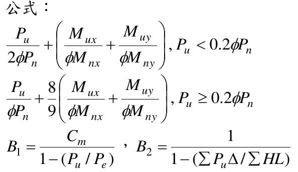
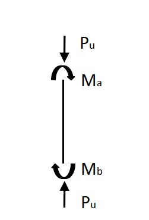

# SS-2014-4 題目正本

> 本檔只記錄**考卷上寫了什麼、圖上畫了什麼**，不含任何解法。解析見同資料夾 `SS-2014-4.md`。
> 判讀清單經使用者確認前，狀態為「待確認」；確認後本檔原則上不再修改（改動須回考卷原圖並記 log）。

| 項目 | 內容 |
|------|------|
| 考卷 | `raw/exams/SS-2014_鋼結構設計.pdf` 第 2 頁（全一張・背面），第四題 |
| 考年 | 民國 103 年（2014） |
| 配分 | 25 分 |
| 附圖 | 1 張（柱端力與端彎矩示意），`SS-2014-4-fig-1.jpg`；分析結果表照錄於 §1；題內公式截圖 `SS-2014-4-eqn-1.png` |
| 判讀狀態 | **待確認**（轉錄 2026-11-02，PyMuPDF 110 dpi 全頁＋附圖 900 dpi 局部目視（向量圖）＋PDF 向量路徑核對，盲讀後才比對既有解析） |

## 1. 考卷原文（逐字）

> 四、有一鋼造斜撐構架系統，經過載重組合分析後得到下表鋼柱在強軸載重分析（含載重係數效應）的結果如圖所示，請檢核 W14×90（滿足結實斷面，鋼材 ASTM A572 Grade 50）之鋼柱是否可滿足 AISC-LRFD 設計要求。此鋼柱長 3.75 m(<$L_p$)，$K_x$=1.79，$K_y$=1.0，此柱上及下端均有側向支撐，所在樓層最大垂直載重（含載重係數效應）為 9000 kN，側力 600 kN，相對應的側位移角為 5/1000。（25 分）
>
> | 分析 | $P_u$（kN） | $M_a$（kN-m） | $M_b$（kN-m） |
> |------|-----------|-------------|-------------|
> | 垂直力分析（1.2D+0.5L） | 1600 | 110 | 70 |
> | 側力（地震力）分析（1.0E） | 450 | 200 | 200 |
>
> 柱 W14×90 型鋼性質如下：
> $F_y$=350 MPa, $E$=200 GPa, $Z_x$=2572769 mm³, $I_x$=415815194 mm⁴, $A$=17097 mm², $r_x$=156 mm, $r_y$=94 mm
>
> 公式：（見 §2）

## 2. 考卷給的公式、附表與參數

- 題文：柱長 3.75 m（< $L_p$）；$K_x$ = 1.79、$K_y$ = 1.0；樓層 $\Sigma P_u$ = 9000 kN、側力 600 kN、側位移角 5/1000；分析表（§1）；斷面性質。
- 題內「公式」照錄：

$$\frac{P_u}{2\phi P_n} + \left(\frac{M_{ux}}{\phi M_{nx}} + \frac{M_{uy}}{\phi M_{ny}}\right),\ P_u < 0.2\phi P_n$$
$$\frac{P_u}{\phi P_n} + \frac89\left(\frac{M_{ux}}{\phi M_{nx}} + \frac{M_{uy}}{\phi M_{ny}}\right),\ P_u \ge 0.2\phi P_n$$
$$B_1 = \frac{C_m}{1 - (P_u/P_e)},\qquad B_2 = \frac{1}{1 - (\sum P_u\Delta/\sum HL)}$$

  

- 交互式**沒有寫「≤ 1.0」**；**沒有給 $\phi$、$C_m$ 式、$P_e$ 式、$F_{cr}$ 式**。
- 卷首注意事項：可以使用電子計算器；不必抄題。

## 3. 附圖

*圖面文字照錄：Pu；Ma；Mb；Pu。*

## 4. 判讀清單

「把握」標**不確定**者請優先確認；解讀類項目（題目用字的意思）另標「解讀」。

| # | 項目 | 判讀 | 圖上／題文依據 | 把握 |
|---|------|------|---------------|------|
| 1 | 端彎矩轉向 | $M_a$、$M_b$ **同為順時針** → 反向（雙）曲率；兩組分析共用此圖，表列值皆為正 → 兩組皆雙曲率 | 900 dpi＋向量路徑：上弧箭頭在右（x≈113.6 pt）朝下、下弧箭頭在左（x≈103.2 pt）朝上 | 確定 |
| 2 | 彎矩軸 | 只有強軸彎矩，$M_{uy}$ = 0 | 題文「強軸載重分析」 | 確定 |
| 3 | $M_{nt}$／$M_{lt}$ | 垂直力分析 → $M_{nt}$、$P_{nt}$；側力分析 → $M_{lt}$、$P_{lt}$ | 表頭「垂直力分析／側力（地震力）分析」 | 確定（解讀） |
| 4 | $B_2$ 資料 | $\Sigma P_u$ = 9000 kN、$\Sigma H$ = 600 kN、$\Delta/L$ = 5/1000 | 題文 | 確定 |
| 5 | 撓曲強度 | 柱長 3.75 m < $L_p$、結實斷面 → 無 LTB 折減（題已明示） | 題文 | 確定 |
| 6 | 構架型式 | 題文寫「斜撐構架」，卻給 $K_x$ = 1.79、側力分析與 $B_2$ 資料，兩者不一致；照題給資料計算 | 題文 | 不確定（解讀） |
| 7 | 有效長度 | $K_xL$ = 1.79×3.75 m、$K_yL$ = 3.75 m | 題文 | 確定 |

---

*轉錄：2026-11-02（SS-U1-3 題目正本推廣・批 2）*
