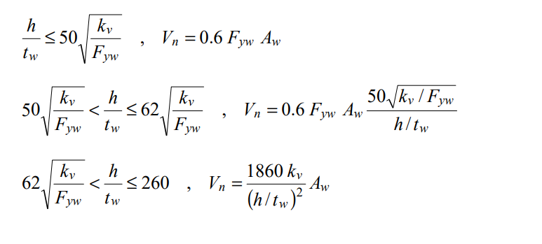
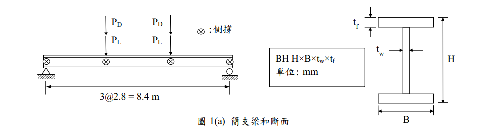
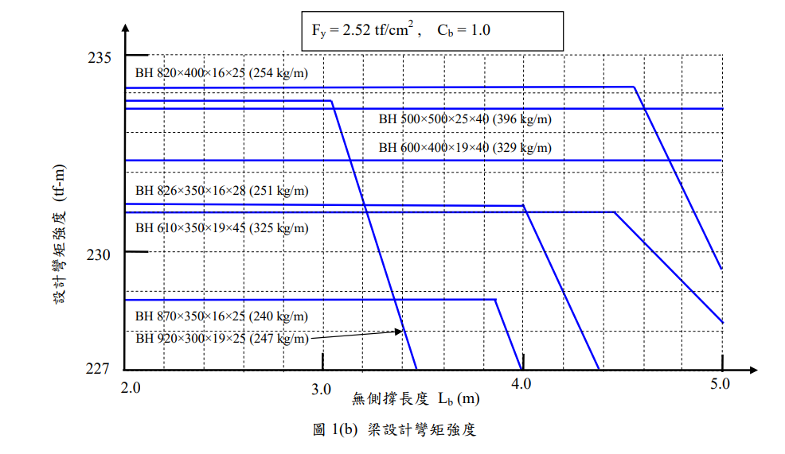

# SS-2015-1 題目正本

> 本檔只記錄**考卷上寫了什麼、圖上畫了什麼**，不含任何解法。解析見同資料夾 `SS-2015-1.md`。
> 判讀清單經使用者確認前，狀態為「待確認」；確認後本檔原則上不再修改（改動須回考卷原圖並記 log）。

| 項目 | 內容 |
|------|------|
| 考卷 | `raw/exams/SS-2015_鋼結構設計.pdf` 第 1 頁（全三頁之第一頁），第一題；參考公式在第 3 頁 |
| 考年 | 民國 104 年（2015） |
| 配分 | 30 分（每小題 10 分） |
| 附圖 | 2 張：圖 1(a) 簡支梁和斷面 `SS-2015-1-fig-1.png`、圖 1(b) 梁設計彎矩強度 `SS-2015-1-chart-1.png`；第 3 頁參考公式截圖 `SS-2015-1-eqn-1.png` |
| 判讀狀態 | **待確認**（轉錄 2026-11-02，PyMuPDF 110 dpi 全頁＋圖 1(b) 250 dpi 目視，圖 1(b) 曲線另以 PDF 向量座標讀值，盲讀後才比對既有解析） |

## 1. 考卷原文（逐字）

> 一、【極限設計法】有一跨距 8.4 m 之簡支承鋼梁，在三分點處各承受載重 $P_D$ = 22 tf，活載重 $P_L$ = 35 tf，梁僅在支承點和載重點有側向支撐如圖 1(a)所示，$E_s$ = 2040 tf/cm²。（每小題 10 分，共 30 分）
> ㈠若使用 A709-36 級鋼料（$F_y$ = 2.52 tf/cm²），由圖 1(b)設計最佳之抗彎矩斷面。
> ㈡檢核此斷面之剪力強度是否足夠？（$\phi_v$ = 0.9，腹板未使用加勁板，$k_v$ = 5.0）
> ㈢檢核此斷面因活載重造成之撓度，是否符合規範之限制。

（題文「在三分點處各承受載重 $P_D$ = 22 tf」照考卷原文，前段漏「靜」字，圖上標 $P_D$。）

## 2. 考卷給的公式、附表與參數

- 題文：跨距 8.4 m；三分點 $P_D = 22$、$P_L = 35$ tf；$E_s = 2040$、$F_y = 2.52$ tf/cm²；$\phi_v = 0.9$、$k_v = 5.0$。
- 圖 1(b)（$F_y = 2.52$ tf/cm²、$C_b = 1.0$）七條曲線，以 PDF 向量座標讀值（縱軸 227–235 tf-m 線性、橫軸 2.0–5.0 m）：

| 斷面（單位重） | 平台值（tf-m） | 平台終點 $L_b$（m） |
|---|---|---|
| BH 820×400×16×25（254 kg/m） | 234.2 | 4.56 |
| BH 920×300×19×25（247 kg/m） | 233.8 | 3.04 |
| BH 500×500×25×40（396 kg/m） | 233.6 | 至 5.0 仍為平台 |
| BH 600×400×19×40（329 kg/m） | 232.3 | 至 5.0 仍為平台 |
| BH 826×350×16×28（251 kg/m） | 231.2 | 4.01 |
| BH 610×350×19×45（325 kg/m） | 231.0 | 4.47 |
| BH 870×350×16×25（240 kg/m） | 228.8 | 3.87 |

  （BH 920×300 的標籤沒有貼在曲線旁，以箭頭指向在 $L_b$ ≈ 3.4 m 陡降的那條線，其平台為 233.8。）
- 第 3 頁「※參考公式」與本題相關者：剪力強度三段式

$$\frac{h}{t_w} \le 50\sqrt{\frac{k_v}{F_{yw}}}:\ V_n = 0.6F_{yw}A_w;\quad 50\sqrt{\frac{k_v}{F_{yw}}} < \frac{h}{t_w} \le 62\sqrt{\frac{k_v}{F_{yw}}}:\ V_n = 0.6F_{yw}A_w\frac{50\sqrt{k_v/F_{yw}}}{h/t_w};\quad 62\sqrt{\frac{k_v}{F_{yw}}} < \frac{h}{t_w} \le 260:\ V_n = \frac{1860k_v}{(h/t_w)^2}A_w$$

  
- **沒有給載重組合係數、撓度限值與各斷面的 $I_x$**。
- 卷首注意事項：㈠可用計算器、㈡不必抄題、㈢計算所需之物理常數、參數及公式等如未給時，請自行合理假設或推知；㈣作答請採用內政部發布 2010 年「鋼結構設計技術規範」為原則，並依題目指定設計法作答。

## 3. 附圖

*圖面文字照錄：PD；PD；PL；PL；⊗：側撐；3@2.8 = 8.4 m；BH H×B×tw×tf 單位: mm；tf；tw；H；B；圖 1(a) 簡支梁和斷面；Fy = 2.52 tf/cm², Cb = 1.0；設計彎矩強度 (tf-m)；無側撐長度 Lb (m)；七條曲線標籤（見 §2 表）；圖 1(b) 梁設計彎矩強度。*

## 4. 判讀清單

「把握」標**不確定**者請優先確認；解讀類項目（題目用字的意思）另標「解讀」。

| # | 項目 | 判讀 | 圖上／題文依據 | 把握 |
|---|------|------|---------------|------|
| 1 | 側撐 | 兩支承與兩載重點，$L_b = 2.8$ m | 圖 1(a) ⊗ 位置＋題文 | 確定 |
| 2 | 圖 1(b) 縱軸 | 設計彎矩強度 $\phi_bM_n$（已乘 $\phi_b$） | 縱軸標「設計彎矩強度」 | 確定 |
| 3 | 曲線與標籤對應 | 如 §2 表；BH 920×300 以箭頭指認 | 圖 1(b) 250 dpi＋向量座標 | 確定 |
| 4 | $C_b$ | 中段 $L_b$ 內彎矩均勻，$C_b = 1.0$ 與圖條件一致 | 題文＋圖 | 確定（解讀） |
| 5 | 載重組合 | 1.2D＋1.6L（係數題未給） | 卷首注意㈢、㈣ | 不確定（解讀） |
| 6 | 梁自重 | 不計（題未給，選斷面前也未知） | 題文 | 不確定（解讀） |
| 7 | 「最佳」 | 設計強度足夠的斷面中單位重最輕者 | 圖例附單位重 | 確定（解讀） |
| 8 | ㈡ $A_w$、$h$ | 由所選 BH 尺寸計算（$h$ 取腹板淨高） | 題文 | 確定（解讀） |
| 9 | ㈢ 撓度限值 | 活載重撓度依規範 $L/360$（題未給） | 題文「規範之限制」 | 不確定（解讀） |

---

*轉錄：2026-11-02（SS-U1-2 題目正本推廣・批 2）*
