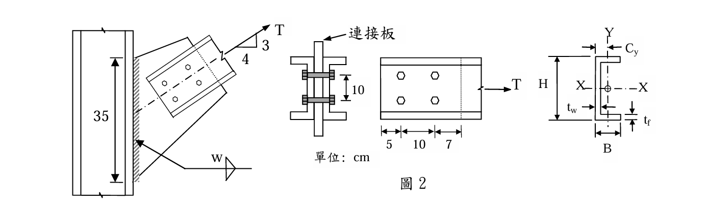

# SS-2015-2 題目正本

> 本檔只記錄**考卷上寫了什麼、圖上畫了什麼**，不含任何解法。解析見同資料夾 `SS-2015-2.md`。
> 判讀清單經使用者確認前，狀態為「待確認」；確認後本檔原則上不再修改（改動須回考卷原圖並記 log）。

| 項目 | 內容 |
|------|------|
| 考卷 | `raw/exams/SS-2015_鋼結構設計.pdf` 第 2 頁（全三頁之第二頁），第二題；參考公式在第 3 頁 |
| 考年 | 民國 104 年（2015） |
| 配分 | 30 分（㈠ 20、㈡ 10） |
| 附圖 | 1 張（圖 2：接合立面、端視、槽鋼平面、單槽鋼斷面），`SS-2015-2-fig-1.png`；第 3 頁參考公式截圖 `SS-2015-2-eqn-1.png` |
| 判讀狀態 | **已確認**（2026-11-02 使用者確認，含「不確定」項之解讀；轉錄同日，PyMuPDF 110 dpi 全頁＋圖 2 450 dpi 局部目視，盲讀後才比對既有解析） |

## 1. 考卷原文（逐字）

> 二、【極限設計法】有一雙槽鋼拉力桿以連接板和 H 柱接合如圖 2 示，槽鋼為 C200×75（H×B×t_w×t_f = 200×75×6×12.5 mm），使用直徑為 2.5 cm 的 A325 高拉力螺栓，1.6 cm 厚的連接板和 H 柱的有效銲長為 35 cm，採用 A992 鋼料（$F_y = 3.5$ tf/cm²，$F_u = 4.6$ tf/cm²）及 E70 銲條（$F_{E70} = 4.9$ tf/cm²），$E_s = 2040$ tf/cm²。
> ㈠求此拉力桿的設計強度。（20 分）
> ㈡若連接板強度足夠，求設計填角銲的銲腳長度 w。（10 分）

## 2. 考卷給的公式、附表與參數

第 3 頁「※參考公式：請自行選擇適合的公式，並檢查其正確性，若有問題應自行修正。」與本題相關者照錄：

$$w_n = w_g - \sum d_h + \sum\frac{s^2}{4g},\qquad T_{ds} = 0.9F_yA_g,\qquad T_{ds} = 0.75F_uA_e,\qquad U = 0.9,\ 0.85,\ 0.75$$

$$\text{當 } F_uA_{nt} \ge 0.6F_uA_{nv}:\ \phi R_n = \phi[0.6F_yA_{gv} + F_uA_{nt}] \le \phi[0.6F_uA_{nv} + F_uA_{nt}]$$

$$\text{當 } 0.6F_uA_{nv} \ge F_uA_{nt}:\ \phi R_n = \phi[0.6F_uA_{nv} + F_yA_{gt}] \le \phi[0.6F_uA_{nv} + F_uA_{nt}]$$

$$\text{填角銲設計強度 } \phi R_n = (0.75)(0.6F_{Exx})(t)(L)$$

- $U$ 只列三個數值，**未列**各值的適用條件。
- 卷首注意事項㈢「計算所需之物理常數、參數及公式等如未給時，請自行合理假設或推知。」㈣「作答請採用內政部發布 2010 年『鋼結構設計技術規範』為原則，並依題目指定設計法作答。」
- 本題**沒給**：槽鋼 $A$、$C_y$（同卷第三題給 C200×75：$I_x = 1970$ cm⁴、$I_y = 170$ cm⁴、$A = 29.9$ cm²、$C_y = 2.49$ cm）、螺栓孔徑、螺栓為承壓型或摩阻型、螺紋是否在剪力面、螺栓強度、邊距。

## 3. 附圖

*圖面文字照錄：T；3；4；35；w；連接板；10；T；5；10；7；單位: cm；Y；C_y；H；X；X；t_w；t_f；B；圖 2。*

## 4. 判讀清單

「把握」標**不確定**者請優先確認；解讀類項目（題目用字的意思）另標「解讀」。

| # | 項目 | 判讀 | 圖上／題文依據 | 把握 |
|---|------|------|---------------|------|
| 1 | 銲道道數 | 銲接符號只在參考線下方畫一個三角形（箭頭側）；立面只見一條銲道陰影 → 一道或連接板兩側各一道，圖面不足以判定 | 圖 2 左（450 dpi） | 不確定 → 使用者確認：**兩道**（連接板兩側各一道，有效總長 70 cm） |
| 2 | 拉力作用線 | 沿槽鋼形心線延伸，約通過 35 cm 銲道中點（無偏心） | 圖 2 左鏈線（解讀） | 不確定 → 使用者確認 |
| 3 | 槽鋼 $A$、$C_y$ | 本題未給，援用同卷第三題 C200×75 數值 | 同卷第三題（解讀） | 不確定 → 使用者確認 |
| 4 | 螺栓型式與孔徑 | 題只寫「A325 高拉力螺栓」，承壓／摩阻、孔徑、螺紋位置須依規範假設 | 題文（解讀） | 不確定 → 使用者確認 |
| 5 | $U$ | 沿力方向每行 2 根 → 0.75 | 槽鋼平面圖＋公式頁三個值（解讀） | 不確定 → 使用者確認 |
| 6 | ㈠「拉力桿的設計強度」 | 拉力桿本身與其螺栓接合各極限狀態取小（全斷面降伏、淨斷面斷裂、塊狀剪力、螺栓剪力、承壓）；連接板強度題未說足夠 | 題文（解讀） | 不確定 → 使用者確認 |
| 7 | ㈡ 設計用力 | 以㈠所得設計強度 $T$ 之 3:4 分量檢核銲道 | 題文「若連接板強度足夠」（解讀） | 不確定 → 使用者確認 |
| 8 | 雙槽鋼排列 | 兩槽鋼**腹板**貼連接板兩側、翼板朝外；螺栓穿過腹板—連接板—腹板 | 圖 2 端視（450 dpi） | 確定 |
| 9 | 螺栓數 | 每支槽鋼 4 顆＝沿力方向 2 顆 × 2 列；列距 10 cm | 平面圖＋端視「10」 | 確定 |
| 10 | 縱向尺寸 | 槽鋼左端（自由端）5 → 10 → 7 至**虛線**；虛線為連接板邊緣，槽鋼右側折斷線表示構材延續 | 圖 2 平面（450 dpi） | 確定 |
| 11 | 力的斜率 | 垂直 3：水平 4 | 圖 2 左斜率三角形 | 確定 |
| 12 | 銲道 | 連接板與 H 柱翼板之填角銲，有效長 35 cm，銲腳 $w$ 待求 | 題文＋圖 2 左 | 確定 |

---

*轉錄：2026-11-02（SS-U1-1 題目正本推廣・批 2）｜確認：2026-11-02 使用者確認*
