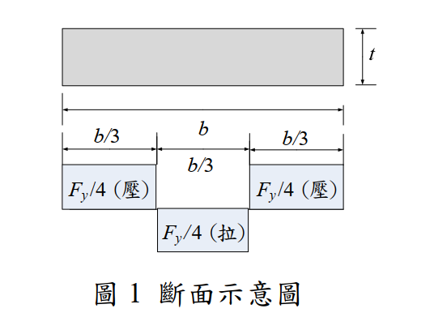
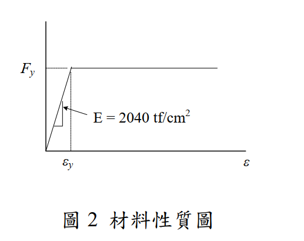

# SS-2016-3 題目正本

> 本檔只記錄**考卷上寫了什麼、圖上畫了什麼**，不含任何解法。解析見同資料夾 `SS-2016-3.md`。
> 判讀清單經使用者確認前，狀態為「待確認」；確認後本檔原則上不再修改（改動須回考卷原圖並記 log）。

| 項目 | 內容 |
|------|------|
| 考卷 | `raw/exams/SS-2016_鋼結構設計.pdf` 第 1 頁（全一張之正面），第三題 |
| 考年 | 民國 105 年（2016） |
| 配分 | 30 分（㈠ 5、㈡ 5、㈢ 5、㈣ 15） |
| 附圖 | 2 張（圖 1 斷面示意圖 `SS-2016-3-fig-1.png`；圖 2 材料性質圖 `SS-2016-3-fig-2.png`） |
| 判讀狀態 | **已確認**（2026-11-02 使用者確認，含「不確定」項之解讀；轉錄同日，PyMuPDF 110 dpi 全頁＋圖 1 350 dpi 局部目視，盲讀後才比對既有解析） |

## 1. 考卷原文（逐字）

> 三、㈠何謂殘餘應力？（5 分）
> ㈡殘餘應力的來源有那些？（5 分）
> ㈢殘餘應力對受壓桿件的影響為何？（5 分）
> ㈣圖 1 所示為某一斷面殘餘應力的分布圖，請繪出圖 1 所示斷面受壓時強軸的 $F_{cr}$ vs $L/r$ 曲線（$F_{cr}$：由軸壓力所引致的挫屈應力，繪圖時，$y$ 軸為 $F_{cr}$，$x$ 軸為 $L/r$，假設 $K = 1$），其中材料之降伏應力（$F_y$）為 2.5 tf/cm² 並具有完美的彈塑性曲線（如圖 2 所示）。（15 分）

## 2. 考卷給的公式、附表與參數

- 題文：$F_y = 2.5$ tf/cm²，$K = 1$。
- 圖 2：$E = 2040$ tf/cm²，完全彈塑性（$\varepsilon_y$ 之後水平）。
- 本題**沒有印任何公式**，也沒有指定設計法（同卷第一題提到 ASD，與本題無關）。
- 卷首注意事項只有㈠可用計算器、㈡不必抄題兩條。

## 3. 附圖

*圖面文字照錄：t；b；b/3；b/3；b/3；Fy/4（壓）；Fy/4（拉）；Fy/4（壓）；圖 1 斷面示意圖。*

*圖面文字照錄：Fy；E = 2040 tf/cm²；εy；ε；圖 2 材料性質圖。*

## 4. 判讀清單

「把握」標**不確定**者請優先確認；解讀類項目（題目用字的意思）另標「解讀」。

| # | 項目 | 判讀 | 圖上／題文依據 | 把握 |
|---|------|------|---------------|------|
| 1 | 斷面形狀 | 單一實心矩形板，寬 $b$、厚 $t$（不是 H 型鋼） | 圖 1 灰色矩形＋右側 $t$ 尺寸線（350 dpi） | 確定 |
| 2 | 分段尺寸 | 總寬 $b$；下方分三段各 $b/3$（中段的 $b/3$ 標在兩條尺寸線之間） | 圖 1 尺寸線端點（350 dpi） | 確定 |
| 3 | 殘餘應力 | 左右兩段 $F_y/4$ 壓、中段 $F_y/4$ 拉，均為塊狀（每段內均勻） | 圖 1 | 確定 |
| 4 | 自平衡 | 圖上數值**不自平衡**：壓力合力 $2\cdot\tfrac{b}{3}t\cdot\tfrac{F_y}{4}$ 是拉力合力的 2 倍；照圖數值作答並指出缺陷，或改為自平衡分布再作答 | 由圖 1 數值計算 | 不確定 → 使用者確認：照圖數值作答並指出缺陷 |
| 5 | 強軸 | 板寬 $b$ 方向彎曲的軸（$I = tb^3/12$） | 題文「強軸」＋圖 1 $b \gg t$ | 確定（解讀） |
| 6 | $F_{cr}$ 的定義 | 軸壓力造成的平均挫屈應力 $P_{cr}/A$（題文括號已定義） | 題文 | 確定 |
| 7 | 曲線範圍 | 由 $L/r = 0$ 畫到彈性段，需標出比例限與轉折點 | 題文「$F_{cr}$ vs $L/r$ 曲線」 | 確定（解讀） |
| 8 | 理論依據 | 切線模數理論（降伏部分 $E_t = 0$），不乘任何安全係數或 $\phi$ | 題文未指定設計法，問的是挫屈應力 | 不確定 → 使用者確認 |

---

*轉錄：2026-11-02（SS-U1-1 題目正本推廣・批 3）｜確認：2026-11-02 使用者確認*
