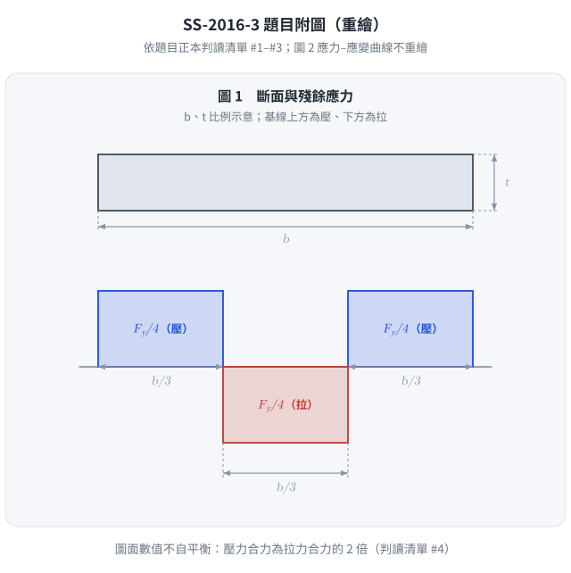
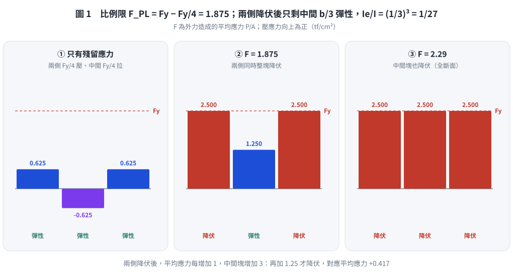

# 考題編號：SS-2016-3

**主分類：** `SS-U1-1` 拉力及壓力桿件
**副分類：** 無
**設計法：** LRFD（考卷未指定設計法；本題為挫屈強度理論，不含 $\phi$）
**標籤：** `壓力桿件` `拉力桿件` `殘留應力` `柱強度曲線` `切線模數` `塊狀殘留應力` `強度平台段`

---

## 1. 題目（考卷原文見題目正本）

> 考卷原文、公式／附表、附圖與判讀清單（已確認）見 [`SS-2016-3-problem.md`](SS-2016-3-problem.md)。本節只列**解題時最容易讀錯的地方**與本解使用的記號；題意以題目正本為準。



*圖 1　題目附圖重繪（依題目正本判讀清單 #1–#3；圖 2 應力–應變曲線不重繪）。壓、拉分畫在基線兩側且等高，一眼可見壓力合力是拉力合力的 2 倍（圖面數值不自平衡），攔下把斷面讀成 H 型鋼或壓拉段對調的誤讀。*

### 常見誤讀

| 項目 | 正確判讀 | 常見誤讀 |
|------|---------|---------|
| 斷面 | 單一實心矩形板 $b \times t$ | 當成 H 型鋼的翼板與腹板 |
| 殘餘應力 | 外側各 $b/3$ 壓 $F_y/4$、中段 $b/3$ 拉 $F_y/4$；圖上數值不自平衡，照圖作答並指出 | 自行改成自平衡卻不說明 |
| 強軸 | 板寬 $b$ 方向彎曲（$I = tb^3/12$），外側 $b/3$ 先降伏、勁度損失最大 | 以為降伏位置不影響勁度 |
| 比例限 | $F_{PL} = F_y - F_y/4 = 1.875$ tf/cm² | 以 $F_y$ 當比例限 |

**本解記號：** $F_y = 2.5$、$E = 2040$ tf/cm²；$F_{rc} = F_y/4 = 0.625$ tf/cm²；$K = 1$；$F_{cr}$ 為平均挫屈應力 $P_{cr}/A$。

---

## 2. 考題核心精神與出題者意圖 (Core Concepts & Examiner's Intent)

**核心觀念：殘留應力降低柱的挫屈強度——中間細長比最危險**

此題系統性地測驗考生對殘留應力的全面理解：從定義、來源、影響機制，到**定量繪製柱強度曲線**的能力。第四小題需要具體計算曲線上的關鍵轉折點。

**出題者測驗重點：**
- 殘留應力的「比例限（Proportional Limit）」概念
- 切線模數（Tangent Modulus）與有效彈性模數的關係
- 能否正確計算 $L/r$ 的轉折點（由彈性轉向非彈性的臨界細長比）
- Euler 曲線 vs 實際柱強度曲線的形狀差異

---

## 3. 解題戰略地圖與陷阱分析 (Strategic Roadmap & Trap Analysis)

**步驟規劃（第四題）：**

1. 由殘留應力分佈求出**比例限**（Proportional Limit）$F_{PL}$
2. 計算彈性挫屈轉折點 $(L/r)_{\text{trans}}$：令 $F_e = F_{PL}$
3. 兩側同時降伏 → 強軸勁度剩 1/27 → 決定平台範圍與極短柱上升段；再接彈性 Euler（長柱）
4. 計算關鍵點的數值，繪製示意圖

**關鍵陷阱：**

> ⚠️ **陷阱1：比例限的計算方向**
> 殘留應力為**壓應力** $F_{rc} = F_y/4$ 時，疊加外部壓應力 $F_a$ 後，兩側 $b/3$ 殘留壓應力區最先（且同時）達到降伏：
> $F_a + F_{rc} = F_y$ → $F_a = F_y - F_{rc} = 3F_y/4$
> 比例限 $F_{PL} = 3F_y/4 = 1.875 \text{ tf/cm}^2$，**非** $F_y$ 本身。

> ⚠️ **陷阱2：塊狀殘留應力不會給平滑曲線**
> 兩側 $b/3$ 的殘留壓應力是**均勻**的，外力加到 $1.875$ 時兩側**同時**整塊降伏，強軸勁度一下子只剩中間 $b/3$ 的 $(1/3)^3 = 1/27$。所以非彈性段不是平滑下彎曲線，而是一段**水平平台** $F_{cr} = 1.875$（$19.9 \le L/r \le 103.6$），平台左端再接一小段 $\pi^2E/[27(L/r)^2]$ 上升到全斷面降伏。套用 $F_yF_e/(F_e + F_{rc})$ 之類的平滑式是錯的。

> ⚠️ **陷阱3：Euler 曲線的起始點計算錯誤**
> Euler 曲線的有效起始點是 $(L/r)_{\text{trans}}$，其數值由 $F_e = F_{PL}$ 求出，而非由 $F_e = F_y$ 求出。

---

## 3.5 變數層次分析（Variable Hierarchy Analysis）

> 複習提示：解題後，在每個卡住的知識點「卡關?」欄標記 `⚠`；第二次複習時只看有 `⚠` 的項目。

**最終目標：** 定義殘留應力 → 說明來源與對壓力桿影響 → 計算比例限 $F_{PL}$ 與轉折點 $(L/r)_{trans}$ → 繪製三段式柱強度曲線

### 主要公式（$\boxed{\phantom{x}}$ = 未知，待推導）

$$\boxed{F_{PL}} = F_y - F_{rc} = F_y - \frac{F_y}{4} = \frac{3F_y}{4}$$

$$\boxed{(L/r)_{trans}} = \sqrt{\frac{\pi^2 E}{F_{PL}}} = \sqrt{\frac{4\pi^2 E}{3F_y}}$$

$$F_{cr}^{(\text{平台})} = F_{PL} = 1.875 \quad (19.9 \le L/r \le 103.6),\qquad F_{cr} = \frac{\pi^2E}{27(L/r)^2}\quad(18.0 \le L/r < 19.9)$$

$$F_{cr}^{(\text{彈性})} = \frac{\pi^2 E}{(L/r)^2} \quad (L/r > (L/r)_{trans})$$

### L1：題目直接給定

| 符號 | 數值 | 說明 |
|------|------|------|
| $F_y$ | 2.5 tf/cm² | 降伏應力 |
| $E$ | 2,040 tf/cm² | 彈性模數 |
| $F_{rc}$ | $F_y/4 = 0.625$ tf/cm² | 殘留壓應力（兩側各 $b/3$） |
| $K$ | 1.0 | 有效長度係數（題目假設） |
| 殘留應力分佈 | 矩形板兩側各 $b/3$ 壓、中間 $b/3$ 拉 | 塊狀分佈（圖 1），不自相平衡 |

### L2：需知識點推導

**Step 1：殘留應力定義與來源（子問題一、二）**

| 符號 | 公式 / 來源 | 卡關? |
|------|------------|:-----:|
| 定義 | 無外力作用下，截面自平衡的初始應力系統 | |
| 主要來源 | ① 不均勻冷卻（熱軋型鋼）② 焊接 ③ 冷加工 | |

**Step 2：殘留應力對壓力桿的影響（子問題三）**

| 符號 | 公式 / 來源 | 卡關? |
|------|------------|:-----:|
| 提前降伏條件 | $F_a + F_{rc} \geq F_y$ → 殘留壓應力區提前降伏 | |
| 切線模數降低 | $E_t < E$ → $F_{cr} < F_e$（Euler） | |
| 影響最大的範圍 | 中等細長比（非彈性挫屈段），短柱和長柱影響較小 | |

**Step 3：比例限與轉折點（子問題四）**

| 符號 | 公式 / 來源 | 卡關? |
|------|------------|:-----:|
| $F_{PL}$ | $F_y - F_{rc} = 2.5 - 0.625 = 1.875$ tf/cm² | |
| $(L/r)_{trans}$ | $\sqrt{4\pi^2 E / 3F_y} = \sqrt{10742} = 103.6$ | |

**Step 4：Fcr 曲線各段**

| 符號 | 公式 / 來源 | 卡關? |
|------|------------|:-----:|
| 彈性段（$L/r \ge 103.6$） | $F_{cr} = \pi^2E/(L/r)^2$ | |
| 兩側降伏後勁度 | 強軸只剩中間 $b/3$：$I_e/I = (1/3)^3 = 1/27$ | ⚠ |
| 平台（$19.9 \le L/r \le 103.6$） | $F_{cr} = 1.875$（兩側一降伏、勁度驟降，立即挫屈） | ⚠ |
| 上升段（$18.0 \le L/r < 19.9$） | $F_{cr} = \pi^2E/[27(L/r)^2]$ | |
| 全斷面降伏（$L/r < 18.0$） | $F_{cr} = 1.875 + \tfrac13 \times 1.25 = 2.29$（以外力增量計；見 §4） | |

### L3：深層知識（不懂就卡住）

| 知識點 | 說明 | 卡關? |
|--------|------|:-----:|
| 比例限 $F_{PL}$ 的計算方向 | $F_{PL} = F_y - F_{rc}$（外壓 + 殘留壓 = 降伏），$F_{PL}$ 是外壓的上限 | |
| 切線模數理論（Shanley） | 挫屈時應力單調增加，全截面用 $E_t$，為保守下界；優於雙模數理論 | |
| Euler 曲線的起始點 | 由 $F_e = F_{PL}$ 決定，不是 $F_e = F_y$！（常見錯誤） | |
| 塊狀殘留應力 → 平台 | 均勻殘留應力區同時降伏，勁度跳降，曲線出現水平段（與 SS-2024-1 同型） | |
| 殘留應力自平衡條件 | 壓區合力 = 拉區合力；本題所給數字不滿足，答題要指出 | |

---

## 4. 步驟化詳細計算過程 (Step-by-Step Detailed Calculation)

### (一) 殘留應力的定義

**殘留應力（Residual Stress）** 是構材在沒有任何外力作用下，由於製造、加工或施工過程中的不均勻處理，仍殘留於截面內部的自平衡應力系統。

- 截面內部的殘留應力**自我平衡**：壓區合力 = 拉區合力（淨力 = 0，淨力矩 = 0）
- 屬於初始應力（Initial Stress），在外力施加前即已存在
- 無法用一般量測外部反力的方式檢測，需截斷取樣或 X 射線繞射法量測

---

### (二) 殘留應力的來源

| 類型 | 說明 | 典型場合 |
|------|------|---------|
| **①不均勻冷卻** | 熱軋型鋼脫模後，截面各部位冷卻速率不同（翼板尖端最薄，冷最快；翼板-腹板交叉處最厚，冷最慢）。先冷部位受拉，後冷部位因受先冷部位的拘束而受壓。 | 熱軋 H 型鋼（最主要）|
| **②焊接（熱輸入不均）** | 焊縫處局部加熱冷卻後收縮，在焊縫鄰近區域產生壓應力，遠處產生拉應力 | 組合斷面、補強板 |
| **③冷加工（Cold Working）** | 在常溫下進行彎曲、矯正、剪切等加工，使材料局部超過降伏點後，卸載時彈性回彈不完全 | 冷彎型鋼、機械矯直 |
| **④表面處理** | 噴砂、研磨等處理使表層產生局部壓縮殘留應力（通常有利）| 疲勞強化處理 |
| **⑤裝配應力** | 強迫對位、預應力螺栓拉緊等施工操作 | 鋼構架施工 |

---

### (三) 殘留應力對受壓桿件的影響

**影響機制（三步驟說明）：**

**步驟 1：提前降伏，減小有效彈性截面**

當施加的外部壓應力 $F_a$ 加上截面殘留壓應力 $F_{rc}$ 超過 $F_y$ 時，該處纖維提前降伏：

$$F_a + F_{rc} \geq F_y \quad \Rightarrow \quad F_a \geq F_y - F_{rc}$$

此時截面只有**未降伏的彈性區域**能抵抗額外的壓力增量，有效截面積減小。

**步驟 2：切線模數（Tangent Modulus）降低**

由於部分截面已降伏（斜率 $E_t < E$），有效剛度降低：

$$E_t < E \quad \Rightarrow \quad F_{cr} = \frac{\pi^2 E_t}{(KL/r)^2} < \frac{\pi^2 E}{(KL/r)^2} = F_e$$

**步驟 3：柱強度在中等細長比（Intermediate Slenderness）時降低最多**

- **極短柱**（$L/r \to 0$）：$F_{cr} \to F_y$（全截面壓縮降伏），殘留應力影響有限
- **中等細長比**（$30 < L/r < 130$ 左右）：挫屈發生在非彈性範圍，殘留應力大幅降低 $F_{cr}$
- **極長柱**（$L/r$ 很大）：彈性挫屈，殘留應力已無顯著影響（因為 $F_e < F_{PL}$，整截面仍彈性）

$$\boxed{\text{殘留應力對中等細長比的柱影響最大，實際 } F_{cr} \text{ 低於 Euler 理論值}}$$

---

### (四) 繪製 $F_{cr}$ vs $L/r$ 曲線（強軸，$K = 1$）

**已知：** $F_y = 2.5$ tf/cm²，$E = 2040$ tf/cm²，殘留應力 $\pm F_y/4 = 0.625$ tf/cm²，完全彈塑性材料。

**處理方式：** 以「外力造成的平均應力增量」$F = P/A$ 計算，殘留應力只決定各塊何時降伏（題目數字不自相平衡，見題目正本判讀 #4）。強軸彎曲時，寬度方向距中心愈遠的材料對 $I$ 貢獻愈大，彈性部分的 $I_e$ 決定切線模數挫屈：

$$F_{cr} = \frac{\pi^2E}{(L/r)^2}\cdot\frac{I_e}{I}$$

#### 步驟 1：比例限

兩側原有壓應力 $F_y/4$，外力應力 $F$ 疊加後 $F + F_y/4 = F_y$ 時兩側**同時整塊**降伏：

$$F_{PL} = F_y - \frac{F_y}{4} = 1.875\ \text{tf/cm}^2$$



*圖 1　比例限 $F_{PL} = F_y - F_y/4 = 1.875$；兩側整塊降伏後只剩中間 $b/3$ 彈性，強軸 $I_e/I = (1/3)^3 = 1/27$。這張圖攔的是比例限取 $F_y$ 而忘了扣殘留應力、$I_e/I$ 寫成 1/3（漏三次方），以及中間塊降伏所需增量沒有乘 3。*

#### 步驟 2：彈性段（$F < 1.875$，全斷面彈性，$I_e/I = 1$）

$$F_{cr} = \frac{\pi^2E}{(L/r)^2},\qquad F_{cr} = 1.875 \Rightarrow (L/r)_1 = \pi\sqrt{\frac{2040}{1.875}} = 103.6$$

#### 步驟 3：兩側降伏後（只剩中間 $b/3$ 彈性）

強軸 $I = tb^3/12$，中間 $b/3$ 的 $I_e = t(b/3)^3/12$：

$$\frac{I_e}{I} = \left(\frac13\right)^3 = \frac1{27}$$

勁度一下子掉到 1/27。對 $L/r$ 介於某範圍的柱：外力加到 1.875 前它還是彈性、不挫屈（$F_e > 1.875$）；一過 1.875，挫屈應力立刻降成 $F_e/27$，若 $F_e/27 < 1.875$ 就馬上挫屈。所以

$$F_{cr} = 1.875\quad\text{當}\quad \frac{\pi^2E}{27(L/r)^2} \le 1.875 \le \frac{\pi^2E}{(L/r)^2}$$

$$(L/r)_2 = \frac{103.6}{\sqrt{27}} = 19.9\ \Rightarrow\ \boxed{F_{cr} = 1.875\quad(19.9 \le L/r \le 103.6)}\ \text{（水平平台）}$$

#### 步驟 4：極短柱

$L/r < 19.9$ 時，兩側降伏後柱仍未挫屈，外力增量只由中間 $b/3$ 承擔（平均應力每增加 1，中間塊增加 3）：

$$F_{cr} = \frac{\pi^2E}{27(L/r)^2}\quad(\text{直到中間塊也降伏})$$

中間塊原為拉應力 $F_y/4$，要再加 $F_y - (-F_y/4) - 1.875 = 1.25$ 才降伏，對應平均應力再增 $1.25/3 = 0.417$：

$$F_{max} = 1.875 + 0.417 = 2.29\ \text{tf/cm}^2,\qquad (L/r)_3 = \pi\sqrt{\frac{2040}{27 \times 2.29}} = 18.0$$

$L/r < 18.0$ 時全斷面降伏，$F_{cr} = 2.29$。

> 若把「全斷面都達到 $F_y$」直接當成 $F_{cr} = F_y = 2.5$，上限會是 2.5、對應 $L/r = 17.3$。兩者差異正是題目殘留應力不平衡的淨壓力 $F_y/12 = 0.21$。若殘留應力自相平衡，兩種算法都會得到 $F_y$。答題時可把上端寫成 $F_y$ 並註明此問題。

#### 步驟 5：曲線數值與圖

| $L/r$ | $F_e = \pi^2E/(L/r)^2$ | $F_{cr}$ (tf/cm²) | 段 |
|:---:|:---:|:---:|---|
| 0 ～ 18.0 | — | **2.29**（或 $F_y$，見上） | 全斷面降伏 |
| 19 | 55.8 | 2.07 | 上升段 $F_e/27$ |
| 19.9 | 50.8 | **1.875** | 平台左端 |
| 40 | 12.58 | 1.875 | 平台 |
| 80 | 3.146 | 1.875 | 平台 |
| **103.6** | **1.875** | **1.875** | 平台右端＝彈性起點 |
| 120 | 1.398 | 1.398 | Euler |
| 150 | 0.895 | 0.895 | Euler |
| 200 | 0.503 | 0.503 | Euler |

```
F_cr (tf/cm²)
 2.5 ┤ - - - - - - - - - - - - - - - - - - - -  F_y
 2.29┤━━┓
     │  ┃ π²E/[27(L/r)²]
1.875┤  ┗━━━━━━━━━━━━━━━━━━━━━━━━━━┓  ← 平台：兩側同時降伏、勁度剩 1/27
     │                            ╲
     │                             ╲  Euler π²E/(L/r)²
     │                               ╲___
     └──┬──┬─────────────────────────┬───────────── L/r
      18.0 19.9                     103.6
```

**曲線特徵：** 三個轉折點 $(18.0,\ 2.29)$、$(19.9,\ 1.875)$、$(103.6,\ 1.875)$；中間細長比的整段柱強度都被殘留應力壓到 $0.75F_y$，這正是 (三) 所說「殘留應力對中等細長比影響最大」的極端例子。

![SS-2016-3 圖解：Fcr 對 L/r 曲線，L/r ≤ 18.0 為全斷面降伏 2.29，18.0–19.9 為 π²E/[27(L/r)²] 上升段，19.9–103.6 為 1.875 平台，103.6 以上為 Euler；並標 Fy = 2.5 與 Euler 延伸虛線](figs/SS-2016-3-fig-2-curve.svg)

*圖 2　$F_{cr}$–$L/r$ 有三個轉折點 $(18.0, 2.29)$、$(19.9, 1.875)$、$(103.6, 1.875)$，中等細長比整段被壓在 $0.75F_y$ 平台。這張圖攔的是把曲線畫成平滑過渡而漏掉平台、轉折點算錯，以及以為長柱也受殘留應力影響。*

---

## 5. 關鍵爭議點與進階探討 (Critical Issues & Advanced Discussion)

### 為什麼不是平滑曲線

教科書常見的平滑非彈性曲線（例如 CRC 拋物線、AISC 的 $0.658^{\lambda_c^2}$）是來自**連續變化**的殘留應力分佈：翼板尖端壓應力最大、往內遞減，外力增加時降伏區逐漸往內擴大，$I_e$ 連續下降。本題的殘留應力是**均勻塊狀**，兩側在同一個外力水準整塊降伏，$I_e$ 一次掉到 1/27，曲線就出現平台。這和 SS-2024-1（2026-08-22 勘誤）是同一型題目。

舊版解析使用 $F_{cr} = F_yF_e/(F_e + F_{rc})$ 畫出平滑下彎曲線，與題目的塊狀分佈不符；並以「腹板拉力」補足殘留應力平衡，但圖 1 只是一塊矩形板、沒有腹板。

### Shanley 切線模數理論 vs 雙模數理論

- **切線模數理論（Tangent Modulus Theory）**：Shanley（1947）証明柱在挫屈發生時，**截面各點應力單調增加**（無回彈），故全截面使用切線模數 $E_t$，為保守下界。
- **雙模數理論（Double Modulus Theory / Engesser）**：假設挫屈時一側回彈（$E$）一側繼續加載（$E_t$），理論上偏不保守。
- 實驗結果接近切線模數理論，現行規範（AISC/LRFD）採用切線模數作為基礎。

### 強軸 vs 弱軸差異

本題要求強軸。若是弱軸（沿厚度 $t$ 方向彎曲），三塊對 $I$ 的貢獻與面積成正比，兩側降伏後 $I_e/I = 1/3$，平台會縮短成 $L/r$ 介於 $103.6/\sqrt3 = 59.8$ 與 103.6 之間，$L/r < 59.8$ 時沿 $\pi^2E/[3(L/r)^2]$ 上升。強軸的勁度損失（1/27）遠比弱軸（1/3）嚴重——殘留壓應力剛好落在離軸最遠的位置。

### 考場安全答法

| 子題 | 核心答法 |
|------|---------|
| (一) | 「無外力作用下，由製造過程產生、截面自平衡的初始應力」 |
| (二) | 「不均勻冷卻（主要）、焊接、冷加工」（至少三項）|
| (三) | 「提前降伏 → 有效截面縮小 → 切線模數下降 → 挫屈強度降低，中等細長比影響最大」 |
| (四) | $F_{PL} = 1.875$、$(L/r)_1 = 103.6$；兩側降伏後強軸 $I_e/I = 1/27$ → 平台 $19.9 \le L/r \le 103.6$；極短柱上升到 2.29（或 $F_y$）；並指出殘留應力不自相平衡 |

---

## 6. 依最新規範（AISC 360-16／-22）對照

| 項目 | 考卷（切線模數理論） | AISC 360-16／-22 |
|:---|:---|:---|
| 柱強度曲線 | 由實際殘留應力分佈推導 | 單一曲線 $F_{cr} = 0.658^{F_y/F_e}F_y$（$F_y/F_e \le 2.25$）、$0.877F_e$，已把典型熱軋殘留應力與初始彎曲 $L/1000$ 一併校準 |
| 殘留應力 | 題目指定 | 不直接出現在公式；直接分析法以剛度折減 $0.8\tau_b$ 反映 |
| 本題 $L/r = 80$ | 1.875 tf/cm²（平台） | $F_e = 3.146$，$F_{cr} = 0.658^{0.795} \times 2.5 = 1.79$ tf/cm² |

**觀察：** 規範曲線在中等細長比處（$L/r = 80$）與本題平台值相近，但規範曲線是平滑的——因為它代表的是連續分佈殘留應力加上初始彎曲的統計結果，而不是單一塊狀分佈。

---

*修正日期：2026-11-01（依考卷原圖：圖 1 為單一矩形板 $b \times t$，兩側 $b/3$ 壓、中間 $b/3$ 拉，無腹板；原解以平滑式 $F_yF_e/(F_e + F_{rc})$ 繪非彈性段並以「腹板拉力」補足平衡。更正為塊狀殘留應力的切線模數解：兩側同時降伏、強軸 $I_e/I = 1/27$ → 平台 $F_{cr} = 1.875$（$19.9 \le L/r \le 103.6$）、上升段 $\pi^2E/[27(L/r)^2]$、全斷面降伏 2.29（或 $F_y$）；指出題目殘留應力不自相平衡；同步 `SS-2016-3-column-curve-viz.html`；新增 §6 對照）*
*圖解補繪：2026-11-03（向量圖 2 張，腳本 `gen_SS-2016-3.py`，改輸入可原地重跑；SVG 供 wiki／PDF，2× PNG 供 pptx／影片）*
*驗證狀態：unverified*

*修正日期：2026-11-02（§1 全文重述改為指向題目正本 `SS-2016-3-problem.md`（已確認）＋常見誤讀＋本解記號；頭表設計法補註考卷未指定；解題內容與答案不變）*

*修正日期：2026-11-03（§1 補入題目附圖重繪 `figs/SS-2016-3-fig-1-problem.svg`（依已確認的題目正本判讀清單，腳本 `gen_SS-2016-3.py`，可重跑）；解題內容與答案不變）*
