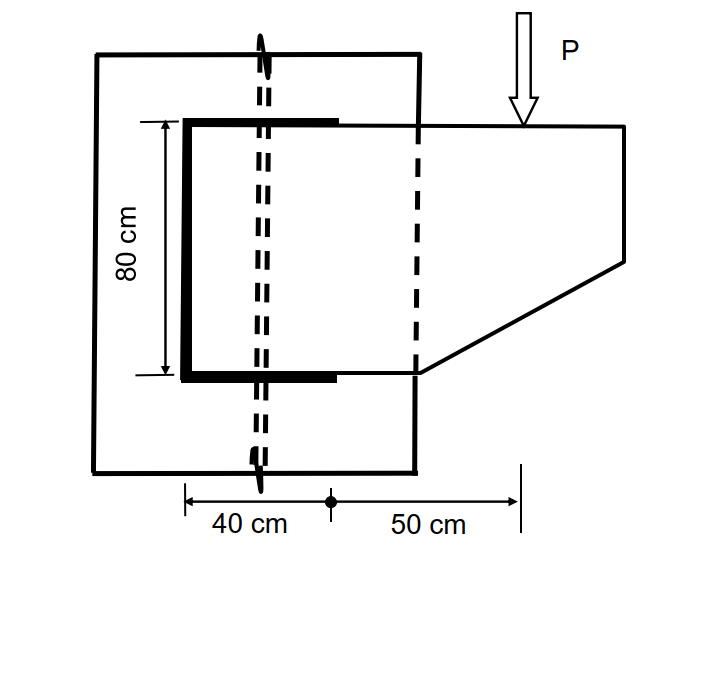

# SS-2017-4 題目正本

> 本檔只記錄**考卷上寫了什麼、圖上畫了什麼**，不含任何解法。解析見同資料夾 `SS-2017-4.md`。
> 判讀清單經使用者確認前，狀態為「待確認」；確認後本檔原則上不再修改（改動須回考卷原圖並記 log）。

| 項目 | 內容 |
|------|------|
| 考卷 | `raw/exams/SS-2017_鋼結構設計.pdf` 第 1 頁（全一頁），第四題 |
| 考年 | 民國 106 年（2017） |
| 配分 | 30 分 |
| 附圖 | 1 張（托架銲接），`SS-2017-4-fig-1.png` |
| 判讀狀態 | **待確認**（轉錄 2026-11-02，PyMuPDF 110 dpi 全頁＋附圖 400 dpi 局部目視，盲讀後才比對既有解析） |

## 1. 考卷原文（逐字）

> 四、一銲接於鋼柱托架承受 P 之集中載重，採用 E70XX 銲條，填角銲之有效喉厚為 10 mm，銲道長度如下圖，上、下水平銲道長度相同。請依極限設計法檢核該銲道可承受之最大集中載重 $P_u$。（30 分）（$\phi 0.6F_{EXX}$，$\phi$ = 0.75，不須考慮載重係數）

## 2. 考卷給的公式、附表與參數

- 題文：E70XX；**有效喉厚** 10 mm；$\phi 0.6F_{EXX}$、$\phi$ = 0.75；不須考慮載重係數。
- 圖面：垂直銲道 80 cm；下方尺寸 40 cm、50 cm。
- **沒有給 $F_{EXX}$ 數值**（E70XX 依規範自取）。
- 卷首注意事項：㈠可用計算器、㈡不必抄題、㈢除專門名詞或數理公式外應使用本國文字作答。

## 3. 附圖

*圖面文字照錄：P；80 cm；40 cm；50 cm。*

## 4. 判讀清單

「把握」標**不確定**者請優先確認；解讀類項目（題目用字的意思）另標「解讀」。

| # | 項目 | 判讀 | 圖上／題文依據 | 把握 |
|---|------|------|---------------|------|
| 1 | 銲道形狀 | ⊐ 形：左垂直 80 cm＋上下水平各一段，右側不銲 | 粗線（400 dpi） | 確定 |
| 2 | 40 cm | 左垂直銲道至水平銲道末端（圓點與水平粗線末端同一位置）→ 水平銲道各 40 cm | 尺寸線端點與粗線末端對齊 | 確定（解讀） |
| 3 | 圓點 | 尺寸線分段記號，不是銲道群形心 | 圓點位於粗線末端 | 確定（解讀） |
| 4 | 50 cm | 水平銲道末端至 P 作用線 → P 距垂直銲道 90 cm | 尺寸線端點 | 確定 |
| 5 | 喉厚 | 題給「有效喉厚」10 mm（不是銲腳） | 題文 | 確定 |
| 6 | 銲道面數 | 單面（圖只見一面） | 圖＋題文未說兩面 | 不確定（解讀） |
| 7 | 分析法 | 彈性向量法（題未指定；亦可用瞬心法） | 題文未指定 | 不確定（解讀） |

---

*轉錄：2026-11-02（SS-U1-4 題目正本推廣・批 2）*
