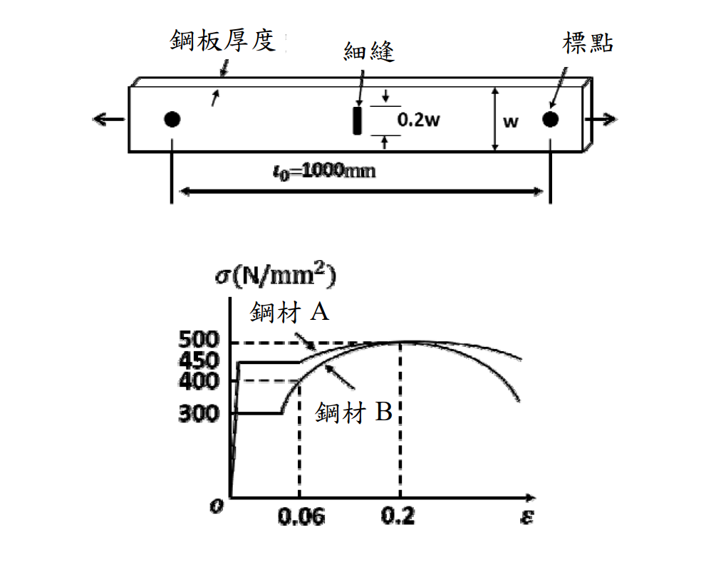

# SS-2018-1 題目正本

> 本檔只記錄**考卷上寫了什麼、圖上畫了什麼**，不含任何解法。解析見同資料夾 `SS-2018-1.md`。
> 判讀清單經使用者確認前，狀態為「待確認」；確認後本檔原則上不再修改（改動須回考卷原圖並記 log）。

| 項目 | 內容 |
|------|------|
| 考卷 | `raw/exams/SS-2018_鋼結構設計.pdf` 第 1 頁（頁次 2－1），第一題 |
| 考年 | 民國 107 年（2018） |
| 配分 | 25 分（㈠ 15、㈡ 10） |
| 附圖 | 1 張（細縫鋼板＋兩鋼材應力－應變曲線），`SS-2018-1-fig-1.png` |
| 判讀狀態 | **待確認**（轉錄 2026-11-03，PyMuPDF 110 dpi 全頁＋附圖 400 dpi 局部目視（附圖為 489×163、335×249 點陣圖）＋抽出文字核對，盲讀後才比對既有解析） |

## 1. 考卷原文（逐字）

> 一、如圖，有一中間設有細縫（slit）之鋼板受拉力作用，此鋼件考慮分別使用應力-應變關係不同之兩種鋼材 A 與 B 製作。
>
> ㈠忽略應力/應變集中進行分析，試推估兩種材料之鋼件受最大拉力時標點間伸長量為何？（15 分）
>
> ㈡說明降伏比對鋼件伸長量之影響。（10 分）

## 2. 考卷給的公式、附表與參數

- 圖上數值：標點間距 $l_0$ = 1000 mm；板寬 w；細縫長 0.2w（位於板寬中央，與拉力方向垂直）。
- 應力－應變圖：縱軸 σ（N/mm²），刻度 300、400、450、500；橫軸 ε，刻度 0.06、0.2。
- **沒有給板厚數值、彈性模數、細縫沿長度方向的尺寸**。
- 卷首注意事項：㈠可以使用電子計算器；㈡不必抄題；㈢本科目除專門名詞或數理公式外，應使用本國文字作答。

## 3. 附圖

*圖面文字照錄：鋼板厚度；細縫；標點；0.2w；w；l₀=1000mm；σ(N/mm²)；鋼材 A；500；450；400；300；鋼材 B；o；0.06；0.2；ε。*

## 4. 判讀清單

「把握」標**不確定**者請優先確認；解讀類項目（題目用字的意思）另標「解讀」。

| # | 項目 | 判讀 | 圖上／題文依據 | 把握 |
|---|------|------|---------------|------|
| 1 | 鋼材 A | 降伏 450 N/mm²、抗拉強度 500（ε = 0.2）；降伏比 0.9 | 圖上刻度（400 dpi） | 確定 |
| 2 | 鋼材 B | 降伏 300、抗拉強度 500（ε = 0.2）；ε = 0.06 時應力 400；降伏比 0.6 | 圖上刻度與虛線 | 確定 |
| 3 | 鋼材 A 平台長 | 平台末端與 0.06 虛線約同位置，圖上未標數值 | 400 dpi 目視（點陣圖） | 確定（解讀） |
| 4 | 細縫 | 寬方向長 0.2w → 細縫處淨寬 0.8w；細縫沿拉力方向的長度未標（極窄） | 圖 | 確定 |
| 5 | 標點 | 兩標點在細縫兩側，間距 1000 mm，伸長量以此段計 | 圖 | 確定 |
| 6 | 「忽略應力/應變集中」 | 細縫處淨斷面與其餘全斷面各自均勻受力 | 題文 | 確定（解讀） |
| 7 | 「最大拉力」 | 鋼件所能承受的最大拉力（由較弱斷面控制） | 題文 | 確定（解讀） |

---

*轉錄：2026-11-03（SS-U2-2 題目正本推廣・批 1）*
