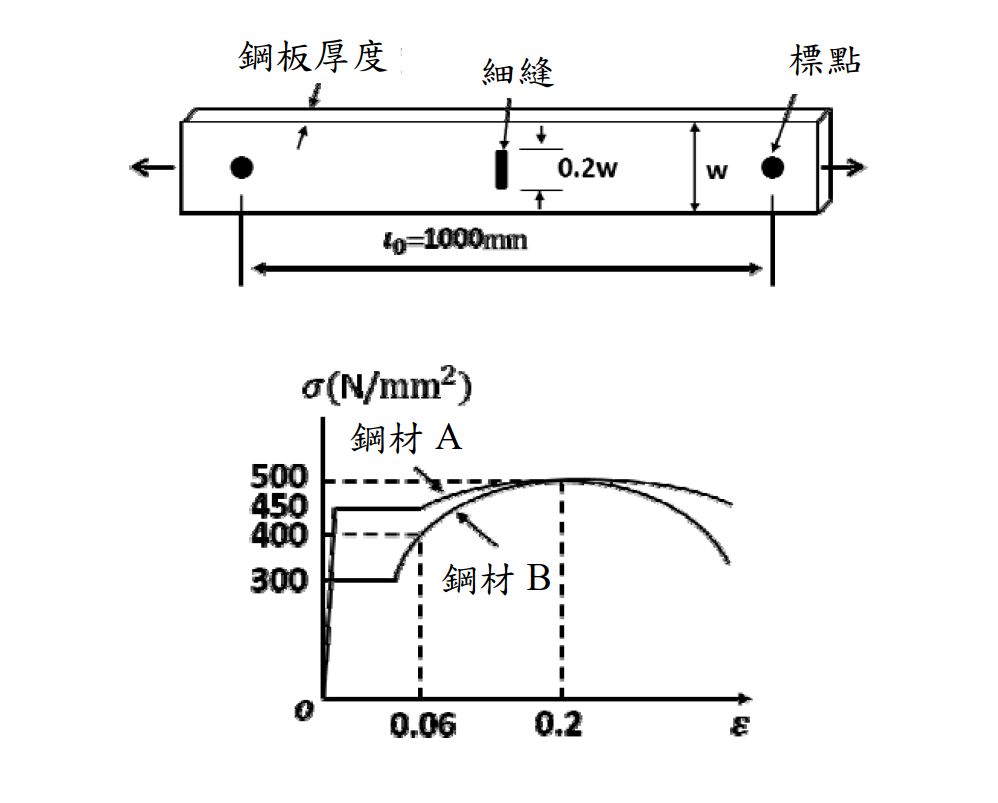

# SS-2018-1 解析

### 考題編號：SS-2018-1

**主分類：** `SS-U2-2` 鋼結構材料特性
**副分類：** 無
**設計法：** 概念題
**標籤：** `降伏比` `σ-ε曲線` `伸長量` `均勻伸長` `應力集中` `韌性` `細縫鋼板` `應變硬化`

---

## 1. 原始題目重述 (Problem Restatement)

**題目：** 如圖，有一中間設有細縫（slit）之鋼板受拉力作用，此鋼件考慮分別使用應力-應變關係不同之兩種鋼材 A 與 B 製作。

**(一)** 忽略應力/應變集中進行分析，試推估兩種材料之鋼件受最大拉力時標點間伸長量為何？（15 分）

**(二)** 說明降伏比對鋼件伸長量之影響。（10 分）

**已知條件（依考卷原圖）：**
- 鋼板寬 $w$，中央細縫長 $0.2w$（垂直於拉力方向）→ 細縫處淨寬 $0.8w$，$A_n/A_g = 0.8$
- 標點間距 $l_0 = 1000$ mm
- 鋼材 A：降伏平台 $F_y = 450$ N/mm²，應變硬化後 $F_u = 500$ N/mm²（$\varepsilon = 0.2$）
- 鋼材 B：降伏平台 $F_y = 300$ N/mm²，應變硬化通過 $(\varepsilon, \sigma) = (0.06,\ 400)$，$F_u = 500$ N/mm²（$\varepsilon = 0.2$）

*圖說（依考卷原圖 500–600 dpi 目視判讀，2026-11-01 更正）：「鋼材 A」箭頭指向**從 450 平台延伸**、在 $\varepsilon \approx 0.035$ 起應變硬化的上方曲線；「鋼材 B」箭頭指向**從 300 平台延伸**的下方曲線。兩曲線皆在 $\varepsilon = 0.2$ 達 500 N/mm²。虛線標示 B 曲線於 $\varepsilon = 0.06$ 時 $\sigma = 400$ N/mm²。降伏比 A = 450/500 = **0.90**、B = 300/500 = **0.60**。*

---

## 2. 考題核心精神與出題者意圖 (Core Concepts & Examiner's Intent)

**核心觀念：** 有缺口（細縫）的構件，**最大拉力由淨斷面達 $F_u$ 決定**：$P_{max} = F_u A_n = 0.8F_uA_g$。此時全斷面（細縫以外的絕大部分長度）應力只有 $P_{max}/A_g = 0.8F_u = 400$ N/mm²。

- 若 $F_y < 0.8F_u$（**降伏比 < $A_n/A_g$**）→ 全斷面在破斷前已降伏、硬化 → 全長參與塑性變形 → 伸長量大
- 若 $F_y > 0.8F_u$（降伏比高）→ 全斷面始終彈性，塑性只集中在細縫處極短的長度 → 伸長量極小

「忽略應力/應變集中」的意思是：細縫斷面與全斷面各自以**均勻應力**計算（不考慮缺口尖端的應力放大），**不是**指全長應變都等於 $\varepsilon_u$。

**出題者意圖：** 這是耐震鋼材限制降伏比（SN 鋼 $YR \le 0.80$）的物理理由——構件在螺栓孔、缺口處淨斷面較小，降伏比過高時塑性變形無法擴散到全長，構件變形能力喪失。

---

## 3. 解題戰略地圖與陷阱分析 (Strategic Roadmap & Trap Analysis)

**作戰計畫：**
1. 由圖讀兩材料 $F_y$、$F_u$（A 450／500、B 300／500）
2. 最大拉力：淨斷面達 $F_u$ → $P_{max} = 500 \times 0.8wt$
3. 全斷面應力 $\sigma_g = P_{max}/A_g = 400$ N/mm²
4. 由 σ-ε 圖查 $\sigma_g$ 對應之應變 → 乘 $l_0$ 得伸長量（細縫處長度極短，貢獻忽略）
5. 以 $YR$ 與 $A_n/A_g$ 的關係說明影響

**關鍵陷阱：**

| 陷阱 | 說明 | 應對 |
|------|------|------|
| ❌ 把 A、B 看反 | A 是 450 平台、B 是 300 平台（舊解對調） | 看圖上箭頭指的曲線 |
| ❌ 以為全長應變 = $\varepsilon_u$ | 最大拉力時只有淨斷面達 $F_u$；全斷面應力只有 $0.8F_u$ | 先求 $P_{max}$，再求全斷面應力 |
| ❌ 用降伏應變或極限應變直接乘 $l_0$ | 要查「全斷面應力 400」在 σ-ε 圖上對應的應變 | B 查到 0.06；A 在彈性段 |

---

## 3.5 變數層次分析（Variable Hierarchy Analysis）

> 複習提示：解題後，在每個卡住的知識點「卡關?」欄標記 `⚠`；第二次複習時只看有 `⚠` 的項目。

**最終目標：** 最大拉力時全斷面應力 400 N/mm² → A 彈性 $\Delta_A \approx 2$ mm、B 硬化段 $\Delta_B \approx 60$ mm → 降伏比 < $A_n/A_g$ 才能全長降伏

### 主要公式（$\boxed{\phantom{x}}$ = 未知，待推導）

$$\boxed{P_{max}} = F_u A_n = F_u(0.8w)t, \qquad \boxed{\sigma_g} = \frac{P_{max}}{A_g} = 0.8F_u$$

$$\boxed{\Delta} \approx \varepsilon(\sigma_g) \times l_0, \qquad \text{全斷面降伏條件：} \frac{F_y}{F_u} < \frac{A_n}{A_g}$$

### L1：題目直接給定

| 符號 | 數值 | 說明 |
|------|------|------|
| $l_0$ | 1000 mm | 標點間距 |
| 細縫 | $0.2w$ | 淨寬 $0.8w$ |
| 鋼材 A | $F_y = 450$、$F_u = 500$ N/mm² | 降伏比 0.90 |
| 鋼材 B | $F_y = 300$、$F_u = 500$ N/mm²；$\sigma = 400$ 時 $\varepsilon = 0.06$ | 降伏比 0.60 |

### L2：需知識點推導

| 符號 | 公式 / 來源 | 卡關? |
|------|------------|:-----:|
| $\sigma_g$ | $0.8 \times 500 = 400$ N/mm²（A、B 相同） | |
| A 的 $\varepsilon$ | $400 < F_y = 450$ → 彈性：$400/E = 400/205000 = 0.00195$ | |
| $\Delta_A$ | $0.00195 \times 1000 \approx 2.0$ mm | |
| B 的 $\varepsilon$ | $400 > F_y = 300$ → 硬化段，圖讀 $\varepsilon = 0.06$ | |
| $\Delta_B$ | $0.06 \times 1000 = 60$ mm | |

### L3：深層知識（不懂就卡住）

| 知識點 | 說明 | 卡關? |
|--------|------|:-----:|
| 淨斷面控制最大拉力 | 缺口處面積最小，最先達 $F_u$ | |
| 全斷面降伏條件 | $F_yA_g < F_uA_n$ ⇔ $YR < A_n/A_g$ | |
| 降伏比與構件變形能力 | 耐震鋼材限制 $YR \le 0.80$，使有孔構件仍能全長降伏 | |

---

## 4. 步驟化詳細計算過程 (Step-by-Step Detailed Calculation)

### (一) 最大拉力時標點間伸長量

**Step 1：最大拉力**（細縫淨斷面達 $F_u$，兩材料 $F_u$ 皆 500 N/mm²）

$$P_{max} = F_u A_n = 500 \times 0.8wt = 400\,wt\ \text{(N)}$$

**Step 2：全斷面（細縫以外）應力**

$$\sigma_g = \frac{P_{max}}{wt} = 400\ \text{N/mm}^2$$

**Step 3：查 σ-ε 圖求全斷面應變、計算伸長量**（細縫沿拉力方向的長度極小，該處局部大應變對 1000 mm 標距的貢獻忽略不計；E 題目未給，取 $2.05 \times 10^5$ N/mm²）

**鋼材 A**（$F_y = 450$）：$\sigma_g = 400 < 450$，全斷面仍在**彈性**範圍

$$\varepsilon_A = \frac{400}{2.05 \times 10^5} = 0.00195 \quad\Rightarrow\quad \boxed{\Delta_A \approx 0.00195 \times 1000 \approx 2\ \text{mm}}$$

**鋼材 B**（$F_y = 300$）：$\sigma_g = 400 > 300$，全斷面已降伏並進入應變硬化，由圖讀 $\sigma = 400$ 時 $\varepsilon = 0.06$

$$\boxed{\Delta_B \approx 0.06 \times 1000 = 60\ \text{mm}}$$

**雙路徑檢核：** 以力平衡反推——若 A 的全斷面要降伏，需 $P \ge F_yA_g = 450wt$，但淨斷面在 $P = 400wt$ 時已達 $F_u$ 而斷裂，故 A 全斷面不可能降伏 ✓；B 全斷面降伏只需 $300wt < 400wt$ ✓。

### (二) 降伏比對伸長量之影響

| 材料 | $F_y$ | $F_u$ | 降伏比 | 最大拉力時全斷面狀態 | 伸長量 |
|------|------|------|-------|------------------|-------|
| A | 450 | 500 | **0.90** | 彈性（400 < 450） | **≈ 2 mm** |
| B | 300 | 500 | **0.60** | 降伏＋硬化（ε = 0.06） | **≈ 60 mm** |

- 全斷面能否降伏取決於 $F_yA_g$ 與 $F_uA_n$ 的大小：**$YR = F_y/F_u < A_n/A_g$（本題 0.8）時，全斷面在淨斷面斷裂前就降伏**，塑性變形擴散到整根構件，伸長量大、破壞有預警
- 降伏比高於 $A_n/A_g$ 時（A），塑性只集中在細縫處，構件整體幾乎沒有伸長就斷裂，呈現類似脆性的行為
- 這就是耐震用鋼（SN 鋼）要求 **$YR \le 0.80$** 的原因：螺栓孔、缺口處 $A_n/A_g$ 常在 0.8 左右，降伏比必須低於此值，構件才有足夠的變形能力（韌性）

---

## 5. 關鍵爭議點與進階探討 (Critical Issues & Advanced Discussion)

### 5.1 「忽略應力/應變集中」的意思

指不考慮細縫尖端的應力放大係數 $K_t$，以淨斷面與全斷面的**平均應力**分析；並不表示「全長應變都達 $\varepsilon_u$」。若全長都達 $\varepsilon_u$，全斷面應力須達 $F_u$，此時淨斷面應力 $F_u/0.8 > F_u$，早已斷裂，自相矛盾。

### 5.2 更正說明

舊版解答把 A、B 兩曲線對調（稱 A 降伏 300、B 降伏 400／極限 450），並以「全長均勻達 $\varepsilon_u$」得 $\Delta_A = 200$、$\Delta_B = 60$ mm，結論變成「降伏比低的材料 $\varepsilon_u$ 大」，偏離本題「降伏比 vs 淨斷面比」的考點。依原圖 A 為 450 平台、B 為 300 平台，正確答案 $\Delta_A \approx 2$ mm、$\Delta_B \approx 60$ mm。

### 5.3 考場建議

- 一定要寫出 $P_{max} = F_uA_n$ 與 $\sigma_g = 0.8F_u = 400$ 這條邏輯鏈
- 第（二）小題點出 $YR < A_n/A_g$ 的條件與 SN 鋼 $YR \le 0.80$ 的關聯即可拿滿分

---

## 6. 依最新規範（AISC 360-16／-22）對照

AISC 360 D2 拉力構材以「全斷面降伏 $F_yA_g$」與「淨斷面斷裂 $F_uA_e$」取小值，並以不同 $\phi$（0.90／0.75）反映希望降伏先於斷裂；AISC 341 耐震規定以 $R_y$、$R_t$ 期望強度與 $A_e/A_g$ 檢核（如斜撐構材淨斷面補強），本質即本題 $YR$ 與 $A_n/A_g$ 的關係。

---

*修正日期：2026-11-01（依考卷原圖 500–600 dpi：鋼材 A 為 450 平台、B 為 300 平台，兩者 $F_u$ = 500，原解 A、B 對調且誤以「全長均勻達 $\varepsilon_u$」計算。更正為最大拉力由細縫淨斷面（0.8w）達 $F_u$ 控制，全斷面應力 400 N/mm²：A 彈性 $\Delta_A$ 200 → **≈ 2 mm**、B 硬化 $\Delta_B$ ≈ **60 mm**；（二）改以 $YR < A_n/A_g$ 說明）*
*驗證狀態：unverified*
