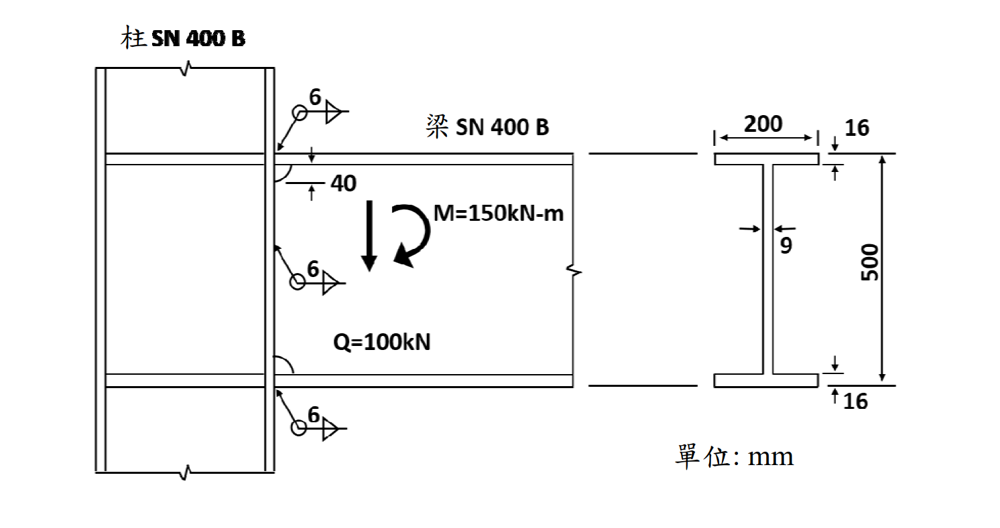

# SS-2018-3 題目正本

> 本檔只記錄**考卷上寫了什麼、圖上畫了什麼**，不含任何解法。解析見同資料夾 `SS-2018-3.md`。
> 判讀清單經使用者確認前，狀態為「待確認」；確認後本檔原則上不再修改（改動須回考卷原圖並記 log）。

| 項目 | 內容 |
|------|------|
| 考卷 | `raw/exams/SS-2018_鋼結構設計.pdf` 第 2 頁（頁次 2－2），第三題 |
| 考年 | 民國 107 年（2018） |
| 配分 | 30 分 |
| 附圖 | 1 張（箱型柱與 H 型梁接頭立面、梁斷面），`SS-2018-3-fig-1.png` |
| 判讀狀態 | **待確認**（轉錄 2026-11-02，PyMuPDF 110 dpi 全頁＋附圖 400 dpi 局部目視，盲讀後才比對既有解析） |

## 1. 考卷原文（逐字）

> 三、試以容許應力設計法（ASD）檢核圖中 SN400B 鋼箱型柱-H 型梁接頭之銲接尺寸。梁翼與梁腹負擔彎矩分別為 $M_f$ = 124.5 kNm 與 $M_w$ = 25.5 kNm。梁腹銲喉斷面模數 $S_w = \dfrac{2 \times 6/\sqrt2 \times 388^2}{6} \times 10^{-3} = 212.9$ cm³，而銲道外側拉應力 $\tau_{w1} = \dfrac{M_w}{S_w} = 119.8$ N/mm²。銲道容許應力 $f_a$ = 90.5 N/mm²。（30 分）

## 2. 考卷給的公式、附表與參數

- 題文：$M_f$ = 124.5、$M_w$ = 25.5 kNm；$S_w$ 算式與 212.9 cm³；$\tau_{w1}$ = 119.8 N/mm²；$f_a$ = 90.5 N/mm²。
- 圖面：$M$ = 150 kN-m、$Q$ = 100 kN；梁 H500×200×9×16（mm）；扇形開孔 40 mm；三個銲接符號皆為 6 mm 填角銲，且箭頭與基線交點畫有**圓圈**。
- 卷首注意事項：㈠可用計算器、㈡不必抄題、㈢除專門名詞或數理公式外應使用本國文字作答。

## 3. 附圖

*圖面文字照錄：柱 SN 400 B；梁 SN 400 B；6；6；6；40；M=150kN-m；Q=100kN；200；16；9；500；16；單位: mm。*

## 4. 判讀清單

「把握」標**不確定**者請優先確認；解讀類項目（題目用字的意思）另標「解讀」。

| # | 項目 | 判讀 | 圖上／題文依據 | 把握 |
|---|------|------|---------------|------|
| 1 | 銲道型式 | 上翼板、腹板、下翼板三處皆為 6 mm **填角銲**（不是全滲透開槽銲） | 三個符號皆為三角形＋「6」（400 dpi） | 確定 |
| 2 | **符號上的圓圈** | **全周銲（weld all around）**：翼板銲道沿翼板上下兩面＋兩端繞一圈（$2 \times 200 + 2 \times 16 = 432$ mm）；腹板兩側 | 三個符號在箭頭與基線交點都有圓圈 | 不確定（影響翼板銲長，請確認） |
| 3 | 腹板銲長 | $500 - 2(16) - 2(40) = 388$ mm，雙面（與題給 $S_w$ 式一致） | 題給 $S_w$ 式＋扇形開孔 40 | 確定 |
| 4 | 彎矩分擔 | $M_f + M_w = 150$ kN-m，與圖上 $M$ 一致 | 題文＋圖 | 確定 |
| 5 | 剪力 | $Q$ = 100 kN 由腹板銲道承擔，與 $\tau_{w1}$ 合成 | 圖上 $Q$ | 確定（解讀） |
| 6 | 翼板力 | $M_f$ ÷ 上下翼板形心距，作用在翼板銲道 | 題文 $M_f$ | 確定（解讀） |
| 7 | 檢核範圍 | 腹板與翼板銲道都要檢核；不足時求所需銲腳 | 題文「檢核…銲接尺寸」 | 確定（解讀） |

---

*轉錄：2026-11-02（SS-U1-4 題目正本推廣・批 2）*
