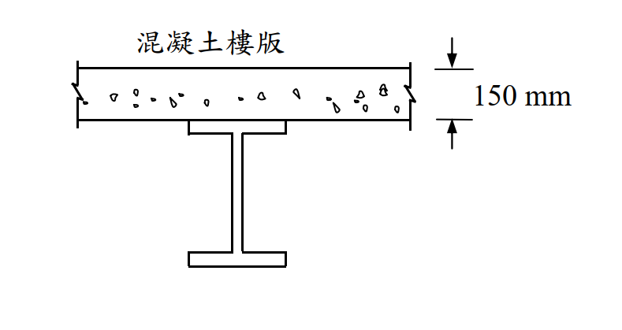

# SS-2019-2 題目正本

> 本檔只記錄**考卷上寫了什麼、圖上畫了什麼**，不含任何解法。解析見同資料夾 `SS-2019-2.md`。
> 判讀清單經使用者確認前，狀態為「待確認」；確認後本檔原則上不再修改（改動須回考卷原圖並記 log）。

| 項目 | 內容 |
|------|------|
| 考卷 | `raw/exams/SS-2019_鋼結構設計.pdf` 第 1 頁（頁次 3－1），第二題 |
| 考年 | 民國 108 年（2019） |
| 配分 | 25 分 |
| 附圖 | 1 張（合成梁斷面），`SS-2019-2-fig-1.png` |
| 判讀狀態 | **待確認**（轉錄 2026-11-02，PyMuPDF 110 dpi 全頁＋附圖 300 dpi 局部目視，盲讀後才比對既有解析） |

## 1. 考卷原文（逐字）

> 二、下圖所示為一鋼梁上有混凝土樓版，鋼梁有足夠的剪力釘與側向支撐。混凝土樓版的有效寬度為 2.5 m。鋼梁為 H500 × 200 × 10 × 16，鋼材降伏應力 $F_y$ = 2.5 tf/cm²。混凝土抗壓強度 $f'_c$ = 210 kgf/cm²。試以極限設計法，依合成斷面之塑性應力分布，計算此合成梁正彎矩計算強度 $M_n$。（25 分）

## 2. 考卷給的公式、附表與參數

- 題文：有效寬度 2.5 m；H500×200×10×16；$F_y = 2.5$ tf/cm²；$f'_c = 210$ kgf/cm²。
- 圖面：版厚 150 mm。
- 本題**沒有印公式**（同卷第 2 頁參考公式為 ASD 梁柱用）。
- 卷首注意事項：㈠可用計算器、㈡不必抄題、㈢除專門名詞或數理公式外應使用本國文字作答。

## 3. 附圖

*圖面文字照錄：混凝土樓版；150 mm。*

## 4. 判讀清單

「把握」標**不確定**者請優先確認；解讀類項目（題目用字的意思）另標「解讀」。

| # | 項目 | 判讀 | 圖上／題文依據 | 把握 |
|---|------|------|---------------|------|
| 1 | 版與梁 | 實心版厚 150 mm，直接擱在上翼板頂面（無鋼承板、無托肩） | 附圖 300 dpi | 確定 |
| 2 | 合成程度 | 完全合成（「足夠的剪力釘」） | 題文 | 確定 |
| 3 | 斷面標示 | H500×200×10×16 ＝ $d \times b_f \times t_w \times t_f$（mm） | 國內標示慣例 | 確定 |
| 4 | 所求 | 正彎矩標稱強度 $M_n$（「計算強度」不乘 $\phi_b$） | 題文符號 $M_n$ | 確定（解讀） |
| 5 | 混凝土應力 | 受壓區 $0.85f'_c$ 均佈、受拉不計 | 塑性應力分布慣例 | 確定（解讀） |

---

*轉錄：2026-11-02（SS-U1-2 題目正本推廣・批 2）*
