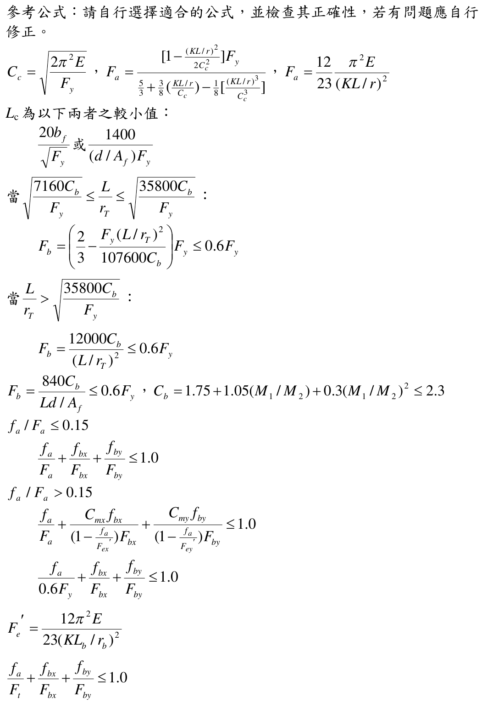
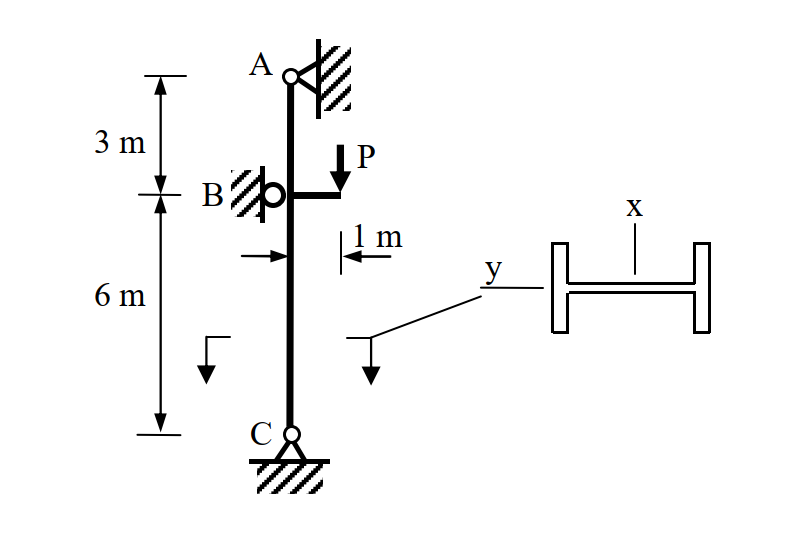

# SS-2019-3 題目正本

> 本檔只記錄**考卷上寫了什麼、圖上畫了什麼**，不含任何解法。解析見同資料夾 `SS-2019-3.md`。
> 判讀清單經使用者確認前，狀態為「待確認」；確認後本檔原則上不再修改（改動須回考卷原圖並記 log）。

| 項目 | 內容 |
|------|------|
| 考卷 | `raw/exams/SS-2019_鋼結構設計.pdf` 第 1 頁（頁次 3－1），第三題；參考公式在第 2 頁（頁次 3－2） |
| 考年 | 民國 108 年（2019） |
| 配分 | 30 分 |
| 附圖 | 1 張（柱立面＋斷面），`SS-2019-3-fig-1.png`；第 2 頁參考公式截圖 `SS-2019-3-eqn-1.png` |
| 判讀狀態 | **待確認**（轉錄 2026-11-02，PyMuPDF 110 dpi 全頁＋附圖 500 dpi 局部目視（向量圖）＋PDF 文字座標核對，盲讀後才比對既有解析） |

## 1. 考卷原文（逐字）

> 三、下圖所示為一 H 型鋼柱 H400 × 200 × 8 × 13，於 B 點承受偏心工作載重 $P$ = 12 tf。鋼柱於 A、B 與 C 點皆有側向支撐。鋼柱為結實斷面，鋼材降伏應力 $F_y$ = 2.5 tf/cm²，極限強度 $F_u$ = 4.1 tf/cm²，彈性模數 $E$ = 2040 tf/cm²。不考慮鋼柱自重，試依據容許應力設計法，檢核鋼柱是否滿足設計需求（無需檢核剪力）。（30 分）
>
> H400 × 200 × 8 × 13：A= 83.4 cm，$I_x$ = 23,500 cm⁴，$I_y$= 1,740 cm⁴，$r_x$= 16.8 cm，$r_y$= 4.56 cm，$r_T$= 5.23 cm，$S_x$= 1,170 cm³，$S_y$= 174 cm³。

（「A= 83.4 cm」照考卷原文，單位應為 cm²。）

## 2. 考卷給的公式、附表與參數

- 題文：$P$ = 12 tf（工作載重）；$F_y$、$F_u$、$E$；斷面性質（照錄於 §1）。
- 第 2 頁「參考公式：請自行選擇適合的公式，並檢查其正確性，若有問題應自行修正。」照錄：

$$C_c = \sqrt{\frac{2\pi^2E}{F_y}},\quad F_a = \frac{\left[1 - \frac{(KL/r)^2}{2C_c^2}\right]F_y}{\frac53 + \frac38\left(\frac{KL/r}{C_c}\right) - \frac18\left[\frac{(KL/r)^3}{C_c^3}\right]},\quad F_a = \frac{12}{23}\frac{\pi^2E}{(KL/r)^2}$$
$$L_c\ \text{為以下兩者之較小值：}\ \frac{20b_f}{\sqrt{F_y}}\ \text{或}\ \frac{1400}{(d/A_f)F_y}$$
$$\text{當}\ \sqrt{\frac{7160C_b}{F_y}} \le \frac{L}{r_T} \le \sqrt{\frac{35800C_b}{F_y}}:\ F_b = \left(\frac23 - \frac{F_y(L/r_T)^2}{107600C_b}\right)F_y \le 0.6F_y$$
$$\text{當}\ \frac{L}{r_T} > \sqrt{\frac{35800C_b}{F_y}}:\ F_b = \frac{12000C_b}{(L/r_T)^2} \le 0.6F_y$$
$$F_b = \frac{840C_b}{Ld/A_f} \le 0.6F_y,\quad C_b = 1.75 + 1.05(M_1/M_2) + 0.3(M_1/M_2)^2 \le 2.3$$
$$f_a/F_a \le 0.15:\ \frac{f_a}{F_a} + \frac{f_{bx}}{F_{bx}} + \frac{f_{by}}{F_{by}} \le 1.0$$
$$f_a/F_a > 0.15:\ \frac{f_a}{F_a} + \frac{C_{mx}f_{bx}}{\left(1 - \frac{f_a}{F'_{ex}}\right)F_{bx}} + \frac{C_{my}f_{by}}{\left(1 - \frac{f_a}{F'_{ey}}\right)F_{by}} \le 1.0,\qquad \frac{f_a}{0.6F_y} + \frac{f_{bx}}{F_{bx}} + \frac{f_{by}}{F_{by}} \le 1.0$$
$$F'_e = \frac{12\pi^2E}{23(KL_b/r_b)^2},\qquad \frac{f_a}{F_t} + \frac{f_{bx}}{F_{bx}} + \frac{f_{by}}{F_{by}} \le 1.0$$

  

- 參考公式**沒有給 $C_m$ 式**，**沒有給結實斷面的 $F_b = 0.66F_y$**（列出的 $F_b$ 式都以 $0.6F_y$ 為上限）。
- **沒有給 $K$、$b_f$、$t_f$、$d$、$A_f$ 的數值**（可由斷面標稱尺寸取得）。
- 卷首注意事項：㈠可以使用電子計算器；㈡不必抄題；㈢本科目除專門名詞或數理公式外，應使用本國文字作答。

## 3. 附圖

*圖面文字照錄：A；3 m；B；P；1 m；6 m；C；x；y。*

## 4. 判讀清單

「把握」標**不確定**者請優先確認；解讀類項目（題目用字的意思）另標「解讀」。

| # | 項目 | 判讀 | 圖上／題文依據 | 把握 |
|---|------|------|---------------|------|
| 1 | 偏心 | P 經托架作用，偏心 1 m（自柱軸線量） | 1 m 尺寸線兩端對齊柱軸線與 P 作用線（500 dpi） | 確定 |
| 2 | 彎曲軸 | 偏心在立面平面內；剖面中腹板平行該平面 → 繞**強軸 x** 彎曲 | 剖面圖 x 軸垂直腹板 | 確定 |
| 3 | B 點支承 | B 點滾支承抵牆 → 在**彎曲平面內**有側向束制，柱為 A–B–C 兩跨連續構材 | 圖上 B 為抵牆滾支承 | 確定 |
| 4 | A、C 支承 | A 為鉸接於牆、C 為鉸支於地面 | 支承符號 | 確定 |
| 5 | 軸力路徑 | P 由托架傳入後**向下經 BC 段到 C**；A 端是否也分擔垂直力（AB 段受拉或不受力）圖上未明示 | A 為鉸接（可承兩向力），題未說明 | 不確定（解讀，影響答案，請確認） |
| 6 | 側向支撐 | 題文「A、B 與 C 點皆有側向支撐」→ 弱軸 $K_yL$ 與 LTB $L_b$：AB 段 3 m、BC 段 6 m | 題文 | 確定（解讀） |
| 7 | 載重性質 | 工作載重，ASD 不乘載重係數 | 題文 | 確定 |
| 8 | 斷面積單位 | 「A= 83.4 cm」為筆誤，應為 cm² | 題文 | 確定 |

---

*轉錄：2026-11-02（SS-U1-3 題目正本推廣・批 2）*
