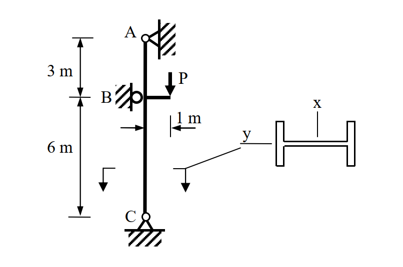
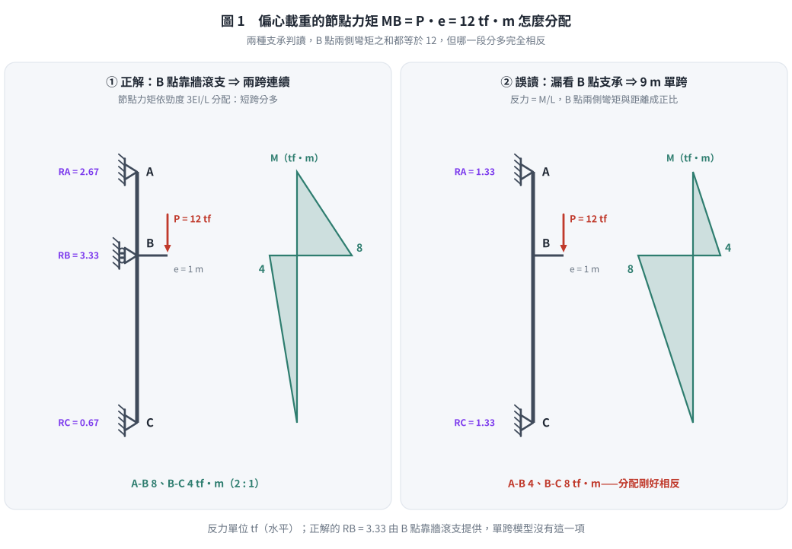
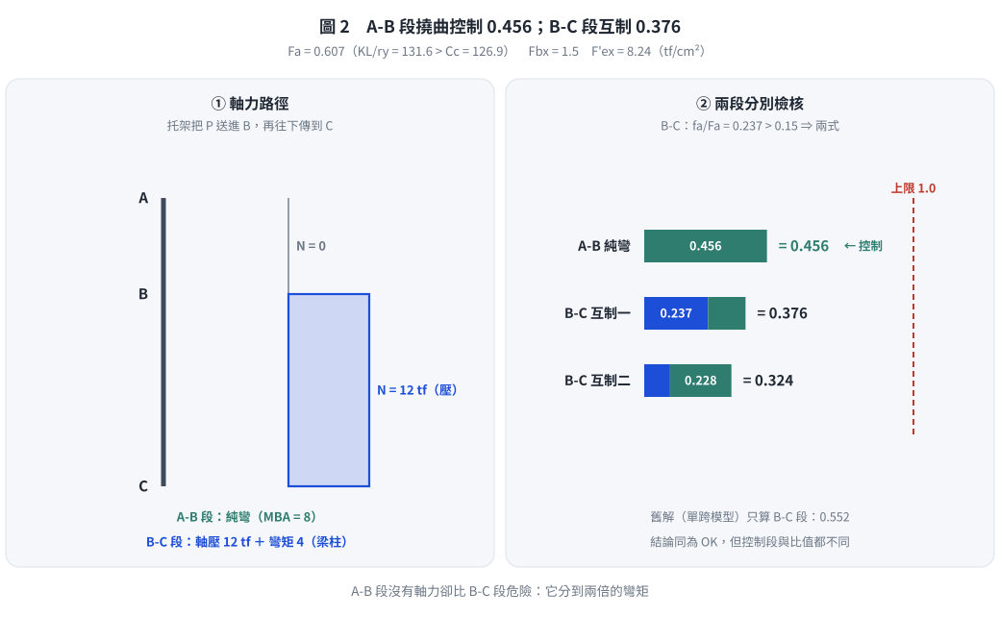

# SS-2019-3 解析

### 考題編號：SS-2019-3

**主分類：** `SS-U1-3` 梁柱桿件
**副分類：** `SS-U1-1`（壓力桿件）
**設計法：** ASD
**標籤：** `梁柱桿件` `偏心載重` `ASD` `互制公式` `Cm` `F'e` `LTB` `Cb` `有效長度` `弱軸挫屈` `彈性挫屈`

---

## 1. 原始題目重述 (Problem Restatement)

**題目：** 下圖所示為一 H 型鋼柱 H400×200×8×13，於 B 點承受偏心工作載重 $P = 12$ tf。鋼柱於 A、B 與 C 點皆有側向支撐。鋼柱為結實斷面，鋼材降伏應力 $F_y = 2.5$ tf/cm²，極限強度 $F_u = 4.1$ tf/cm²，彈性模數 $E = 2040$ tf/cm²。不考慮鋼柱自重，試依容許應力設計法，檢核鋼柱是否滿足設計需求（無需檢核剪力）。（30 分）

**已知斷面性質（H400×200×8×13）：**

| 性質 | 數值 |
|------|------|
| $A$ | 83.4 cm² |
| $I_x$ | 23,500 cm⁴（強軸）|
| $I_y$ | 1,740 cm⁴（弱軸）|
| $r_x$ | 16.8 cm |
| $r_y$ | 4.56 cm |
| $r_T$ | 5.23 cm |
| $S_x$ | 1,170 cm³ |
| $S_y$ | 174 cm³ |

**幾何配置：**
- A（頂部，鉸支）→ B（中間側向支撐，偏心載重施加點；圖示為**靠牆滾支**，提供水平反力）：**3 m**
- B → C（底部，鉸支）：**6 m**
- 偏心距：**$e = 1$ m**（強軸 x 方向）

*圖說：柱長 A-C = 9m（A-B = 3m，B-C = 6m）。P = 12 tf 施加於 B 點，偏心距 1m 朝強軸方向，故彎矩作用於強軸（x 軸，$S_x = 1170$ cm³）。A、B、C 三點均有側向支撐；B 點畫有靠牆滾支，柱在強軸平面內為 A–B–C **兩跨連續**（A、C 鉸、B 水平束制）。軸力由 B 點傳至底部 C，A-B 段無軸壓；B 點外加彎矩依兩跨勁度分配，A-B 段彎矩較大、B-C 段承受軸壓且較長，兩段都要檢核。*

**考卷給定參考公式（ASD 梁柱）：**

$$C_c = \sqrt{\frac{2\pi^2 E}{F_y}}, \quad F_a = \frac{\left[1 - \frac{(KL/r)^2}{2C_c^2}\right]F_y}{\frac{5}{3} + \frac{3}{8}\frac{KL/r}{C_c} - \frac{1}{8}\left(\frac{KL/r}{C_c}\right)^3}, \quad F_a = \frac{12\pi^2 E}{23(KL/r)^2}$$

$$L_c = \min\!\left(\frac{20b_f}{\sqrt{F_y}},\; \frac{1400}{(d/A_f)F_y}\right)$$

當 $\sqrt{7160C_b/F_y} \le L/r_T \le \sqrt{35800C_b/F_y}$：
$$F_b = \left(\frac{2}{3} - \frac{F_y(L/r_T)^2}{107600C_b}\right)F_y \le 0.6F_y$$

$$F_b = \frac{840C_b}{Ld/A_f} \le 0.6F_y, \quad C_b = 1.75 + 1.05(M_1/M_2) + 0.3(M_1/M_2)^2 \le 2.3$$

當 $f_a/F_a \le 0.15$：$\dfrac{f_a}{F_a} + \dfrac{f_{bx}}{F_{bx}} + \dfrac{f_{by}}{F_{by}} \le 1.0$

當 $f_a/F_a > 0.15$：
$$\frac{f_a}{F_a} + \frac{C_{mx}f_{bx}}{\left(1-\frac{f_a}{F_{ex}'}\right)F_{bx}} + \frac{C_{my}f_{by}}{\left(1-\frac{f_a}{F_{ey}'}\right)F_{by}} \le 1.0$$
$$\frac{f_a}{0.6F_y} + \frac{f_{bx}}{F_{bx}} + \frac{f_{by}}{F_{by}} \le 1.0$$

$$F_e' = \frac{12\pi^2 E}{23(KL_b/r_b)^2}$$

---

## 2. 考題核心精神與出題者意圖 (Core Concepts & Examiner's Intent)

**核心觀念：** 偏心載重在柱上同時產生軸壓力與彎矩，需以梁柱互制公式（beam-column interaction）綜合檢核。關鍵步驟是：正確分配彎矩圖、判斷控制段、計算 $F_a$（壓力容許應力）與 $F_b$（彎曲容許應力），再代入互制方程式。

**出題者意圖：**
1. 考核偏心載重引起的彎矩分布（矩靜力分析）
2. 考核壓力桿件容許應力 $F_a$（細長比計算、$C_c$ 判斷彈/非彈性）
3. 考核 LTB 容許彎曲應力 $F_b$（$C_b$、$L/r_T$ 計算）
4. 考核梁柱互制公式（$C_m$、$F_e'$ 的應用）

---

## 3. 解題戰略地圖與陷阱分析 (Strategic Roadmap & Trap Analysis)

**作戰計畫（7 步驟）：**
1. 靜力分析→彎矩圖
2. 計算 $f_a$
3. 計算各段 $KL/r$，判斷 $F_a$
4. 計算 $f_{bx}$（控制段最大彎矩）
5. 計算 $C_b$，判斷 LTB 範圍，求 $F_{bx}$
6. 判斷 $f_a/F_a$ 大小，選取互制公式
7. 代入互制公式，判定 OK/NG

**關鍵陷阱：**

| 陷阱 | 說明 | 應對 |
|------|------|------|
| ❌ 彎矩分布算錯 | B 點為靠牆滾支（水平束制），柱為兩跨連續；若漏看 B 支承、當成 A–C 簡支，會得到 A-B 4、B-C 8 tf·m（剛好相反） | B 點外加彎矩依兩跨勁度 $3EI/L$ 分配：A-B 2/3、B-C 1/3 |
| ❌ 軸力路徑與控制段 | 軸力 $P$ 自 B 點向下傳至 C，A-B 段無軸壓；A-B 段彎矩 8 tf·m（純彎）、B-C 段 4 tf·m＋軸壓 | 兩段分別檢核，不可把 B-C 段軸力疊到 A-B 段彎矩 |
| ❌ 誤用 $KL/ry = 65.8$（A-B段）計算 $F_a$ | 弱軸最大細長比在B-C段 $KL/r_y = 131.6$ | 取最大細長比控制 |
| ❌ $F_b$ 只用 $840C_b/(Ld/A_f)$ | 需同時計算 $L/r_T$ 對應的公式，取兩者**較大值** | 兩式都算，取 max（但不超過 $0.6F_y$）|
| ❌ $C_m$ 算錯 | B-C 段端點彎矩：B=4 tf·m，C=0 tf·m | $M_1/M_2 = 0$，$C_m = 0.6$ |

## 3.5 變數層次分析（Variable Hierarchy Analysis）

> 複習提示：解題後，在每個卡住的知識點「卡關?」欄標記 `⚠`；第二次複習時只看有 `⚠` 的項目。

**最終目標：** 靜力分析求彎矩圖 → 計算 $f_a$、$F_a$（壓力容許）、$F_{bx}$（LTB 容許彎曲）→ 代入梁柱互制公式確認 DCR ≤ 1.0

### 主要公式（$\boxed{\phantom{x}}$ = 未知，待推導）

**Step 1：靜力分析（等效集中矩）**
$$\boxed{M_B} = P \times e = 12 \times 1 = 12 \text{ tf}\cdot\text{m}$$

**Step 2：軸壓應力與壓力容許應力**
$$\boxed{f_a} = P / A, \quad C_c = \sqrt{2\pi^2 E / F_y}, \quad \boxed{F_a} = \frac{12\pi^2 E}{23(KL/r)^2}$$

**Step 3：LTB 容許彎曲應力**
$$\boxed{F_{bx}} = \max\!\left[\left(\frac{2}{3}-\frac{F_y(L/r_T)^2}{107600C_b}\right)F_y,\; \frac{840C_b}{Ld/A_f}\right] \leq 0.6F_y$$

**Step 4：梁柱互制公式（$f_a/F_a > 0.15$，取控制值）**
$$\text{互制一：}\frac{f_a}{F_a} + \frac{C_{mx}\,f_{bx}}{\left(1-f_a/\boxed{F'_{ex}}\right)F_{bx}} \leq 1.0$$
$$\text{互制二：}\frac{f_a}{0.6F_y} + \frac{f_{bx}}{F_{bx}} \leq 1.0$$

### L1：題目直接給定

| 符號 | 數值 | 說明 |
|------|------|------|
| $P$ | 12 tf | 偏心工作載重 |
| $e$ | 1 m | 偏心距（強軸方向） |
| $F_y$ | 2.5 tf/cm² | 降伏應力 |
| $E$ | 2040 tf/cm² | 彈性模數 |
| $A$ | 83.4 cm² | 斷面積（H400×200×8×13）|
| $r_x$ | 16.8 cm | 強軸迴轉半徑 |
| $r_y$ | 4.56 cm | 弱軸迴轉半徑 |
| $r_T$ | 5.23 cm | 受壓翼板迴轉半徑 |
| $S_x$ | 1,170 cm³ | 強軸彈性斷面模數 |
| $A\text{-B}$ | 3 m | 上段長度 |
| $B\text{-C}$ | 6 m | 下段長度（控制段）|

### L2：需知識點推導

**Step 1：靜力分析（彎矩圖）**

| 符號 | 公式 / 來源 | 卡關? |
|------|------------|:-----:|
| $M_B$ | $P \times e = 12$ tf·m（B 點等效集中矩）| |
| 分配係數 | $k = 3EI/L$（遠端鉸）：$k_{AB} : k_{BC} = \tfrac{1}{3} : \tfrac{1}{6} = 2 : 1$ | ⚠ |
| $M_{B\text{上}}$ | $\tfrac{2}{3} \times 12 = 8$ tf·m（A-B 段最大彎矩，無軸壓）| |
| $M_{B\text{下}}$ | $\tfrac{1}{3} \times 12 = 4$ tf·m（B-C 段最大彎矩，軸壓 12 tf）| |

**Step 2：軸壓應力與 $F_a$（B-C 段控制）**

| 符號 | 公式 / 來源 | 卡關? |
|------|------------|:-----:|
| $f_a$ | $P/A = 12/83.4 = 0.1439$ tf/cm² | |
| $C_c$ | $\sqrt{2\pi^2 E / F_y} = 126.9$ | |
| $KL/r_y$ | $1.0 \times 600/4.56 = 131.6 > C_c$ → 彈性挫屈 | |
| $F_a$ | $12\pi^2 E / [23(KL/r)^2] = 0.6067$ tf/cm² | |
| $f_a/F_a$ | $0.237 > 0.15$ → 須用完整互制公式 | |

**Step 3：彎曲應力與 $F_{bx}$**

| 符號 | 公式 / 來源 | 卡關? |
|------|------------|:-----:|
| $f_{bx}$ | B-C 段：$400/1170 = 0.342$ tf/cm²；A-B 段：$800/1170 = 0.684$ tf/cm² | |
| $C_b$ | $1.75 + 1.05(M_1/M_2) = 1.75$（$M_1=0$，單曲率）| |
| $L/r_T$ | $600/5.23 = 114.7$，落在非彈性 LTB 區間 | |
| $F_{b1}$ | $(2/3 - F_y(L/r_T)^2/[107600 C_b]) F_y = 1.230$ tf/cm² | |
| $F_{b2}$ | $840 C_b / (L \cdot d/A_f) = 1.593 → 取上限 0.6F_y = 1.5$ tf/cm² | |
| $F_{bx}$ | $\max(1.230, 1.5) = 1.5$ tf/cm² | |

**Step 4：梁柱互制**

| 符號 | 公式 / 來源 | 卡關? |
|------|------------|:-----:|
| $C_{mx}$ | $0.6 - 0.4(M_1/M_2) = 0.6$（單曲率，$M_1=0$）| |
| $F'_{ex}$ | $12\pi^2 E / [23(KL_b/r_x)^2] = 8.24$ tf/cm²（強軸）| |
| 互制一（B-C）| $0.237 + 0.139 = 0.376 \leq 1.0$ ✓ | |
| 互制二（B-C）| $0.096 + 0.228 = 0.324 \leq 1.0$ ✓ | |
| A-B 純彎 | $f_{bx}/F_{bx} = 0.684/1.5 = 0.456 \leq 1.0$ ✓（**控制**）| |

### L3：深層知識（不懂就卡住）

| 知識點 | 說明 | 卡關? |
|--------|------|:-----:|
| ASD 梁柱互制公式選擇 | $f_a/F_a$ 是否 $> 0.15$ 決定用哪個公式；兩個互制方程式皆須驗算 | |
| $C_c$ 判斷彈/非彈性挫屈 | $KL/r > C_c$ → 彈性（Euler），反之 → 非彈性 | |
| LTB 兩公式取大值 | $F_{b1}$（$L/r_T$ 線性折減）和 $F_{b2}$（$Ld/A_f$）兩式都算，取大值，且不超過 $0.6F_y$ | |
| $C_b$ 單曲率計算 | $M_1/M_2 = 0$ 時 $C_b = 1.75$；B-C 段端部彎矩 4→0、A-B 段 8→0，皆 $M_1 = 0$ | |
| 偏心載重彎矩分布 | B 點有水平束制 → 兩跨連續梁受節點力矩，依勁度分配（遠端鉸 $k = 3EI/L$）；軸力路徑由載重點往下 | |
| $F'_e$ 強/弱軸分別計算 | 互制公式中 $F'_{ex}$ 用**強軸** $r_x$ 計算（彎矩作用於強軸），不可與弱軸 $r_y$ 混用 | |

---

## 4. 步驟化詳細計算過程 (Step-by-Step Detailed Calculation)

### Step 1：靜力分析與彎矩圖

偏心載重 $P = 12$ tf 經 1 m 托架作用在 B 點，等效於：
- **軸壓力** $P = 12$ tf：由 B 點向下傳至底部支承 C（**B-C 段受壓、A-B 段無軸力**；A 點視為只提供水平束制的側向支承）
- **集中彎矩** $M_B = P \times e = 12 \times 1 = 12$ tf·m（施加於 B 點，強軸）

**支承判讀：** A 鉸、C 鉸，B 點畫有**靠牆滾支**（水平束制）。強軸平面內柱為 A–B–C **兩跨連續梁**，B 點承受節點力矩 $M_B$。

**彎矩分配（兩跨遠端皆鉸，$k = 3EI/L$）：**

$$k_{AB} : k_{BC} = \frac{3EI}{300} : \frac{3EI}{600} = 2 : 1$$

$$M_{BA} = \frac{2}{3} \times 12 = 8 \text{ tf}\cdot\text{m}, \qquad M_{BC} = \frac{1}{3} \times 12 = 4 \text{ tf}\cdot\text{m}$$

**水平反力：** $R_A = 8/3 = 2.67$ tf、$R_C = 4/6 = 0.67$ tf、$R_B = 3.33$ tf（$\Sigma H = 0$ ✓）；轉角相容檢核：$\theta_B = M_{BA}L_{AB}/3EI = 8 \times 3/3EI = 4 \times 6/3EI$ ✓

**彎矩圖：**

| 位置 | 彎矩 |
|------|------|
| A | 0 |
| B（上，A-B 段端）| **8 tf·m** |
| B（下，B-C 段端）| **4 tf·m** |
| C | 0 |

- **段 A-B（3 m）**：彎矩 0 → 8 tf·m，**無軸壓**，純彎檢核
- **段 B-C（6 m）**：彎矩 4 → 0 tf·m，軸壓 12 tf，梁柱互制檢核

> 原解漏看 B 點水平支承、把 A–C 當成單跨簡支，得 A-B 4、B-C 8 tf·m（分配剛好相反），並把軸力算到整根柱。

*圖 1　節點力矩 $M_B = P \cdot e = 12$ tf·m 的兩種分配。正解（兩跨連續）短跨 A-B 分到 8、B-C 分到 4；漏看 B 點支承的單跨模型恰好相反——這張圖攔的就是本題 2026-11-01 勘誤的那個錯。*

---

### Step 2：計算軸壓應力 $f_a$

$$f_a = \frac{P}{A} = \frac{12}{83.4} = \mathbf{0.1439 \text{ tf/cm}^2}$$

---

### Step 3：計算壓力容許應力 $F_a$（B-C 段）

**計算 $C_c$：**
$$C_c = \sqrt{\frac{2\pi^2 E}{F_y}} = \sqrt{\frac{2 \times 9.8696 \times 2040}{2.5}} = \sqrt{16{,}110} = \mathbf{126.9}$$

**B-C 段各方向細長比：**

弱軸（控制）：
$$\frac{KL}{r_y} = \frac{1.0 \times 600}{4.56} = \mathbf{131.6} \quad (\text{K=1.0，兩端鉸支})$$

強軸：
$$\frac{KL}{r_x} = \frac{1.0 \times 600}{16.8} = 35.7$$

控制：弱軸 $KL/r_y = 131.6 > C_c = 126.9$ → **彈性挫屈**

$$F_a = \frac{12\pi^2 E}{23(KL/r)^2} = \frac{12 \times 9.8696 \times 2040}{23 \times 131.6^2} = \frac{241{,}650}{398{,}327}$$

$$\boxed{F_a = 0.6067 \text{ tf/cm}^2}$$

$$\frac{f_a}{F_a} = \frac{0.1439}{0.6067} = \mathbf{0.237 > 0.15} \quad \Rightarrow \text{須使用完整互制公式}$$

---

### Step 4：計算彎曲應力 $f_{bx}$

$$f_{bx}^{BC} = \frac{400}{1170} = \mathbf{0.342 \text{ tf/cm}^2}, \qquad f_{bx}^{AB} = \frac{800}{1170} = \mathbf{0.684 \text{ tf/cm}^2}$$

（兩段最大彎矩皆發生於 B 點，作用於強軸）

---

### Step 5：計算容許彎曲應力 $F_{bx}$（B-C 段）

**H400×200×8×13 斷面參數（$t_f = 13$ mm = 1.3 cm）：**

$$d = 40 \text{ cm},\quad A_f = b_f \times t_f = 20 \times 1.3 = 26 \text{ cm}^2$$

$$\frac{d}{A_f} = \frac{40}{26} = 1.538 \text{ cm}^{-1}$$

**$C_b$ 計算（B-C 段，端部彎矩 $M_2 = 4$ tf·m，$M_1 = 0$ tf·m）：**

$$C_b = 1.75 + 1.05 \times \frac{M_1}{M_2} + 0.3\left(\frac{M_1}{M_2}\right)^2 = 1.75 + 0 + 0 = \mathbf{1.75}$$

**判斷 $L/r_T$ 範圍（$L$ = 600 cm）：**

$$\sqrt{\frac{7160 C_b}{F_y}} = \sqrt{\frac{7160 \times 1.75}{2.5}} = \sqrt{5012} = 70.8$$

$$\sqrt{\frac{35800 C_b}{F_y}} = \sqrt{\frac{35800 \times 1.75}{2.5}} = \sqrt{25060} = 158.3$$

$$\frac{L}{r_T} = \frac{600}{5.23} = 114.7$$

→ $70.8 \le 114.7 \le 158.3$ → 非彈性 LTB 區間

**LTB 公式 1（$L/r_T$ 線性折減）：**

$$F_{b1} = \left(\frac{2}{3} - \frac{F_y(L/r_T)^2}{107600\,C_b}\right)F_y = \left(\frac{2}{3} - \frac{2.5 \times 114.7^2}{107600 \times 1.75}\right) \times 2.5$$

$$= \left(0.6667 - \frac{32{,}890}{188{,}300}\right) \times 2.5 = (0.6667 - 0.1747) \times 2.5 = 1.230 \text{ tf/cm}^2$$

**LTB 公式 2（$Ld/A_f$）：**

$$F_{b2} = \frac{840\,C_b}{L \cdot d/A_f} = \frac{840 \times 1.75}{600 \times 1.538} = \frac{1470}{922.8} = 1.593 \text{ tf/cm}^2 > 0.6F_y = 1.5$$

$$\Rightarrow F_{b2} = 1.5 \text{ tf/cm}^2$$（上限 $0.6F_y$）

**取較大值：**
$$F_{bx} = \max(F_{b1},\,F_{b2}) = \max(1.230,\, 1.5) = \boxed{1.5 \text{ tf/cm}^2}$$

---

### Step 6：計算 $C_{mx}$ 與 $F'_{ex}$

**$C_{mx}$（B-C 段，$M_1/M_2 = 0$，單曲率）：**
$$C_{mx} = 0.6 - 0.4 \times \frac{M_1}{M_2} = 0.6 - 0 = \mathbf{0.6}$$

**$F'_{ex}$（強軸，B-C 段）：**
$$\frac{KL_b}{r_b} = \frac{1.0 \times 600}{r_x} = \frac{600}{16.8} = 35.71$$

$$F'_{ex} = \frac{12\pi^2 E}{23(KL_b/r_b)^2} = \frac{12 \times 9.8696 \times 2040}{23 \times 35.71^2} = \frac{241{,}650}{29{,}329} = \mathbf{8.24 \text{ tf/cm}^2}$$

---

### Step 7：B-C 段代入互制公式

#### 互制公式一（$f_a/F_a = 0.237 > 0.15$）：

$$\frac{f_a}{F_a} + \frac{C_{mx}\,f_{bx}}{\left(1-\dfrac{f_a}{F'_{ex}}\right)F_{bx}} = 0.237 + \frac{0.6 \times 0.342}{\left(1 - \dfrac{0.1439}{8.24}\right) \times 1.5} = 0.237 + \frac{0.205}{1.474} = 0.237 + 0.139 = \mathbf{0.376} \le 1.0 \quad \checkmark$$

#### 互制公式二：

$$\frac{f_a}{0.6F_y} + \frac{f_{bx}}{F_{bx}} = \frac{0.1439}{1.5} + \frac{0.342}{1.5} = 0.096 + 0.228 = \mathbf{0.324} \le 1.0 \quad \checkmark$$

---

### Step 8：A-B 段（純彎）

A-B 段無軸壓，只檢核撓曲。$L_b = 300$ cm $> L_c = \min(20b_f/\sqrt{F_y},\ 1400/[(d/A_f)F_y]) = \min(253,\ 364) = 253$ cm，不得用 $0.66F_y$；$C_b = 1.75$（$M_1 = 0$），$L/r_T = 300/5.23 = 57.4 < \sqrt{7160C_b/F_y} = 70.8$ → $F_{bx} = 0.6F_y = 1.5$ tf/cm²

$$\frac{f_{bx}}{F_{bx}} = \frac{0.684}{1.5} = \mathbf{0.456} \le 1.0 \quad \checkmark \quad (\text{控制})$$

---

### 結論

$$\boxed{\text{鋼柱 H400×200×8×13 滿足 ASD 設計需求（A-B 段撓曲控制，比值 0.456；B-C 段互制 0.376）} \quad \checkmark}$$

**替代解讀（A 點也承受垂直反力）：** 兩端鉸支皆可承受軸力時，軸力依軸向勁度 $EA/L$ 分配：A-B 段受**拉** $12 \times 6/9 = 8$ tf、B-C 段受壓 $4$ tf。B-C：$f_a/F_a = 0.079 < 0.15$ → $0.079 + 0.228 = 0.307$；A-B（拉＋彎）：$0.096/1.5 + 0.456 = 0.520$。結論仍 OK。

*圖 2　軸力路徑與兩段檢核。A-B 段沒有軸力，卻分到兩倍彎矩，純彎 0.456 反而控制；這張圖攔的是把軸力算到整根柱，以及只驗 B-C 段。*

---

## 5. 關鍵爭議點與進階探討 (Critical Issues & Advanced Discussion)

### 偏心載重的彎矩分布（最容易出錯處）

偏心載重 $P = 12$ tf、$e = 1$ m，等效節點力矩 $M_B = 12$ tf·m 施加於 B。關鍵是**先看 B 點支承**：圖上 B 點畫有靠牆滾支，柱在強軸平面內是兩跨連續梁，節點力矩依各跨勁度分配（遠端鉸 $k = 3EI/L$）：短跨 A-B 勁度大，分到 2/3（8 tf·m），長跨 B-C 分到 1/3（4 tf·m）。

若漏看 B 點支承、當成 A–C 單跨簡支，反力 $R_A = R_C = 12/9$ tf，B 點兩側彎矩變成 4（上）／8（下）——分配剛好相反，控制段也跟著選錯。本題此誤讀在數值上偏保守（舊解比值 0.552），結論雖同為 OK，但力學模型不正確。

**記憶口訣：** 「有支承的節點力矩，短跨分多」；沒有中間支承時才是「近端小、遠端大」。

### 弱軸細長比跨越 $C_c$ 的處理

$KL/r_y = 131.6$ 略大於 $C_c = 126.9$，代表鋼柱「恰好」在彈性挫屈範圍。若計算 $C_c$ 稍有誤差，可能算成非彈性（對答案影響不大，但務必寫清楚判斷過程）。

### 軸力路徑

軸力由托架傳入 B 點後向下傳至底部支承 C，A-B 段沒有軸壓（主解採 A 點只提供水平束制）。原解把軸壓 12 tf 算到整根柱，並以 B-C 段的軸力與 A–C 簡支模型的 8 tf·m 組合；在正確模型下，A-B 段是 8 tf·m 純彎（0.456 控制）、B-C 段是 4 tf·m＋軸壓（0.376）。若 A 點也承受垂直反力，見 Step 8 替代解讀，結論不變。

---

## 6. 依最新規範（AISC 360-16／-22）對照

| 項目 | 考卷（ASD 1989 系） | AISC 360-16／-22（ASD，$\Omega$） |
|:---|:---|:---|
| 柱強度 | $KL/r > C_c$：$F_a = 12\pi^2E/[23(KL/r)^2]$ | $F_e = \pi^2E/(KL/r)^2$，$F_y/F_e > 2.25$ 時 $F_{cr} = 0.877F_e$，$P_c = F_{cr}A_g/1.67$ |
| 撓曲 | $F_b$ 由 $L/r_T$、$Ld/A_f$ 兩式取大，$\le 0.6F_y$ | $M_n$ 依 $L_p$、$L_r$ 三區段（需 $J$、$C_w$），$M_c = M_n/1.67$ |
| 二階效應 | $C_m/(1 - f_a/F'_e)$ | $B_1 = C_m/(1 - 1.6P_r/P_{e1})$（ASD 取 $\alpha = 1.6$） |
| 互制 | 兩式（$f_a/F_a > 0.15$） | H1-1a／b |

**本題以 360-16 估算 B-C 段軸力：** $KL/r_y = 131.6$ → $F_e = 1.163$ tf/cm²，$F_y/F_e = 2.15 < 2.25$ → $F_{cr} = 0.658^{2.15} \times 2.5 = 1.017$ tf/cm²，$P_c = 1.017 \times 83.4/1.67 = 50.8$ tf，$P_r/P_c = 0.236$（與考卷 $f_a/F_a = 0.237$ 幾乎相同）。撓曲強度需 $J$、$C_w$（題目未給），A-B 段 $L_b = 300$ cm 僅略大於 $L_p = 1.76r_y\sqrt{E/F_y} = 229$ cm，$M_n$ 接近 $M_p$，比值將低於考卷版 0.456，結論不變。

---

*修正日期：2026-11-01（依考卷原圖：B 點為靠牆滾支（水平束制），柱為 A–B–C 兩跨連續；原解漏看 B 點支承當成 A–C 簡支，彎矩分配相反（A-B 4／B-C 8 tf·m）且把軸力算到整根柱。更正為依勁度分配 A-B 8、B-C 4 tf·m，軸力只在 B-C 段：B-C 互制 0.376、A-B 純彎 0.456（控制），結論 OK 不變（原解 0.552）；補替代解讀（A 點承受垂直反力）、§6 對照，並修正檔內 `\times`／`\text` 被轉成 Tab 字元的亂碼）*
*圖解補繪：2026-11-03（向量圖 2 張，腳本 `gen_SS-2019-3.py`，改輸入可原地重跑；SVG 供 wiki／PDF，2× PNG 供 pptx／影片）*
*驗證狀態：unverified*
