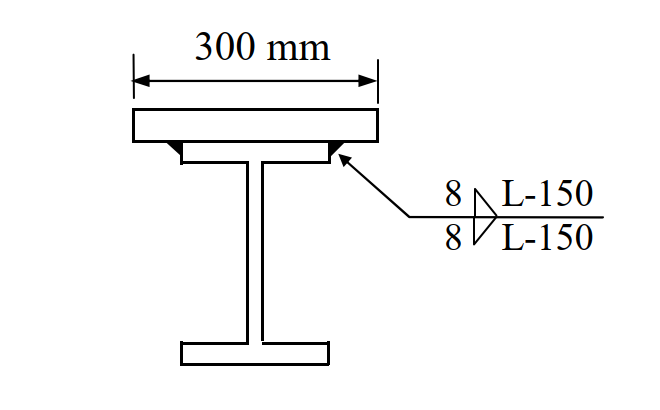

# SS-2019-4 題目正本

> 本檔只記錄**考卷上寫了什麼、圖上畫了什麼**，不含任何解法。解析見同資料夾 `SS-2019-4.md`。
> 判讀清單經使用者確認前，狀態為「待確認」；確認後本檔原則上不再修改（改動須回考卷原圖並記 log）。

| 項目 | 內容 |
|------|------|
| 考卷 | `raw/exams/SS-2019_鋼結構設計.pdf` 第 3 頁（頁次 3－3），第四題 |
| 考年 | 民國 108 年（2019） |
| 配分 | 25 分 |
| 附圖 | 1 張（組合斷面與銲接符號），`SS-2019-4-fig-1.png` |
| 判讀狀態 | **待確認**（轉錄 2026-11-02，PyMuPDF 110 dpi 全頁＋附圖 450 dpi 局部目視，盲讀後才比對既有解析） |

## 1. 考卷原文（逐字）

> 四、下圖所示組合斷面為一 H 型鋼 H500 × 200 × 9 × 16（mm）上翼板銲接一鋼板 PL25 × 300（mm），該斷面承受因數化載重彎矩 25 tf-m 與剪力 50 tf。型鋼與鋼板之鋼材降伏應力皆為 $F_y$ = 2.5 tf/cm²。鋼板與型鋼的銲接使用腳長為 8 mm 的填角銲，銲條為 E70XX，$F_{EXX}$ = 4.9 tf/cm²。銲接為斷續銲接，銲道中心至中心距離為 150 mm。試以極限設計法，計算所需斷續銲道長度 L 為何。（25 分）
> 參考公式：$\phi 0.6F_{EXX}$，$\phi$ = 0.75。

## 2. 考卷給的公式、附表與參數

- 題文：H500×200×9×16；PL25×300；$M_u$ = 25 tf-m、$V_u$ = 50 tf；$F_y$ = 2.5、$F_{EXX}$ = 4.9 tf/cm²；腳長 8 mm；斷續銲中心距 150 mm；$\phi$ = 0.75。
- 卷首注意事項：㈠可用計算器、㈡不必抄題、㈢除專門名詞或數理公式外應使用本國文字作答。

## 3. 附圖

*圖面文字照錄：300 mm；8；L-150；8；L-150。*

## 4. 判讀清單

「把握」標**不確定**者請優先確認；解讀類項目（題目用字的意思）另標「解讀」。

| # | 項目 | 判讀 | 圖上／題文依據 | 把握 |
|---|------|------|---------------|------|
| 1 | 銲道位置 | 鋼板底面與翼板左右兩側邊緣交角各一道，沿梁長方向 | 斷面圖兩處黑色三角（450 dpi） | 確定 |
| 2 | 符號 | 8 mm 填角銲，「L-150」= 每段長 L（待求）、中心距 150 mm；基線上下對稱 → 兩道並列（鏈式，非交錯） | 符號上下對齊 | 確定（解讀） |
| 3 | 設計力 | 鋼板與翼板介面的水平剪力流 $q = V_uQ/I$，$Q$ 取鋼板對組合斷面中性軸的一次矩 | 題文給 $V_u$ | 確定（解讀） |
| 4 | $M_u$ = 25 tf-m | 剪力流計算用不到（干擾資訊或供檢核斷面） | 題文 | 確定（解讀） |
| 5 | 斷面性質 | 題未給，由尺寸自算（不計圓角） | 題文 | 確定（解讀） |
| 6 | 母材檢核 | 是否另檢核翼板／鋼板母材剪力 | 題文只給銲道式 | 不確定（解讀） |

---

*轉錄：2026-11-02（SS-U1-4 題目正本推廣・批 3）*
