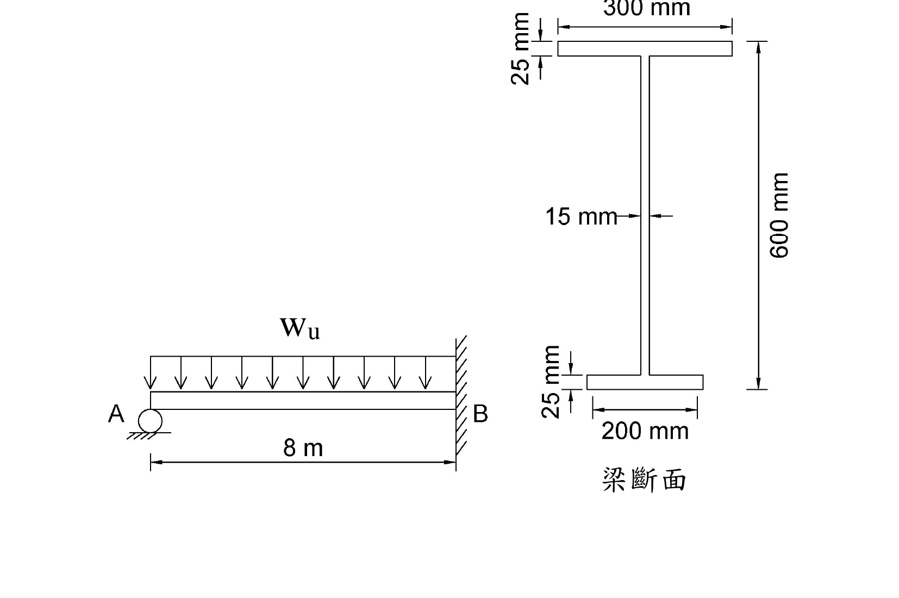

# SS-2020-2 題目正本

> 本檔只記錄**考卷上寫了什麼、圖上畫了什麼**，不含任何解法。解析見同資料夾 `SS-2020-2.md`。
> 判讀清單經使用者確認前，狀態為「待確認」；確認後本檔原則上不再修改（改動須回考卷原圖並記 log）。

| 項目 | 內容 |
|------|------|
| 考卷 | `raw/exams/SS-2020_鋼結構設計.pdf` 第 1 頁，第二題 |
| 考年 | 民國 109 年（2020） |
| 配分 | 25 分 |
| 附圖 | 1 張（梁立面＋梁斷面），`SS-2020-2-fig-1.png` |
| 判讀狀態 | **已確認**（2026-11-02 使用者確認，含「不確定」項之解讀；轉錄同日，PyMuPDF 110 dpi 全頁＋關鍵尺寸 220–400 dpi 局部目視，盲讀後才比對既有解析） |

## 1. 考卷原文（逐字）

> 二、下圖所示為一承受均佈載重之鋼梁桿件，兩端分別為滾支承及固定端，梁斷面如圖所示，假設鋼梁有充分之側向支撐，且斷面為結實斷面，材料強度 $F_y = 2.5\ \text{tf/cm}^2$，試依塑性分析，求此鋼梁可承受之極限均佈載重 $w_u$。（25 分）

## 2. 考卷給的公式、附表與參數

本卷第 3 頁「參考資料」（照錄，與本題無直接關係）：H400×400×12×22 斷面性質 $A = 218.7$ cm²、$r_x = 17.56$ cm、$r_y = 10.36$ cm、$Z_x = 3707$ cm³、$Z_y = 1773$ cm³；公式 $\lambda_c$、$F_{cr}$（兩式）、H1 互制兩式、$B_1 = \dfrac{0.64}{1 - (P_u/P_{e1})}\left[1 - \dfrac{M_1}{M_2}\right] + 0.32\dfrac{M_1}{M_2} \ge 1.0$、$P_{e1} = A_gF_y/\lambda_c^2$、$L_p = 80r_y/\sqrt{F_y}$。無塑性分析相關式。

## 3. 附圖

*圖面文字照錄：Wu；A；B；8 m；300 mm；25 mm；15 mm；600 mm；25 mm；200 mm；梁斷面。*

## 4. 判讀清單

「把握」標**不確定**者請優先確認；解讀類項目（題目用字的意思）另標「解讀」。

| # | 項目 | 判讀 | 圖上／題文依據 | 把握 |
|---|------|------|---------------|------|
| 1 | 結構型式 | 單跨梁，跨度 8 m | 8 m 尺寸線兩端對齊 A、B | 確定 |
| 2 | A 端支承 | 滾支 | 圓圈＋地面斜線；題文「滾支承」 | 確定 |
| 3 | B 端支承 | 固定端 | 右側牆面斜線；題文「固定端」 | 確定 |
| 4 | 載重 | 均佈 $w_u$，向下，滿跨 | 整排箭頭 | 確定 |
| 5 | 上翼板 | 寬 300 mm、厚 25 mm | 上方尺寸線；左上 25 mm 一對箭頭 | 確定 |
| 6 | 下翼板 | 寬 200 mm、厚 25 mm | 下方尺寸線；左下 25 mm 一對箭頭 | 確定 |
| 7 | 腹板厚 | 15 mm | 中段一對箭頭夾腹板 | 確定 |
| 8 | 全深 | **600 mm（上翼板頂至下翼板底）**；腹板淨高 550 mm 為推得值 | 右側尺寸線上、下界線分別對齊上翼板頂與下翼板底（220 dpi） | 確定 |
| 9 | 寬翼板位置 | 寬 300 在上、窄 200 在下 | 斷面圖 | 確定 |

---

*轉錄：2026-11-02（U2-1 題目／解答拆分試做）｜確認：2026-11-02 使用者確認*
