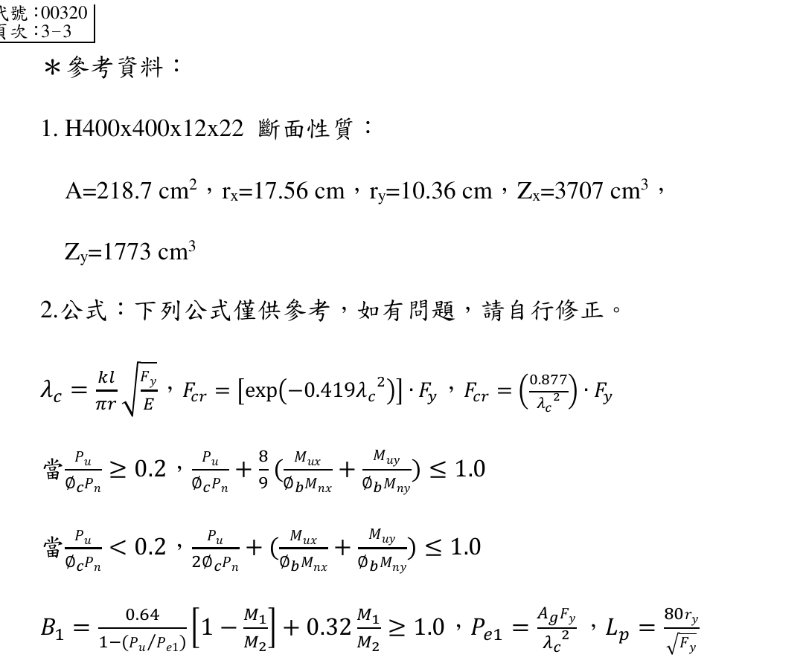
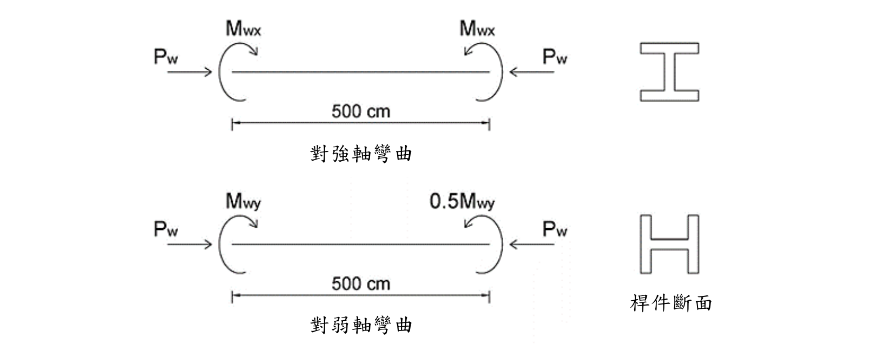

# SS-2020-3 題目正本

> 本檔只記錄**考卷上寫了什麼、圖上畫了什麼**，不含任何解法。解析見同資料夾 `SS-2020-3.md`。
> 判讀清單經使用者確認前，狀態為「待確認」；確認後本檔原則上不再修改（改動須回考卷原圖並記 log）。

| 項目 | 內容 |
|------|------|
| 考卷 | `raw/exams/SS-2020_鋼結構設計.pdf` 第 2 頁（頁次 3－2），第三題；參考資料在第 3 頁（頁次 3－3） |
| 考年 | 民國 109 年（2020） |
| 配分 | 25 分 |
| 附圖 | 1 張（強軸、弱軸受力圖＋斷面），`SS-2020-3-fig-1.png`；第 3 頁參考資料截圖 `SS-2020-3-eqn-1.png` |
| 判讀狀態 | **待確認**（轉錄 2026-11-02，PyMuPDF 110 dpi 全頁＋附圖 450 dpi 局部目視（附圖為 523×317 點陣圖），盲讀後才比對既有解析） |

## 1. 考卷原文（逐字）

> 三、有一梁柱桿件承受端點載重如下圖所示，$P_w$=150 tf，$M_{wx}$=6 tf-m，桿件長為 500 cm，斷面為 H 400x400x12x22，在桿件兩端皆有側向支撐，$K_x$=1.8，$K_y$=1.2，採用之材料強度 $F_y$=2.5 tf/cm²，$E$=2100 tf/cm²。試依極限設計規範，假設載重係數 r=1.6，求其弱軸尚可承受之最大彎矩 $M_{wy}$。（25 分）

## 2. 考卷給的公式、附表與參數

- 題文：$P_w$ = 150 tf；$M_{wx}$ = 6 tf-m；長 500 cm；$K_x$ = 1.8、$K_y$ = 1.2；$F_y$ = 2.5、$E$ = 2100 tf/cm²；載重係數 r = 1.6。
- 第 3 頁「＊參考資料」照錄：
  1. H400x400x12x22 斷面性質：$A$ = 218.7 cm²，$r_x$ = 17.56 cm，$r_y$ = 10.36 cm，$Z_x$ = 3707 cm³，$Z_y$ = 1773 cm³
  2. 公式：下列公式僅供參考，如有問題，請自行修正。

$$\lambda_c = \frac{kl}{\pi r}\sqrt{\frac{F_y}{E}},\quad F_{cr} = \left[\exp(-0.419\lambda_c^2)\right]\cdot F_y,\quad F_{cr} = \left(\frac{0.877}{\lambda_c^2}\right)\cdot F_y$$
$$\text{當}\ \frac{P_u}{\phi_cP_n} \ge 0.2,\ \frac{P_u}{\phi_cP_n} + \frac89\left(\frac{M_{ux}}{\phi_bM_{nx}} + \frac{M_{uy}}{\phi_bM_{ny}}\right) \le 1.0$$
$$\text{當}\ \frac{P_u}{\phi_cP_n} < 0.2,\ \frac{P_u}{2\phi_cP_n} + \left(\frac{M_{ux}}{\phi_bM_{nx}} + \frac{M_{uy}}{\phi_bM_{ny}}\right) \le 1.0$$
$$B_1 = \frac{0.64}{1 - (P_u/P_{e1})}\left[1 - \frac{M_1}{M_2}\right] + 0.32\frac{M_1}{M_2} \ge 1.0,\quad P_{e1} = \frac{A_gF_y}{\lambda_c^2},\quad L_p = \frac{80r_y}{\sqrt{F_y}}$$

  

- 兩條 $F_{cr}$ 式**沒有標適用範圍**（$\lambda_c$ ≤ 1.5／> 1.5）；$B_1$ 式照考卷原樣（形式特殊，$M_1/M_2$ 正負號未定義）。
- **沒有給 $\phi_c$、$\phi_b$、$S_x$、$S_y$、$B_2$ 式**。
- 卷首注意事項：㈠可以使用電子計算器；㈡不必抄題；㈢本科目除專門名詞或數理公式外，應使用本國文字作答；註：參考資料在第 3 頁。

## 3. 附圖

*圖面文字照錄：Mwx；Mwx；Pw；Pw；500 cm；對強軸彎曲；Mwy；0.5Mwy；Pw；Pw；500 cm；對弱軸彎曲；桿件斷面。*

## 4. 判讀清單

「把握」標**不確定**者請優先確認；解讀類項目（題目用字的意思）另標「解讀」。

| # | 項目 | 判讀 | 圖上／題文依據 | 把握 |
|---|------|------|---------------|------|
| 1 | 強軸端彎矩 | 左端順時針、右端逆時針，兩端皆 $M_{wx}$ → **單曲率、均勻彎矩** | 450 dpi：左弧箭頭在右上朝下、右弧箭頭在左上朝下 | 確定 |
| 2 | 弱軸端彎矩 | 左 $M_{wy}$ 順時針、右 0.5$M_{wy}$ 逆時針 → **單曲率**，端彎矩比 0.5 | 同上 | 確定 |
| 3 | 載重係數 | r = 1.6 同時乘 $P_w$、$M_{wx}$、$M_{wy}$ | 題文「假設載重係數 r=1.6」 | 確定（解讀） |
| 4 | 有效長度 | $K_xL$ = 900 cm、$K_yL$ = 600 cm | 題文 | 確定 |
| 5 | 側向支撐 | 兩端有側撐 → $L_b$ = 500 cm（參考資料給 $L_p$ 式供比較） | 題文 | 確定（解讀） |
| 6 | 側移放大 | 題只給 $B_1$、未給 $B_2$ 與側移資料 → 只考慮 $B_1$ | 參考資料 | 確定（解讀） |
| 7 | 所求 | 弱軸工作彎矩 $M_{wy}$ 的最大值（工作載重值，非因數化值） | 題文「$M_{wy}$」與 $P_w$、$M_{wx}$ 同為 w 下標 | 確定（解讀） |

---

*轉錄：2026-11-02（SS-U1-3 題目正本推廣・批 2）*
