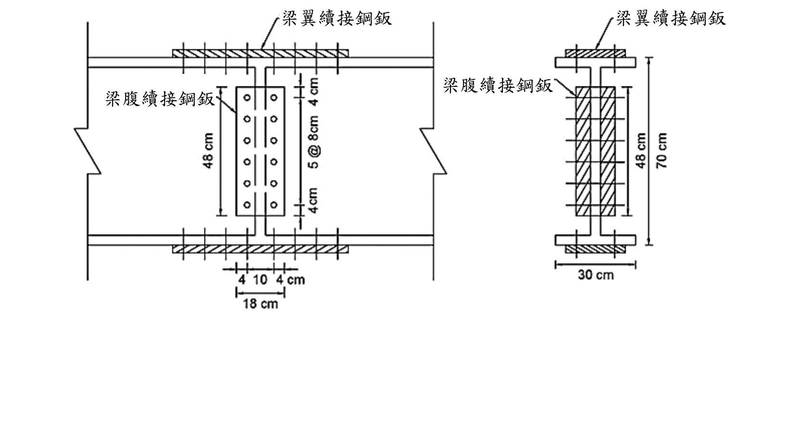

# SS-2020-4 題目正本

> 本檔只記錄**考卷上寫了什麼、圖上畫了什麼**，不含任何解法。解析見同資料夾 `SS-2020-4.md`。
> 判讀清單經使用者確認前，狀態為「待確認」；確認後本檔原則上不再修改（改動須回考卷原圖並記 log）。

| 項目 | 內容 |
|------|------|
| 考卷 | `raw/exams/SS-2020_鋼結構設計.pdf` 第 2 頁（頁次 3－2），第四題 |
| 考年 | 民國 109 年（2020） |
| 配分 | 25 分 |
| 附圖 | 1 張（四鈑接合梁續接立面與斷面），`SS-2020-4-fig-1.png` |
| 判讀狀態 | **待確認**（轉錄 2026-11-02，PyMuPDF 110 dpi 全頁＋附圖 300 dpi 局部目視，盲讀後才比對既有解析） |

## 1. 考卷原文（逐字）

> 四、下圖為以四鈑接合之鋼梁續接圖，梁斷面為 H700x300x14x25，材料強度 $F_y$=2.5 tf/cm²，螺栓為 A490 螺栓，容許剪應力 $F_{va}$=2.8 tf/cm²，梁在續接位置承受之 $M_w$=60 tf-m，$V_w$=70 tf，若規範規定：梁續接之接合強度不得小於梁桿件強度之一半，試依容許應力設計規範，設計梁腹鈑續接接合鈑需要之螺栓尺寸及需要之鈑厚。（25分）

## 2. 考卷給的公式、附表與參數

- 題文：H700×300×14×25；$F_y$ = 2.5 tf/cm²；A490，$F_{va}$ = 2.8 tf/cm²；$M_w$ = 60 tf-m、$V_w$ = 70 tf；接合強度 ≥ 梁強度之一半。
- 圖面：腹板續接鈑高 48、寬 18 cm（4＋10＋4）；螺栓列距 5@8 cm，上下邊距 4 cm；梁高 70、翼寬 30 cm。
- **沒有給承壓容許應力、$F_u$ 與梁強度的定義式**。
- 卷首注意事項：㈠可用計算器、㈡不必抄題、㈢除專門名詞或數理公式外應使用本國文字作答。

## 3. 附圖

*圖面文字照錄：梁翼續接鋼鈑；梁腹續接鋼鈑；48 cm；4 cm；5 @ 8cm；4cm；4；10；4 cm；18 cm；梁翼續接鋼鈑；梁腹續接鋼鈑；48 cm；70 cm；30 cm。*

## 4. 判讀清單

「把握」標**不確定**者請優先確認；解讀類項目（題目用字的意思）另標「解讀」。

| # | 項目 | 判讀 | 圖上／題文依據 | 把握 |
|---|------|------|---------------|------|
| 1 | 四鈑 | 上下翼板外側各 1 片＋腹板兩側各 1 片 | 斷面圖斜線 | 確定 |
| 2 | 腹板螺栓 | 每側梁 1 縱列 6 支（全鈑 12 支），雙剪 | 立面圖＋腹板兩側各一鈑 | 確定 |
| 3 | 4、10、4 cm | 鈑邊至螺栓列 4 cm、兩縱列相距 10 cm（每列距續接縫 5 cm） | 尺寸線端點（300 dpi） | 確定 |
| 4 | 腹板設計力 | $V_w$ 全由腹板承擔；$M_w$ 依 $I_w/I_x$ 分給腹板；螺栓群偏心 5 cm | 題文＋圖 | 不確定（解讀） |
| 5 | 「強度之一半」 | 設計力取「實際載重」與「梁強度一半」的較大者；梁強度的定義（容許彎矩、剪力）題未給 | 題文 | 不確定（解讀） |
| 6 | 所求 | 螺栓直徑與腹板續接鈑厚度 | 題文 | 確定 |

---

*轉錄：2026-11-02（SS-U1-4 題目正本推廣・批 3）*
