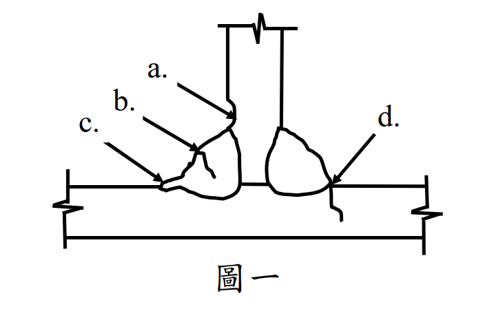

# SS-2021-1 題目正本

> 本檔只記錄**考卷上寫了什麼、圖上畫了什麼**，不含任何解法。解析見同資料夾 `SS-2021-1.md`。
> 判讀清單經使用者確認前，狀態為「待確認」；確認後本檔原則上不再修改（改動須回考卷原圖並記 log）。

| 項目 | 內容 |
|------|------|
| 考卷 | `raw/exams/SS-2021_鋼結構設計.pdf` 第 1 頁（頁次 3－1），第一題 |
| 考年 | 民國 110 年（2021） |
| 配分 | 25 分 |
| 附圖 | 1 張（圖一：T 形接頭兩側填角銲之瑕疵示意），`SS-2021-1-fig-1.png` |
| 判讀狀態 | **待確認**（轉錄 2026-11-02，PyMuPDF 110 dpi 全頁＋附圖 450 dpi 局部目視（向量圖）＋抽出文字核對，盲讀後才比對既有解析） |

## 1. 考卷原文（逐字）

> 一、請說明鋼結構銲道檢測常採用之五種非破壞檢測方法，若圖一中填角銲道銲接發現 a、b、c、d 四種瑕疵，請說明此四種瑕疵之名稱及其對應適合之一種非破壞檢測方式。（25 分）

## 2. 考卷給的公式、附表與參數

- 本題**沒有給任何數值或公式**。
- 卷首注意事項：㈠可以使用電子計算器；㈡不必抄題；㈢本科目除專門名詞或數理公式外，應使用本國文字作答。

## 3. 附圖

*圖面文字照錄：a.；b.；c.；d.；圖一。*

## 4. 判讀清單

「把握」標**不確定**者請優先確認；解讀類項目（題目用字的意思）另標「解讀」。

| # | 項目 | 判讀 | 圖上／題文依據 | 把握 |
|---|------|------|---------------|------|
| 1 | 題目要求 | ①五種常用非破壞檢測方法；②a～d 四種瑕疵的名稱；③每種瑕疵對應**一種**適合的檢測方式 | 題文 | 確定 |
| 2 | a 位置 | 左銲道**豎板側銲趾**，母材表面凹入 | 450 dpi 目視 | 確定 |
| 3 | b 位置 | 左銲道**表面**，有細線伸入銲道金屬內 | 450 dpi 目視 | 確定 |
| 4 | c 位置 | 左銲道**底板側銲趾**，銲道端部小突起／凹痕 | 450 dpi 目視 | 確定 |
| 5 | d 位置 | 右銲道**底板側銲趾**，細線自銲趾伸入**底板母材** | 450 dpi 目視 | 確定 |
| 6 | 瑕疵名稱 | 圖為示意，名稱由考生依形狀判斷（屬作答內容，本檔不判定） | 圖未標名稱 | 確定（解讀） |

---

*轉錄：2026-11-02（SS-U2-3 題目正本推廣・批 1）*
