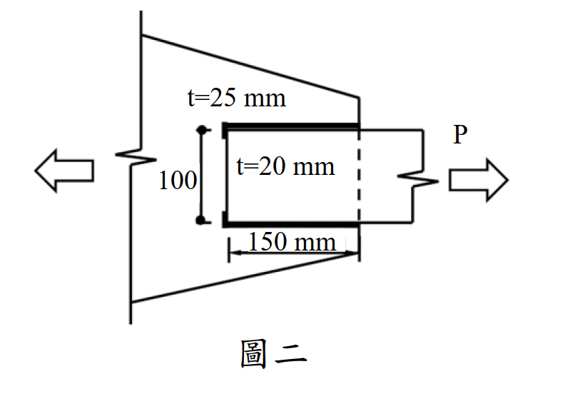

# SS-2021-2 題目正本

> 本檔只記錄**考卷上寫了什麼、圖上畫了什麼**，不含任何解法。解析見同資料夾 `SS-2021-2.md`。
> 判讀清單經使用者確認前，狀態為「待確認」；確認後本檔原則上不再修改（改動須回考卷原圖並記 log）。

| 項目 | 內容 |
|------|------|
| 考卷 | `raw/exams/SS-2021_鋼結構設計.pdf` 第 1 頁（頁次 3－1），第二題；參考公式在第 3 頁 |
| 考年 | 民國 110 年（2021） |
| 配分 | 20 分 |
| 附圖 | 1 張（圖二：疊接拉力接合），`SS-2021-2-fig-1.png` |
| 判讀狀態 | **已確認**（2026-11-02 使用者確認，含「不確定」項之解讀；轉錄同日，PyMuPDF 110 dpi 全頁＋圖二 400 dpi 局部目視，盲讀後才比對既有解析） |

## 1. 考卷原文（逐字）

> 二、圖二所示拉力構材為 SM400 鋼材，$F_y = 2.5$ tf/cm²，$F_u = 4.1$ tf/cm²，$E = 2040$ tf/cm²，板厚分別為 $t = 20$ mm 及 $t = 25$ mm，採用填角銲道疊接，請分別繪製發生拉力斷裂及塊狀剪力破壞之模式，依現行鋼結構極限設計法規範，塊狀剪力破壞拉力強度依式(1)及式(2)計算後擇一，且不大於 $0.6F_uA_{nv} + F_uA_{nt}$。請詳細說明式(1)中 $0.6F_yA_{gv}$ 之 $0.6F_y$ 所代表之意義；又，請詳細說明塊狀剪力破壞式(1)及式(2)擇一且不大於 $0.6F_uA_{nv} + F_uA_{nt}$ 之原因。（20 分）
>
> $$\phi R_n = \phi(0.6F_yA_{gv} + F_uA_{nt}) \le \phi(0.6F_uA_{nv} + F_uA_{nt}) \;\cdots\cdots(1)$$
> $$\phi R_n = \phi(0.6F_uA_{nv} + F_yA_{gt}) \le \phi(0.6F_uA_{nv} + F_uA_{nt}) \;\cdots\cdots(2)$$

## 2. 考卷給的公式、附表與參數

- 題文：SM400，$F_y = 2.5$、$F_u = 4.1$、$E = 2040$ tf/cm²；板厚 20 mm 與 25 mm；式(1)、式(2)（照錄於 §1）。
- 第 3 頁「參考公式：請自行選擇適合的公式，並檢查其正確性，若有問題應自行修正。」與本題相關者照錄：

$$\text{當 } F_uA_{nt} \ge 0.6F_uA_{nv} \text{ 時}\quad \phi R_n = \phi(0.6F_yA_{gv} + F_uA_{nt}) \le \phi(0.6F_uA_{nv} + F_uA_{nt})$$
$$\text{當 } 0.6F_uA_{nv} \ge F_uA_{nt} \text{ 時}\quad \phi R_n = \phi(0.6F_uA_{nv} + F_yA_{gt}) \le \phi(0.6F_uA_{nv} + F_uA_{nt})$$
$$\phi = 0.75$$

  （題文只說「擇一」，**擇一的判別條件印在第 3 頁**。）
- 卷首注意事項：㈠可用計算器、㈡不必抄題、㈢除專門名詞或數理公式外應使用本國文字作答。

## 3. 附圖

*圖面文字照錄：t=25 mm；t=20 mm；100；150 mm；P；圖二。*

## 4. 判讀清單

「把握」標**不確定**者請優先確認；解讀類項目（題目用字的意思）另標「解讀」。

| # | 項目 | 判讀 | 圖上／題文依據 | 把握 |
|---|------|------|---------------|------|
| 1 | 構件分工 | $t = 20$ mm 為受拉板（右端受 $P$）；$t = 25$ mm 為梯形節點板（左端承接） | 圖二標註位置（400 dpi） | 確定 |
| 2 | 100 | 受拉板寬度（單位未標，依圖中另一尺寸「150 mm」判為 mm） | 尺寸線端點在受拉板上下緣 | 確定 |
| 3 | 150 mm | 疊接長度＝縱向銲道長度 | 尺寸線自板端到節點板右緣 | 確定 |
| 4 | 銲道配置 | 兩道縱向填角銲沿受拉板上下兩緣；板端無橫向銲，只在兩角有短回銲 | 粗線只在上下緣，左緣細線，兩角短粗線（400 dpi） | 確定 |
| 5 | 題目要求 | 繪拉力斷裂與塊狀剪力**破壞模式**＋文字說明兩項原因；**不要求算出數值** | 題文 | 確定（解讀） |
| 6 | 繪圖對象 | 拉力斷裂與塊狀剪力都要考慮受拉板與節點板兩者（題文說「板厚分別為」兩種） | 題文 | 不確定 → 使用者確認 |
| 7 | 「擇一」 | 依第 3 頁條件：$F_uA_{nt} \ge 0.6F_uA_{nv}$ 用式(1)，否則用式(2) | 第 3 頁參考公式 | 確定 |

---

*轉錄：2026-11-02（SS-U1-1 題目正本推廣・批 3）｜確認：2026-11-02 使用者確認*
