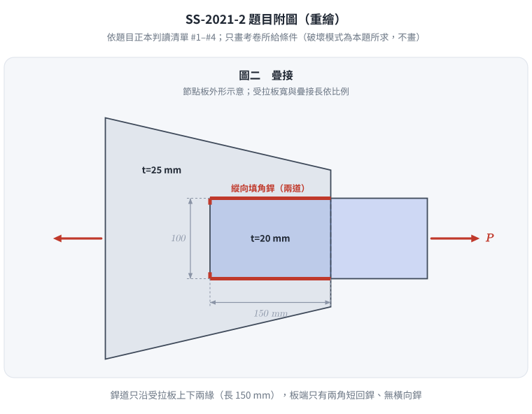
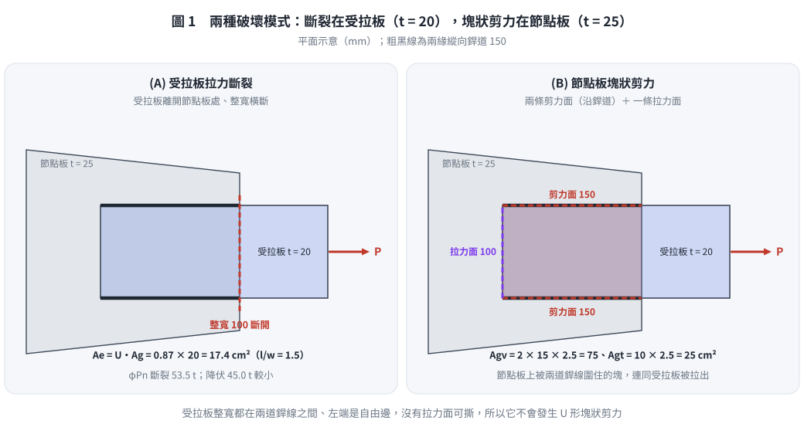
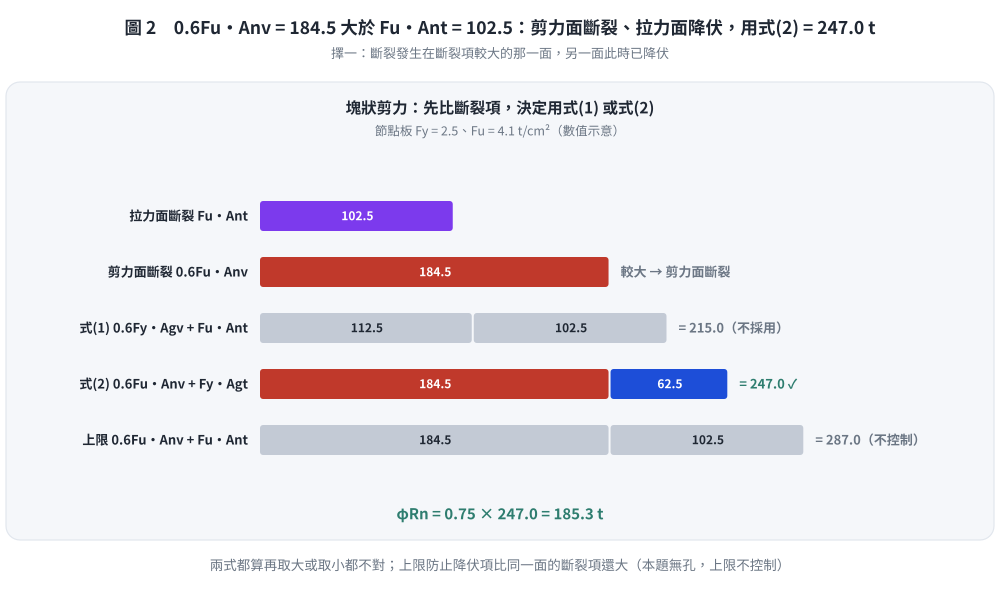

# 考題編號：SS-2021-2

**主分類：** `SS-U1-1` 拉力及壓力桿件
**副分類：** `SS-U1-4` 接合之分析與設計
**設計法：** LRFD
**標籤：** `拉力桿件` `塊狀剪力` `銲接拉力接合` `填角銲` `疊接` `斷裂模式` `0.6Fy意義` `剪力降伏` `節點板塊狀剪力`

---

## 1. 題目（考卷原文見題目正本）

> 考卷原文、公式／附表、附圖與判讀清單（已確認）見 [`SS-2021-2-problem.md`](SS-2021-2-problem.md)。本節只列**解題時最容易讀錯的地方**與本解使用的記號；題意以題目正本為準。



*圖 1　題目附圖重繪（依題目正本判讀清單 #1–#4；節點板外形為示意，破壞模式為本題所求不畫）。銲道只畫在受拉板上下兩緣、板端左緣不畫橫向銲，攔下把三面圍銲當成題目條件、或把兩塊板厚對調的誤讀。*

### 常見誤讀

| 項目 | 正確判讀 | 常見誤讀 |
|------|---------|---------|
| 兩板分工 | $t = 20$ mm 為受拉板（寬 100 mm）；$t = 25$ mm 為梯形節點板 | 兩板角色對調 |
| 銲道 | 上下兩道縱向銲，長 150 mm；板端只有兩角短回銲，沒有橫向銲 | 當成三面圍銲 |
| 所求 | 繪破壞模式並說明原因；數值只作說明 | 只算數值不畫圖 |
| 擇一 | 第 3 頁條件：$F_uA_{nt} \ge 0.6F_uA_{nv}$ 用式(1)，否則用式(2) | 取兩式較大或較小者 |

**本解記號：** 受拉板 $w = 10$ cm、$t = 2.0$ cm；節點板 $t = 2.5$ cm；銲長 $l = 15$ cm；$F_y = 2.5$、$F_u = 4.1$ tf/cm²；$\phi = 0.75$（塊狀剪力）。

---

## 2. 考題核心精神與出題者意圖 (Core Concepts & Examiner's Intent)

**核心觀念：** 銲接疊接的兩種破壞位置不同——**拉力斷裂發生在受拉構材**（含剪力遲滯），**塊狀剪力發生在節點板**（被兩道銲線圍住的那一塊被撕出）；再說明塊狀剪力公式「剪力降伏／斷裂 ＋ 拉力斷裂／降伏」組合與上限的由來。

**出題者考查重點：**
1. 能從圖上判斷哪一塊板、沿哪幾條線破壞。
2. $0.6F_y$ 是剪力降伏應力（von Mises：$F_y/\sqrt3$）。
3. 擇一準則與上限的力學理由。

---

## 3. 解題戰略地圖與陷阱分析 (Strategic Roadmap & Trap Analysis)

**關鍵陷阱：**

> ⚠️ **陷阱 1：寬度與疊接長度看反。** 垂直的 100 是板寬，水平的 150 是銲長。看反會把破壞面畫錯方向、剪力遲滯也算錯（$l/w = 1.5$，不是 0.67）。

> ⚠️ **陷阱 2：塊狀剪力畫在受拉板上。** 受拉板整個寬度都夾在兩道銲線之間，左端是自由邊，撕不出「U 形塊」；會被撕出 U 形塊的是 **$t = 25$ mm 節點板**：兩道銲線是剪力面，銲線左端連線是拉力面。

> ⚠️ **陷阱 3：擇一準則說成「取兩式較大／較小者」。** 準則是比較兩個**斷裂項**：$F_uA_{nt} \ge 0.6F_uA_{nv}$ 用式(1)，否則用式(2)。

> ⚠️ **陷阱 4：$0.6F_y$ 說成安全係數。** 它是剪力降伏應力。

---

## 3.5 變數層次分析（Variable Hierarchy Analysis）

> 複習提示：解題後，在每個卡住的知識點「卡關?」欄標記 `⚠`；第二次複習時只看有 `⚠` 的項目。

**最終目標：** 繪製拉力斷裂與塊狀剪力破壞模式 → 說明 $0.6F_y$ → 解釋擇一準則與上限（概念題；以下數值僅供說明）

### L1：題目直接給定

| 符號 | 數值 | 說明 |
|------|------|------|
| $F_y$、$F_u$ | 2.5、4.1 tf/cm² | SM400 |
| 受拉板 | $t = 20$ mm，寬 $w = 100$ mm | 構材 |
| 節點板 | $t = 25$ mm | 梯形 |
| 銲長 $l$ | 150 mm（上下各一道） | 疊接長度 |
| $\phi$ | 0.75 | 塊狀剪力 |

### L2：需知識點推導

| 符號 | 公式 / 來源 | 卡關? |
|------|------------|:-----:|
| 受拉板 $A_g$ | $10 \times 2.0 = 20$ cm² | |
| $U$ | 板件縱向銲 $l/w = 150/100 = 1.5$ → $U = 0.87$（$2w > l \ge 1.5w$） | ⚠ |
| 構材降伏 | $0.9 \times 2.5 \times 20 = 45.0$ t | |
| 構材斷裂 | $0.75 \times 4.1 \times 0.87 \times 20 = 53.5$ t | |
| 節點板 $A_{gv} = A_{nv}$ | $2 \times 15 \times 2.5 = 75$ cm²（兩道銲線） | ⚠ |
| 節點板 $A_{gt} = A_{nt}$ | $10 \times 2.5 = 25$ cm²（銲線左端連線） | |
| 擇一判斷 | $F_uA_{nt} = 102.5 < 0.6F_uA_{nv} = 184.5$ → 用式(2) | |
| 式(2) | $184.5 + 2.5 \times 25 = 247.0$ t ≤ 上限 287.0 t → $\phi R_n = 185.3$ t | |

### L3：深層知識（不懂就卡住）

| 知識點 | 說明 | 卡關? |
|--------|------|:-----:|
| $0.6F_y$ | von Mises：純剪降伏 $\tau_y = F_y/\sqrt3 = 0.577F_y \approx 0.6F_y$ | |
| 塊狀剪力是「斷裂」現象 | 破壞以某一面**斷裂**結束；另一面在斷裂發生時已達降伏 | |
| 擇一準則 | 斷裂發生在斷裂強度較大的那一面，另一面取降伏 | |
| 上限 | 兩面都斷裂為強度上界；降伏項不得因 $A_g > A_n$ 而算出比斷裂更大的值 | |
| 板件縱向銲 $U$ | $l \ge 2w$：1.0；$2w > l \ge 1.5w$：0.87；$1.5w > l \ge w$：0.75 | |

---

## 4. 步驟化詳細計算過程 (Step-by-Step Detailed Calculation)

### 一、繪製破壞模式

#### (A) 拉力斷裂（受拉構材 $t = 20$ mm）

```
  節點板 t=25                 │← 節點板右緣
 ┌────────────────────────────┤
 │      ══════════════════════╪═══╗   ═══ 上緣銲道（l = 150）
 │      ║ 受拉板 t=20        ✂│   ║
◁│      ║ 寬 w = 100         ✂│   ║  ▷ P
 │      ║                    ✂│   ║
 │      ══════════════════════╪═══╝   ═══ 下緣銲道（l = 150）
 └────────────────────────────┤
                              ✂ = 斷裂線：受拉板在節點板邊緣處整寬橫向斷開
```

- 位置：受拉板在銲道右端、離開節點板處的橫斷面（力全部集中在板上、尚未進入銲道之處）。
- 斷面：$A_n = A_g = 10 \times 2.0 = 20$ cm²（無孔），只有兩緣有銲，需乘剪力遲滯 $U$：
  $l/w = 150/100 = 1.5$ → $U = 0.87$ → $A_e = 17.4$ cm²，$\phi_tP_n = 0.75 \times 4.1 \times 17.4 = 53.5$ t（降伏 45.0 t 較小，構材由降伏控制）。

#### (B) 塊狀剪力（節點板 $t = 25$ mm）

```
   ┌──────────────────────────┐
   │     ┏━━━━━━━━━━━━━━━━━━━━┥  ← 剪力面 1：沿上緣銲道，長 150
   │     ┃ ← 拉力面            │
   │     ┃  （銲道左端連線，   │   被撕出的 U 形塊（100 × 150）
   │     ┃    長 100）         │   隨受拉板一起往右被拉出
   │     ┗━━━━━━━━━━━━━━━━━━━━┥  ← 剪力面 2：沿下緣銲道，長 150
   └──────────────────────────┘
```

- 節點板上被兩道銲線圍住的 100 × 150 矩形，以「兩條剪力面（沿銲線）＋一條拉力面（銲線左端連線）」整塊撕出。
- $A_{gv} = A_{nv} = 2 \times 15 \times 2.5 = 75$ cm²，$A_{gt} = A_{nt} = 10 \times 2.5 = 25$ cm²（銲接無孔）。
- 受拉板本身不會發生 U 形塊狀剪力：它整個寬度都在兩道銲線之間，左端是自由邊，沒有拉力面可撕；它只可能沿銲趾剪斷（$0.75 \times 0.6 \times 4.1 \times 2 \times 15 \times 2.0 = 110.7$ t），或在上述 (A) 斷裂。

**數值示意（題目未要求）：**

| 項目 | 數值 |
|------|------|
| $F_uA_{nt}$ | $4.1 \times 25 = 102.5$ t |
| $0.6F_uA_{nv}$ | $0.6 \times 4.1 \times 75 = 184.5$ t（較大 → 剪力面斷裂、用式(2)） |
| 式(1) | $0.6 \times 2.5 \times 75 + 102.5 = 215.0$ t |
| 式(2) | $184.5 + 2.5 \times 25 = 247.0$ t |
| 上限 | $184.5 + 102.5 = 287.0$ t |
| $\phi R_n$ | $0.75 \times 247.0 = 185.3$ t |



*圖 1　兩種破壞模式：拉力斷裂發生在受拉板（離開節點板處整寬斷開），塊狀剪力發生在節點板（兩剪力面沿銲道、拉力面在銲道左端）。這張圖攔的是把斷裂畫在節點板、把 U 形塊狀剪力畫在受拉板，或把拉力面放錯位置。*

---

### 二、$0.6F_y$ 的意義

$0.6F_y$ 是鋼材的**剪力降伏應力** $\tau_y$。依 von Mises（畸變能）降伏準則，純剪狀態下

$$\tau_y = \frac{F_y}{\sqrt3} = 0.577F_y \approx 0.6F_y$$

所以 $0.6F_yA_{gv}$ 是「剪力面**全斷面（毛面積）**剪力降伏」時能承擔的力。用毛面積，是因為降伏是沿整個剪力面發生的大變形現象（與 $F_yA_g$ 用毛面積同理）；斷裂則發生在最小斷面，所以斷裂項用淨面積 $0.6F_uA_{nv}$（剪力斷裂強度約為 $0.6F_u$）。

---

### 三、擇一與上限的原因

#### (A) 為何擇一

塊狀剪力的破壞**以斷裂收場**：一個面斷開時，整塊才會被拉出。兩個面的變形能力不同——拉力面短、剪力面長，兩個面不會同時達到斷裂。規範（AISC 1993 LRFD，與我國 99 年版極限設計法同源）的假設是：

- **斷裂發生在斷裂強度較大的那一面**；斷裂發生時，另一面早已降伏（延性好，變形跟得上）。
- 因此先比較兩個斷裂項：
  - $F_uA_{nt} \ge 0.6F_uA_{nv}$：拉力面斷裂、剪力面降伏 → **式(1)** $0.6F_yA_{gv} + F_uA_{nt}$
  - $0.6F_uA_{nv} > F_uA_{nt}$：剪力面斷裂、拉力面降伏 → **式(2)** $0.6F_uA_{nv} + F_yA_{gt}$

兩式各自代表一種「一面斷裂＋一面降伏」的機構，只有斷裂項較大的那一個符合實際破壞順序，所以是**擇一**，不是兩式都算再取大或取小。

#### (B) 為何不大於 $0.6F_uA_{nv} + F_uA_{nt}$

- 式(1)的剪力項用毛面積降伏 $0.6F_yA_{gv}$，式(2)的拉力項用 $F_yA_{gt}$。當孔多、孔大使 $A_{nv}$ 遠小於 $A_{gv}$（或 $A_{nt}$ 遠小於 $A_{gt}$）時，「降伏項」可能算得比同一面的「斷裂項」還大，這在物理上不成立——一個面在降伏前就會先在淨斷面斷裂。
- 兩面都斷裂 $0.6F_uA_{nv} + F_uA_{nt}$ 是這個 U 形塊所能傳的力的上界，所以兩式都要以它為上限。

本題銲接無孔，$A_{nv} = A_{gv}$、$A_{nt} = A_{gt}$，又 $F_u > F_y$，上限不會控制；有螺栓孔的接合才可能被上限截斷。



*圖 2　擇一：$0.6F_uA_{nv} = 184.5$ 大於 $F_uA_{nt} = 102.5$，剪力面斷裂、拉力面降伏，用式(2) = 247.0 t，$\phi R_n = 185.3$ t；上限 287.0 不控制。這張圖攔的是兩式都算後取大或取小、用降伏項決定擇一，或以為無孔時上限會控制。*

---

### 計算彙整

| 項目 | 說明 |
|------|------|
| 拉力斷裂 | 受拉板（$t = 20$），銲道右端整寬 100 mm 橫向斷開；$U = 0.87$ |
| 塊狀剪力 | 節點板（$t = 25$），兩條 150 mm 剪力面＋一條 100 mm 拉力面 |
| $0.6F_y$ | 剪力降伏應力 $\approx F_y/\sqrt3$ |
| 擇一 | 比較 $F_uA_{nt}$ 與 $0.6F_uA_{nv}$，斷裂發生在較大者 |
| 上限 | 兩面皆斷裂為上界，防止降伏項高估 |

---

## 5. 關鍵爭議點與進階探討 (Critical Issues & Advanced Discussion)

### 新規範已改寫這兩條式子

AISC 360-05 起（我國尚未跟進），塊狀剪力改為單一式：

$$R_n = 0.6F_uA_{nv} + U_{bs}F_uA_{nt} \le 0.6F_yA_{gv} + U_{bs}F_uA_{nt}$$

拉力面一律取斷裂（$U_{bs} = 1$ 均勻、0.5 不均勻），剪力面取「斷裂」與「降伏」的較小者。理由是試驗顯示拉力面總是斷裂，舊式「擇一」的機構假設與試驗不符，且有時會得到不保守的結果。

| 本題（節點板） | 舊式（考卷） | AISC 360-16／-22 |
|---|:---:|:---:|
| 剪力項 | 式(2)：$0.6F_uA_{nv} = 184.5$ | $\min(0.6F_uA_{nv}, 0.6F_yA_{gv}) = \min(184.5, 112.5) = 112.5$ |
| 拉力項 | $F_yA_{gt} = 62.5$ | $F_uA_{nt} = 102.5$ |
| $R_n$ | 247.0 t | 215.0 t |
| $\phi R_n$ | 185.3 t | 161.3 t |

### 考場答題要點

1. 圖：兩張圖都要標出是哪一塊板、哪幾條線、哪個方向受力；寬 100、銲長 150 標清楚。
2. $0.6F_y$：寫出 $\tau_y = F_y/\sqrt3$ 的來源。
3. 擇一：寫出判斷式與「斷裂發生在斷裂強度較大的面、另一面降伏」。
4. 上限：寫出「降伏項不得大於同一面的斷裂項，兩面斷裂為上界」。

---

*修正日期：2026-11-01（依考卷原圖：垂直標註 100 mm 為受拉板寬、水平 150 mm 為疊接（銲道）長度，原解兩者對調；塊狀剪力發生於 $t = 25$ mm 節點板（兩道銲線為剪力面、銲線左端連線為拉力面），原解畫在受拉板上；更正擇一準則說明（比較兩斷裂項，斷裂發生在較大者），補剪力遲滯 $U = 0.87$ 與數值示意；新增 AISC 360-05 以後單一式之對照）*
*圖解補繪：2026-11-03（向量圖 2 張，腳本 `gen_SS-2021-2.py`，改輸入可原地重跑；SVG 供 wiki／PDF，2× PNG 供 pptx／影片）*
*驗證狀態：unverified*

*修正日期：2026-11-02（§1 全文重述改為指向題目正本 `SS-2021-2-problem.md`（已確認）＋常見誤讀＋本解記號；解題內容與答案不變）*

*修正日期：2026-11-03（§1 補入題目附圖重繪 `figs/SS-2021-2-fig-1-problem.svg`（依已確認的題目正本判讀清單，腳本 `gen_SS-2021-2.py`，可重跑）；解題內容與答案不變）*
