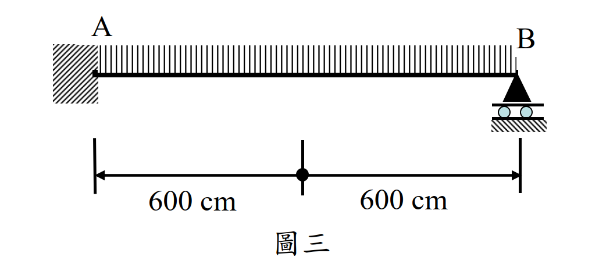

# SS-2021-3 題目正本

> 本檔只記錄**考卷上寫了什麼、圖上畫了什麼**，不含任何解法。解析見同資料夾 `SS-2021-3.md`。
> 判讀清單經使用者確認前，狀態為「待確認」；確認後本檔原則上不再修改（改動須回考卷原圖並記 log）。

| 項目 | 內容 |
|------|------|
| 考卷 | `raw/exams/SS-2021_鋼結構設計.pdf` 第 2 頁，第三題 |
| 考年 | 民國 110 年（2021） |
| 配分 | 45 分 |
| 附圖 | 1 張（圖三，梁立面），`SS-2021-3-fig-1.png`；表一以本檔 §2 文字表為準（證據圖未含表一） |
| 判讀狀態 | **已確認**（2026-11-02 使用者確認，含「不確定」項之解讀；轉錄同日，PyMuPDF 110 dpi 全頁＋關鍵尺寸 220–400 dpi 局部目視，盲讀後才比對既有解析） |

## 1. 考卷原文（逐字）

> 三、耐震結構系統中有一如圖三所示承受均布載重（$w$）之鋼梁，該鋼梁採用 SM490 鋼材，$F_y = 3.5\ \text{tf/cm}^2$，$F_u = 4.9\ \text{tf/cm}^2$，$F_r = 1.16\ \text{tf/cm}^2$，$E = 2040\ \text{tf/cm}^2$。該梁在 A 點與鋼柱彎矩接合處及 B 點有充分側向支撐。自表一選擇一符合極限設計法規範耐震設計需求且可有效發揮斷面性質之最適當斷面，並詳細說明原因，未說明原因者不予計分。請計算所選擇斷面塑性彎矩強度及形狀因子後，再依極限設計法規範檢核該斷面是否足以發揮其塑性極限強度，若無法發揮其塑性強度請說明如何改善以使其可發揮塑性極限強度；若可發揮其塑性強度亦請說明理由，並計算其塑性極限強度。（45 分）

## 2. 考卷給的公式、附表與參數

**表一**（照錄；單位見首欄）

| $d\times b_f\times t_w\times t_f$（mm） | BH 700×300×9×19 | BH 700×300×12×25 | BH 500×500×16×36 | BH 500×500×25×50 |
|---|---|---|---|---|
| $A$（cm²） | 156 | 228 | 428 | 600 |
| $J$（cm⁴） | 153 | 350 | 1610 | 4380 |
| $C_w\times10^3$（cm⁶） | 9910 | 12800 | 40400 | 52700 |
| $X_1$（tf/cm²） | 107 | 144 | 294 | 439 |
| $X_2$（(cm²/tf)²） | 5.82 | 1.82 | 0.0844 | 0.0185 |
| $I_x$（cm⁴） | 154000 | 198000 | 205000 | 268000 |
| $I_y$（cm⁴） | 8550 | 11300 | 75000 | 104000 |
| $r_x$（cm） | 29.8 | 29.5 | 21.9 | 21.1 |
| $r_y$（cm） | 7.02 | 7.03 | 13.2 | 13.2 |
| $r_T$（cm） | 7.99 | 8 | 14 | 14 |
| $S_x$（cm³） | 4400 | 5670 | 8180 | 10700 |
| $S_y$（cm³） | 570 | 751 | 3000 | 4170 |

**參考公式**（第 3 頁，印在第四題之後，全卷共用；照錄）：「參考公式：請自行選擇適合的公式，並檢查其正確性，若有問題應自行修正。」

$$C_b\left\{M_p - (M_p - M_r)\left[\frac{L_b - L_p}{L_r - L_p}\right]\right\} \le M_p,\ \phi = 0.9;\qquad C_b = 1.75 + 1.05(M_1/M_2) + 0.3(M_1/M_2)^2 \le 2.3$$

$$\lambda_{pd} = 14/\sqrt{F_y},\ \lambda_p = 17/\sqrt{F_y},\ \lambda_r = 37/\sqrt{F_y - F_r}$$

$$\lambda_{pd} = 138/\sqrt{F_y},\ \lambda_p = 170/\sqrt{F_y},\ \lambda_r = 260/\sqrt{F_y}$$

（考卷兩行並列、未標翼板或腹板；依數值為翼板、腹板兩組）

$$L_p = \frac{80r_y}{\sqrt{F_{yf}}},\ L_r = \frac{r_yX_1}{F_L}\sqrt{1+\sqrt{1+X_2F_L^2}},\ M_r = F_LS_x,\ F_L = (F_{yf} - F_r)\text{ 或 }F_{yw}\text{ 取小值}$$

$$M_{cr} = \frac{C_bS_xX_1\sqrt2}{L_b/r_y}\sqrt{1 + \frac{X_1^2X_2}{2(L_b/r_y)^2}}$$

（另有塊狀剪力兩式與 $\phi = 0.75$，屬他題。）考卷未印 $M_p$、$Z_x$、形狀因子或塑性機構的式子。

## 3. 附圖

*圖面文字照錄：A；B；600 cm；600 cm；圖三。*

## 4. 判讀清單

「把握」標**不確定**者請優先確認；解讀類項目（題目用字的意思）另標「解讀」。

| # | 項目 | 判讀 | 圖上／題文依據 | 把握 |
|---|------|------|---------------|------|
| 1 | A 端 | 固接（與鋼柱彎矩接合） | 左側牆面斜線剖面；題文「A 點與鋼柱彎矩接合處」 | 確定 |
| 2 | B 端 | 滾支 | 三角形＋兩個滾輪＋地面斜線 | 確定 |
| 3 | 跨度 | 1200 cm（600 + 600） | 兩段尺寸線 | 確定 |
| 4 | 跨中黑點 | 尺寸線分段點，**不是支承也不是側撐** | 黑點在尺寸線上、不在梁上；題文側撐只列 A、B | 確定 |
| 5 | 側向支撐 | 只在 A、B 兩點 → 未支撐長度 1200 cm | 題文 | 確定 |
| 6 | 載重 | 均布 $w$，滿跨 | 梁上方整排細線 | 確定 |
| 7 | 表一 BH700×300×9×19 之 $A$ | 照錄 156 cm²；以尺寸計為 173.6 cm²，考卷數值不一致 | 表一（尺寸核算為解讀） | 確定（照錄） |
| 8 | 「塑性彎矩強度」 | $M_p = F_yZ_x$（不乘 $\phi$） | 題文用字（解讀） | 不確定 → 使用者確認 |
| 9 | 「塑性極限強度」 | 梁形成崩塌機構時的極限載重 $w$（而非斷面 $M_p$） | 題文「計算其塑性極限強度」接在「足以發揮其塑性極限強度」之後（解讀） | 不確定 → 使用者確認 |

---

*轉錄：2026-11-02（U2-1 題目／解答拆分試做）｜確認：2026-11-02 使用者確認*
