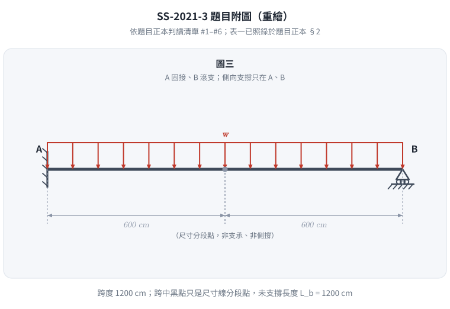
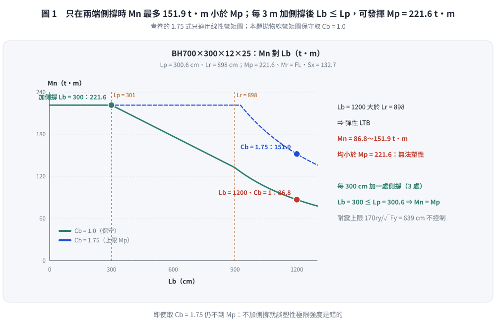
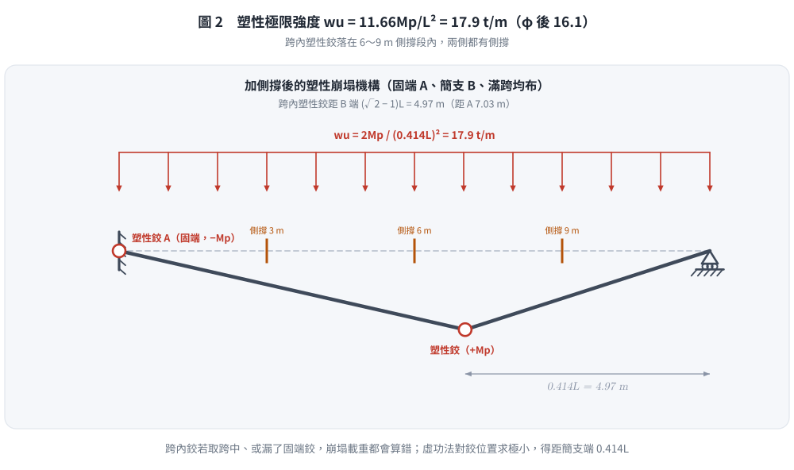

# 考題編號：SS-2021-3

**主分類：** `SS-U1-2` 梁桿件
**副分類：** `SS-U2-1` 塑性分析與設計
**設計法：** LRFD
**標籤：** `梁桿件` `耐震緊實斷面` `LTB側扭挫屈` `斷面選擇` `側扭挫屈` `形狀因子` `側向支撐` `SN耐震鋼材` `SM490` `塑性機構`

---

## 1. 題目（考卷原文見題目正本）

> 考卷原文、公式／附表、附圖與判讀清單（已確認）見 [`SS-2021-3-problem.md`](SS-2021-3-problem.md)。本節只列**解題時最容易讀錯的地方**與本解使用的記號；題意以題目正本為準。

*圖 1　題目附圖重繪（依題目正本判讀清單 #1–#6；表一已照錄於題目正本 §2，不重繪）。中間黑點為尺寸線分段點，非側撐。*

### 常見誤讀

| 項目 | 正確判讀 | 常見誤讀 |
|------|---------|---------|
| 跨中黑點 | 尺寸線分段點，**不是側撐**；側撐只在 A、B → $L_b = 1200$ cm | 當成側撐，取 $L_b = 600$ cm |
| 表一 | 全文照錄在題目正本 §2（附圖 `fig-1.png` 只有圖三） | 以為截圖含表一而漏抄數值 |
| BH700×300×9×19 之 $A$ | 考卷印 156 cm²，以尺寸計為 173.6 cm²（考卷數值不一致；此斷面被寬厚比淘汰，不影響答案） | 據以質疑整張表 |
| 「塑性極限強度」 | 梁形成崩塌機構時的極限載重 $w$ | 只答斷面 $M_p$ |

**本解記號：** $L = 1200$ cm（A 固接、B 滾支）；$F_y = 3.5$、$F_r = 1.16$、$E = 2040$ tf/cm²；選用斷面與表一性質見題目正本 §2。

---

## 2. 考題核心精神與出題者意圖 (Core Concepts & Examiner's Intent)

**核心觀念：耐震梁的三道門檻——寬厚比（λpd）→ 側向支撐（$L_b \le L_p$ 且符合耐震側撐間距）→ 塑性極限強度**

出題者要考生：
1. 用耐震緊實斷面 $\lambda_{pd}$（不是一般 $\lambda_p$）篩選；
2. 說出「哪一個斷面最適合當梁」的理由——強軸受彎要靠**深度**，同樣的鋼料放在離中性軸愈遠愈有效；
3. 算 $Z_x$、$M_p$、形狀因子；
4. 認出 $L_b = 12$ m 太長、無法發揮 $M_p$，並提出加側撐的具體做法；
5. 加側撐後計算塑性極限強度（塑性鉸機構）。

---

## 3. 解題戰略地圖與陷阱分析 (Strategic Roadmap & Trap Analysis)

**步驟規劃：**
1. 四斷面逐一檢核 $\lambda_{pd}$ → 淘汰 BH700×300×9×19
2. 比較剩餘三斷面的強軸受彎效率（$Z_x$／重量）→ 選 BH700×300×12×25
3. 算 $Z_x$、$M_p$、$f$
4. $L_p$、$L_r$ → $L_b = 1200 > L_r$ → 彈性 LTB，$M_n < M_p$
5. 改善：側撐間距 ≤ $L_p$ 且 ≤ 耐震限值 → 每 3 m 一處
6. 塑性極限強度：一端固接一端簡支受均布 → $w_u = 11.66M_p/L^2$

**關鍵陷阱：**

> ⚠️ **陷阱1：用一般 $\lambda_p$ 而非耐震 $\lambda_{pd}$。** 翼板 $14/\sqrt{F_y} = 7.48$、腹板 $138/\sqrt{F_y} = 73.8$。

> ⚠️ **陷阱2：$L_r$ 公式代 $r_T$。** 考卷印的 $L_r$ 式用的是 $r_y$（LRFD 的 $X_1$、$X_2$ 體系）；$r_T$ 是 ASD $F_b$ 公式用的。

> ⚠️ **陷阱3：「有效發揮斷面性質」誤解為「選 $r_y$ 最大」。** 寬翼 500×500 的 $r_y$ 大、$L_p$ 長，但它的鋼料多放在翼板寬度方向，強軸受彎的 $Z_x$／重量比明顯較低；作為耐震梁，側撐本來就必須加，$L_p$ 長短不是決定性因素。

> ⚠️ **陷阱4：中點圓點當成側撐。** 那是尺寸線標記；題文明言只有 A、B 有側撐。

---

## 3.5 變數層次分析（Variable Hierarchy Analysis）

> 複習提示：解題後，在每個卡住的知識點「卡關?」欄標記 `⚠`；第二次複習時只看有 `⚠` 的項目。

**最終目標：** $\lambda_{pd}$ 篩選 → 選斷面（附理由）→ $Z_x$、$M_p$、$f$ → $L_b$ 檢核 → 改善 → 塑性極限強度

### 主要公式（$\boxed{\phantom{x}}$ = 未知，待推導）

$$\lambda_{pdf} = \frac{14}{\sqrt{F_y}},\quad \lambda_{pdw} = \frac{138}{\sqrt{F_y}},\qquad \boxed{Z_x} = b_ft_f(d - t_f) + \frac{t_wh_w^2}{4},\quad \boxed{M_p} = F_yZ_x,\quad \boxed{f} = \frac{Z_x}{S_x}$$

$$L_p = \frac{80r_y}{\sqrt{F_y}},\quad L_r = \frac{r_yX_1}{F_L}\sqrt{1 + \sqrt{1 + X_2F_L^2}},\quad \boxed{w_u} = \frac{11.66M_p}{L^2}$$

### L1：題目直接給定

| 符號 | 數值 | 說明 |
|------|------|------|
| $F_y$、$F_r$、$E$ | 3.5、1.16、2040 tf/cm² | SM490 |
| 支承 | A 固接（梁柱彎矩接合）、B 滾支 | 一端固一端簡支 |
| $L$ | 1200 cm | 全跨 |
| 側撐 | A、B | $L_b = 1200$ cm |
| 斷面 | 表一四種 | 含 $X_1$、$X_2$、$r_y$、$S_x$ |

### L2：需知識點推導

| 符號 | 公式 / 來源 | 卡關? |
|------|------------|:-----:|
| $\lambda_{pdf}$、$\lambda_{pdw}$ | 7.48、73.8 | |
| BH700×300×9×19 | 翼板 7.89 > 7.48 → 淘汰 | |
| 其餘三斷面 | 皆符合 $\lambda_{pd}$ | |
| 效率比較 | $Z_x/A$：700×300×12×25 = 27.8 cm；500×500×16×36 = 21.2；500×500×25×50 = 20.4 | ⚠ |
| 選定 | **BH700×300×12×25** | |
| $Z_x$ | $30 \times 2.5 \times 67.5 + 1.2 \times 65^2/4 = 6{,}330$ cm³ | |
| $M_p$、$f$ | 221.6 t·m、$6{,}330/5{,}670 = 1.116$ | |
| $L_p$、$L_r$ | 300.6 cm、898 cm | |
| $M_n$（$L_b = 1200$） | 彈性：$C_b = 1.0$ → 86.8 t·m（$C_b = 1.75$ → 151.9）< $M_p$ | |
| 改善 | 側撐間距 ≤ $\min(L_p,\ 170r_y/\sqrt{F_y}) = \min(300.6,\ 639)$ → 每 300 cm | ⚠ |
| 塑性極限 | $w_u = 11.66 \times 221.6/12^2 = 17.9$ t/m | |

### L3：深層知識（不懂就卡住）

| 知識點 | 說明 | 卡關? |
|--------|------|:-----:|
| 耐震 $\lambda_{pd}$ | 要維持大塑性轉角（約 0.03 rad）不局部挫屈，比 $\lambda_p$ 嚴 | |
| 強軸受彎效率 | $Z_x \approx A_fd + A_wd/4$，深度愈大愈有效 | |
| 耐震梁側撐間距 | 本國規範 13.6.7：上下翼板皆撐，$L_b \le 170r_y/\sqrt{F_y}$（$r_y$ cm、$F_y$ tf/cm²），側撐強度 ≥ 2% $F_yb_ft_f$，塑性鉸處另須側撐（AISC 341 為 $0.086r_yE/F_y$，勿混用） | |
| 一端固一端簡支塑性機構 | 固端與距簡支端 $0.414L$ 處形成塑性鉸，$w_u = 11.66M_p/L^2$ | |
| $C_b$ 公式適用 | 1.75 式假設段內彎矩線性變化；本題為拋物線，保守取 1.0 | |

---

## 4. 步驟化詳細計算過程 (Step-by-Step Detailed Calculation)

### Step 1：耐震緊實斷面檢核（$\lambda_{pd}$）

$$\lambda_{pdf} = \frac{14}{\sqrt{3.5}} = 7.48,\qquad \lambda_{pdw} = \frac{138}{\sqrt{3.5}} = 73.8$$

| 斷面 | $b_f/2t_f$ | $h/t_w$ | 結果 |
|------|:---:|:---:|:---:|
| BH700×300×9×19 | 7.89 > 7.48 | 73.6 | ❌ 翼板不合格 |
| BH700×300×12×25 | 6.00 | 54.2 | ✅ |
| BH500×500×16×36 | 6.94 | 26.8 | ✅ |
| BH500×500×25×50 | 5.00 | 16.0 | ✅ |

### Step 2：選擇最適當斷面

| 斷面 | $A$ (cm²) | 單位重 (kg/m) | $Z_x$ (cm³) | $M_p$ (t·m) | $Z_x/A$ (cm) | $L_p$ (cm) |
|------|:---:|:---:|:---:|:---:|:---:|:---:|
| **BH700×300×12×25** | 228 | 179 | 6,330 | 221.6 | **27.8** | 300.6 |
| BH500×500×16×36 | 428 | 336 | 9,085 | 318.0 | 21.2 | 564.5 |
| BH500×500×25×50 | 600 | 471 | 12,250 | 428.8 | 20.4 | 564.5 |

**選定 BH700×300×12×25**，理由：
1. **符合耐震緊實斷面**（翼板 6.00 < 7.48、腹板 54.2 < 73.8）。
2. **強軸受彎最有效**：每單位面積提供的塑性模數最大（27.8 cm，比寬翼斷面高 31%～36%），重量只有 500×500×16×36 的 53%。梁受強軸彎矩，鋼料應放在離中性軸遠處（深梁），寬翼 500×500 屬於柱用斷面。
3. 寬翼斷面雖然 $r_y$ 大、$L_p$ 較長，但耐震梁本來就要依耐震規定加側撐（見 Step 5），$L_p$ 的優勢不能抵銷 88% 的用鋼增加。
4. 耐震「強柱弱梁」也希望梁的 $M_p$ 不要無謂地大，避免柱子跟著加大。

> 若以「不加側撐時折減最少」為選擇準則，也可主張 BH500×500×16×36（$L_p = 565$ cm、$L_r = 2{,}465$ cm，$L_b = 1200$ 時 $M_n = 275.6$ t·m），但答案中須說明其用鋼量近乎加倍、且仍無法不加側撐就發揮 $M_p$。

### Step 3：塑性彎矩與形狀因子（BH700×300×12×25）

$$h_w = 70 - 2 \times 2.5 = 65\ \text{cm}$$

$$Z_x = b_ft_f(d - t_f) + \frac{t_wh_w^2}{4} = 30 \times 2.5 \times 67.5 + \frac{1.2 \times 65^2}{4} = 5{,}062.5 + 1{,}267.5 = \boxed{6{,}330\ \text{cm}^3}$$

$$M_p = F_yZ_x = 3.5 \times 6{,}330 = 22{,}155\ \text{tf}\cdot\text{cm} = \boxed{221.6\ \text{t}\cdot\text{m}}$$

$$f = \frac{Z_x}{S_x} = \frac{6{,}330}{5{,}670} = \boxed{1.116}$$

### Step 4：檢核能否發揮塑性強度（$L_b = 1200$ cm）

$$L_p = \frac{80 \times 7.03}{\sqrt{3.5}} = 300.6\ \text{cm},\qquad F_L = \min(3.5 - 1.16,\ 3.5) = 2.34\ \text{tf/cm}^2$$

$$L_r = \frac{7.03 \times 144}{2.34}\sqrt{1 + \sqrt{1 + 1.82 \times 2.34^2}} = 432.6 \times 2.076 = 898\ \text{cm}$$

$L_b = 1200 > L_r$ → 彈性 LTB：

$$M_{cr} = \frac{C_bS_xX_1\sqrt2}{L_b/r_y}\sqrt{1 + \frac{X_1^2X_2}{2(L_b/r_y)^2}},\qquad \frac{L_b}{r_y} = \frac{1200}{7.03} = 170.7$$

$$M_{cr}(C_b = 1) = \frac{5{,}670 \times 144 \times 1.414}{170.7}\sqrt{1 + \frac{144^2 \times 1.82}{2 \times 170.7^2}} = 6{,}764 \times 1.283 = 8{,}680\ \text{tf}\cdot\text{cm} = 86.8\ \text{t}\cdot\text{m}$$

**$C_b$：** A 端負彎矩 $wL^2/8 = 18w$，跨內正彎矩最大 $9wL^2/128 = 10.1w$，彎矩圖為拋物線（中間有反曲點），考卷的 1.75 式只適用於線性彎矩圖。保守取 $C_b = 1.0$；即使以 1.75 式（$M_1/M_2 = 0$）取 1.75，$M_{cr} = 151.9$ t·m 仍小於 $M_p = 221.6$ t·m。

$$\boxed{M_n < M_p\quad\Rightarrow\quad\text{無法發揮塑性極限強度}}$$

### Step 5：改善方式

1. **增設中間側向支撐**，使每段 $L_b \le L_p = 300.6$ cm，同時滿足本國耐震梁側撐間距限制（13.6.7）$L_b \le 170r_y/\sqrt{F_y} = 170 \times 7.03/\sqrt{3.5} = 639$ cm；本題由 $L_p$ 控制。
2. 取每 **300 cm** 一處（距 A 端 3、6、9 m，共 3 處），各段 $L_b = 300 \le 300.6$ cm → $M_n = M_p$。
3. 塑性鉸位置（A 端與距 B 端約 $0.414L = 4.97$ m 處，即距 A 約 7.0 m）附近也要有側撐：A 端由梁柱接頭提供，正彎矩鉸落在 6～9 m 段內，兩端皆有側撐。
4. 側撐須同時拘束**上下翼板**（或以樓板＋下翼板角撐），且側撐強度 ≥ 2% $F_yb_ft_f$（13.6.7）。

*圖 1　只在兩端側撐時 $M_n$ 最多 151.9 t·m，小於 $M_p = 221.6$ t·m；每 3 m 加一處側撐，$L_b = 300 \le L_p = 300.6$ cm，才能發揮 $M_p$。這張圖攔的是不加側撐就用 $M_p$、$C_b$ 直接取 1.75，或側撐間距只看耐震上限 639 cm。*

### Step 6：塑性極限強度

側撐後各段皆可發揮 $M_p$。一端固接、一端簡支梁受均布載重的塑性機構：固端塑性鉸＋跨內塑性鉸（距簡支端 $x = (\sqrt2 - 1)L = 0.414L$）：

$$w_u = \frac{2M_p}{x^2} = \frac{2M_p}{(0.414L)^2} = \frac{11.66M_p}{L^2} = \frac{11.66 \times 221.6}{12^2} = \boxed{17.9\ \text{t/m}}$$

（以設計強度計 $\phi_b = 0.9$：16.1 t/m。）

**雙路徑驗算（虛功法）：** 設跨內鉸在距 B 端 $x$，令 $\theta_B = \delta/x$、$\theta_A = \delta/(L - x)$，內功 $M_p[\theta_A + (\theta_A + \theta_B)]$，外功 $w L\delta/2$ → $w = \dfrac{2M_p(2L - x)}{Lx(L - x)}$，對 $x$ 求極小得 $x = 0.586L$（距 A）= 0.414L（距 B），$w_u = 11.66M_p/L^2$ ✔。

*圖 2　塑性崩塌機構：固端鉸＋距簡支端 $0.414L = 4.97$ m 的跨內鉸，$w_u = 11.66M_p/L^2 = 17.9$ t/m（$\phi$ 後 16.1）。這張圖攔的是把跨內鉸放在跨中，或漏了固端鉸。*

### 計算彙整

| 項目 | 數值 |
|------|------|
| 選定斷面 | BH700×300×12×25 |
| 耐震寬厚比 | 翼板 6.00／7.48、腹板 54.2／73.8 ✓ |
| $Z_x$ | 6,330 cm³ |
| $M_p$ | 221.6 t·m |
| 形狀因子 $f$ | 1.116 |
| $L_p$／$L_r$ | 300.6／898 cm |
| $L_b = 1200$ cm | 彈性 LTB，$M_n$ = 86.8（$C_b = 1$）～151.9（$C_b = 1.75$）t·m < $M_p$ |
| 改善 | 每 300 cm 加側撐（3 處），上下翼板皆撐 |
| 塑性極限強度 | $w_u = 17.9$ t/m（$\phi$ 後 16.1） |

---

## 5. 關鍵爭議點與進階探討 (Critical Issues & Advanced Discussion)

### 舊版解析的錯誤

| 項目 | 舊解 | 更正 |
|---|---|---|
| 選擇理由 | BH500×500×16×36「$r_y$ 最大、**最輕**」 | 它的 $A = 428$ cm²，是合格三斷面中第二重，並非最輕；最輕且強軸受彎最有效的是 BH700×300×12×25（228 cm²） |
| $L_r$ | 以 $r_T$ 代入（得 1,023／2,615 cm） | 考卷式用 $r_y$：898／2,465 cm |
| 改善 | 每 400 cm 側撐 | 若選 500×500，400 cm ≤ $L_p$ 565 且 ≤ 本國耐震限值 $170r_y/\sqrt{F_y}$ = 1,200 cm 可行；若選 700×300，需 300 cm |
| 塑性極限強度 | 只給 $\phi_bM_p$ | 題目要「塑性極限強度」，應給塑性機構載重 $w_u$ |

### 耐震設計的 $\lambda_{pd}$ 為何比 $\lambda_p$ 更嚴格？

一般 $\lambda_p$ 只保證能到達 $M_p$；耐震梁要在反覆載重下維持塑性轉角（約 0.03 rad）而不局部挫屈，翼板、腹板寬厚比都要更小。

### 考場安全答法

1. 寫出 $\lambda_{pd}$ 兩個值並淘汰 BH700×300×9×19。
2. 寫「最適當」的理由：符合 $\lambda_{pd}$、強軸受彎最有效（$Z_x$／重量最大）、最輕。
3. $Z_x$、$M_p$、$f$。
4. $L_b = 1200 > L_p$（甚至 $> L_r$）→ 不能發揮 $M_p$。
5. 加側撐：間距 ≤ $L_p$ 且 ≤ $170r_y/\sqrt{F_y}$（本國 13.6.7），上下翼板皆撐。
6. 塑性極限強度 $w_u = 11.66M_p/L^2$。

---

## 6. 依最新規範（AISC 360-16／-22、AISC 341）對照

| 項目 | 考卷（我國極限設計法） | AISC 360-16／341-16 |
|:---|:---|:---|
| 耐震寬厚比 | $\lambda_{pd}$：翼板 $14/\sqrt{F_y}$（≈ $0.30\sqrt{E/F_y}$） | 341 表 D1.1 高韌性：翼板 $0.32\sqrt{E/R_yF_y}$、腹板 $2.57\sqrt{E/R_yF_y}$（純彎） |
| 側撐間距 | 13.6.7：$170r_y/\sqrt{F_y}$ = 639 cm | 341 §D1.2b 高韌性梁 $L_b \le 0.095r_yE/(R_yF_y)$（341-10 為 $0.086r_yE/F_y$） |
| $L_p$、$L_r$ | $80r_y/\sqrt{F_y}$、$X_1$/$X_2$ | $1.76r_y\sqrt{E/F_y}$、$r_{ts}$ 式 |
| 本題 | 選 BH700×300×12×25，側撐 @300 cm | 以 $R_y = 1.1$ 計，341-16 間距 $\le 0.095 \times 7.03 \times 2040/(1.1 \times 3.5) = 354$ cm，結論相同 |

---

*修正日期：2026-11-01（原解選 BH500×500×16×36 之理由「最輕」與表一不符（A = 428 cm²，非最輕），且 $L_r$ 改用 $r_T$ 與考卷公式不符；依強軸受彎效率與用鋼量改選 **BH700×300×12×25**（$Z_x$ = 6,330 cm³、$M_p$ = 221.6 t·m、$f$ = 1.116），$L_b$ = 12 m 彈性 LTB 不能發揮 $M_p$，改善為每 300 cm 側撐（並符合 $0.086r_yE/F_y$ = 352 cm），塑性極限強度 $w_u$ = 11.66$M_p/L^2$ = **17.9 t/m**；並列 BH500×500×16×36 之替代論述；指出題表 BH700×300×9×19 面積數字有誤；新增虛功法驗算與 §6 對照）*
*修正日期：2026-11-01（第二次：耐震梁側撐間距原引 AISC 341-10 之 $0.086r_yE/F_y$ = 352 cm，更正為本國《鋼結構極限設計法》13.6.7 之 $170r_y/\sqrt{F_y}$ = 639 cm 與側撐強度 2% $F_yb_ft_f$；本題仍由 $L_p$ = 300.6 cm 控制，每 300 cm 側撐、$w_u$ = 17.9 t/m 結論不變）*
*圖解補繪：2026-11-03（向量圖 2 張，腳本 `gen_SS-2021-3.py`，改輸入可原地重跑；SVG 供 wiki／PDF，2× PNG 供 pptx／影片）*
*驗證狀態：unverified*

*修正日期：2026-11-02（§1 全文重述改為指向題目正本 `SS-2021-3-problem.md`（已確認）＋常見誤讀＋本解記號，避免題意兩份不同步；解題內容與答案不變）*

*修正日期：2026-11-03（§1 補入題目附圖重繪 `figs/SS-2021-3-fig-1-problem.svg`（依已確認的題目正本判讀清單，腳本 `gen_SS-2021-3.py`，可重跑）；解題內容與答案不變）*
