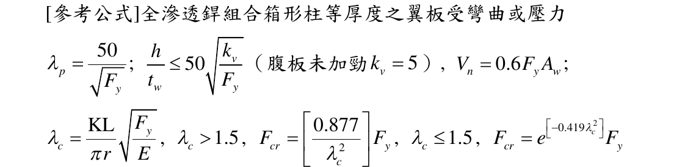

# SS-2022-1 題目正本

> 本檔只記錄**考卷上寫了什麼、圖上畫了什麼**，不含任何解法。解析見同資料夾 `SS-2022-1.md`。
> 判讀清單經使用者確認前，狀態為「待確認」；確認後本檔原則上不再修改（改動須回考卷原圖並記 log）。

| 項目 | 內容 |
|------|------|
| 考卷 | `raw/exams/SS-2022_鋼結構設計.pdf` 第 1 頁（頁次 2－1），第一題 |
| 考年 | 民國 111 年（2022） |
| 配分 | 25 分 |
| 附圖 | 無；題內參考公式截圖 `SS-2022-1-eqn-1.png` |
| 判讀狀態 | **待確認**（轉錄 2026-11-02，PyMuPDF 110 dpi 全頁目視＋抽出文字核對，盲讀後才比對既有解析） |

## 1. 考卷原文（逐字）

> （註：題目所列之計算公式僅供參考應自負確認與勘誤責任，另視設計需求可自行假設適用的條件等）
>
> 一、已知鋼柱斷面為 BOX 800 × 800 × 32(mm)，受壓有效長細比 $(KL/r)_{eff}$ 為 30.54，且設計配置有充分的側向支撐與束制。使用的鋼板降伏強度 $F_y$ = 3.3 tf/cm² 而楊氏係數 $E$ = 2040 tf/cm²。載重組合後經分析的係數化載重 $P_{u1}$ = -1119 tf，$M_{u2}$ = -179 tf-m，$M_{u3}$ = -19.4 tf-m，$V_{u2}$ = -86.77 tf，$V_{u3}$ = -9.14 tf。試依極限強度設計（LRFD）法，分析與檢核鋼柱之設計強度是否適足。（25 分）

## 2. 考卷給的公式、附表與參數

- 題文：BOX 800×800×32 mm；$(KL/r)_{eff}$ = 30.54；$F_y$ = 3.3、$E$ = 2040 tf/cm²；$P_{u1}$、$M_{u2}$、$M_{u3}$、$V_{u2}$、$V_{u3}$（照錄於 §1）。
- 「[參考公式]全滲透銲組合箱形柱等厚度之翼板受彎曲或壓力」照錄：

$$\lambda_p = \frac{50}{\sqrt{F_y}};\quad \frac{h}{t_w} \le 50\sqrt{\frac{k_v}{F_y}}\ \text{（腹板未加勁}\ k_v = 5\text{）},\quad V_n = 0.6F_yA_w;$$
$$\lambda_c = \frac{KL}{\pi r}\sqrt{\frac{F_y}{E}},\quad \lambda_c > 1.5,\ F_{cr} = \left[\frac{0.877}{\lambda_c^2}\right]F_y,\quad \lambda_c \le 1.5,\ F_{cr} = e^{\left[-0.419\lambda_c^2\right]}F_y$$

  

- **沒有給 $\phi$、軸力彎矩交互式、$M_n$ 式、二階放大（$B_1$、$B_2$）資料**。
- 卷首注意事項：㈠可以使用電子計算器；㈡不必抄題；㈢本科目除專門名詞或數理公式外，應使用本國文字作答；另卷首註：題目所列之計算公式僅供參考應自負確認與勘誤責任，另視設計需求可自行假設適用的條件等。

## 3. 附圖

本題無附圖。

## 4. 判讀清單

「把握」標**不確定**者請優先確認；解讀類項目（題目用字的意思）另標「解讀」。

| # | 項目 | 判讀 | 圖上／題文依據 | 把握 |
|---|------|------|---------------|------|
| 1 | 斷面 | 方形箱型，外寬 800 mm、板厚 32 mm（四面等厚） | 題文 | 確定 |
| 2 | 下標 1、2、3 | 分析軟體構件局部軸（1 = 軸向、2／3 = 兩斷面軸）；方形斷面兩軸性質相同 | 題文符號 | 確定（解讀） |
| 3 | 負號 | $P_{u1}$ 負值 = 壓力；彎矩、剪力負號只表方向，檢核取絕對值 | 題文「受壓有效長細比」 | 確定（解讀） |
| 4 | 有效長細比 | 直接用 $(KL/r)_{eff}$ = 30.54，兩軸共用 | 題文 | 確定 |
| 5 | 側向支撐 | 「充分的側向支撐與束制」→ 不考慮 LTB | 題文 | 確定（解讀） |
| 6 | 二階效應 | 題未給放大資料；分析彎矩是否已含二階效應題未說明 | 題文 | 不確定（解讀） |
| 7 | 檢核範圍 | 寬厚比、軸壓、雙軸彎曲交互、兩向剪力（題給 $V_n$ 式與 $V_{u2}$、$V_{u3}$） | 題文＋參考公式 | 確定（解讀） |

---

*轉錄：2026-11-02（SS-U1-3 題目正本推廣・批 2）*
