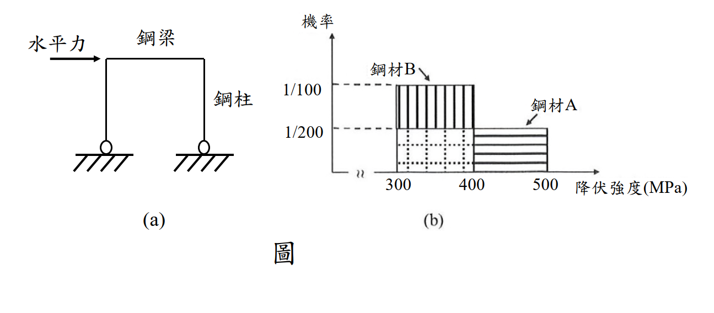

# SS-2022-4 題目正本

> 本檔只記錄**考卷上寫了什麼、圖上畫了什麼**，不含任何解法。解析見同資料夾 `SS-2022-4.md`。
> 判讀清單經使用者確認前，狀態為「待確認」；確認後本檔原則上不再修改（改動須回考卷原圖並記 log）。

| 項目 | 內容 |
|------|------|
| 考卷 | `raw/exams/SS-2022_鋼結構設計.pdf` 第 2 頁（頁次 2－2），第四題 |
| 考年 | 民國 111 年（2022） |
| 配分 | 25 分 |
| 附圖 | 1 張（(a) 門型構架、(b) 兩鋼材降伏強度分布），`SS-2022-4-fig-1.png` |
| 判讀狀態 | **待確認**（轉錄 2026-11-03，PyMuPDF 110 dpi 全頁＋附圖 400 dpi 局部目視（附圖為 623×330 點陣圖）＋抽出文字核對，盲讀後才比對既有解析） |

## 1. 考卷原文（逐字）

> 四、設計考慮如圖(a)的鉸支承門型抗彎鋼構架受地震水平力作用時，鋼梁比鋼柱先降伏且在梁端形成塑鉸。為達上述「強柱弱梁」設計目標，選擇使鋼柱的塑性斷面模數為鋼梁的 1.25 倍。兩種鋼材的降伏強度分布如圖(b)所示。假設鋼梁與鋼柱的製作屬統計上之獨立事件。試分別針對鋼材 A 與鋼材 B，分析柱與梁使用同一種鋼材製作卻未達設計目標變「強梁弱柱」之機率，並說明限制鋼材降伏強度範圍的意義。（25 分）

## 2. 考卷給的公式、附表與參數

- 題文：$Z_{\text{柱}} = 1.25\,Z_{\text{梁}}$；梁、柱製作為統計獨立。
- 圖(b)：縱軸「機率」刻度 1/100、1/200；橫軸「降伏強度(MPa)」刻度 300、400、500。
- 卷首注意事項：㈠可以使用電子計算器；㈡不必抄題；㈢本科目除專門名詞或數理公式外，應使用本國文字作答。另卷首註：題目所列之計算公式僅供參考應自負確認與勘誤責任，另視設計需求可自行假設適用的條件等。

## 3. 附圖

*圖面文字照錄：水平力；鋼梁；鋼柱；(a)；機率；鋼材B；鋼材A；1/100；1/200；300；400；500；降伏強度(MPa)；(b)；圖。*

## 4. 判讀清單

「把握」標**不確定**者請優先確認；解讀類項目（題目用字的意思）另標「解讀」。

| # | 項目 | 判讀 | 圖上／題文依據 | 把握 |
|---|------|------|---------------|------|
| 1 | 鋼材 B 分布 | 300～400 MPa 均勻分布，縱軸值 1/100 | 圖(b) 直線陰影矩形（400 dpi） | 確定 |
| 2 | 鋼材 A 分布 | 300～500 MPa 均勻分布，縱軸值 1/200（300～400 段以點線格畫在 B 之下） | 點線格與水平陰影同高 1/200，A 標籤指 400～500 段 | 確定（解讀） |
| 3 | 縱軸意義 | 「機率」實為每 MPa 的機率密度（B：100×1/100 = 1；A：200×1/200 = 1） | 面積檢核 | 確定（解讀） |
| 4 | 失敗定義 | 「強梁弱柱」：柱的塑性彎矩小於梁（$1.25F_{y,\text{柱}} < F_{y,\text{梁}}$） | 題文 | 確定（解讀） |
| 5 | 同一鋼材 | 柱與梁皆用 A，或皆用 B，分別計算 | 題文「分別針對」 | 確定 |
| 6 | 圖(a) | 只是情境示意，無尺寸數值 | 圖 | 確定 |

---

*轉錄：2026-11-03（SS-U2-2 題目正本推廣・批 1）*
