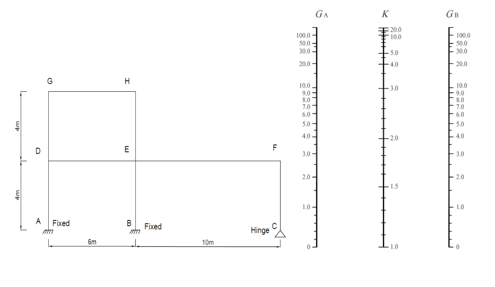

# SS-2023-1 題目正本

> 本檔只記錄**考卷上寫了什麼、圖上畫了什麼**，不含任何解法。解析見同資料夾 `SS-2023-1.md`。
> 判讀清單經使用者確認前，狀態為「待確認」；確認後本檔原則上不再修改（改動須回考卷原圖並記 log）。

| 項目 | 內容 |
|------|------|
| 考卷 | `raw/exams/SS-2023_鋼結構設計.pdf` 第 1 頁（頁次 2－1），第一題 |
| 考年 | 民國 112 年（2023） |
| 配分 | 25 分 |
| 附圖 | 1 張（構架圖＋$G_A$–$K$–$G_B$ 對位圖），`SS-2023-1-fig-1.png` |
| 判讀狀態 | **已確認**（2026-11-02 使用者確認，含「不確定」項之解讀；轉錄同日，PyMuPDF 110 dpi 全頁＋構架 300 dpi 局部目視，盲讀後才比對既有解析） |

## 1. 考卷原文（逐字）

> 一、計算精確的有效長度係數，在鋼結構設計中相當重要。請用查圖的方法，試求下圖結構各柱子之有效長度係數（K）。鉸接（hinge）時，G 可用 10，固接（fixed）時，G 可用 1。（25 分）
>
> 柱與梁之 I 值表（單位：cm⁴）
>
> |  | 柱 AD、BE and CF | 柱 DG and EH | 梁 EF | 梁 DE and GH |
> |---|---|---|---|---|
> | I 值 | 16000 | 3000 | 17000 | 35000 |

## 2. 考卷給的公式、附表與參數

- I 值表（照錄於 §1）。
- 支承的 $G$：鉸接 10、固接 1（題文）。
- 對位圖一張（$G_A$、$K$、$G_B$ 三軸；$K$ 軸刻度由 1.0 到 20.0，即側移構架版本），**沒有印對位圖公式**。
- 卷首注意事項：㈠可用計算器、㈡不必抄題、㈢除專門名詞或數理公式外應使用本國文字作答。

## 3. 附圖

*圖面文字照錄：G；H；D；E；F；A；B；C；Fixed；Fixed；Hinge；4m；4m；6m；10m；$G_A$；$K$；$G_B$；對位圖刻度（$G$ 軸 0～100.0，$K$ 軸 1.0～20.0）。*

## 4. 判讀清單

「把握」標**不確定**者請優先確認；解讀類項目（題目用字的意思）另標「解讀」。

| # | 項目 | 判讀 | 圖上／題文依據 | 把握 |
|---|------|------|---------------|------|
| 1 | 支承 | A、B 固接（斜線地面符號＋「Fixed」）；C 鉸支（三角形＋「Hinge」） | 構架圖（300 dpi） | 確定 |
| 2 | 構件與長度 | 柱 AD、BE、CF 各 4 m；柱 DG、EH 各 4 m；梁 DE 6 m、EF 10 m、GH 6 m | 構架圖尺寸線 | 確定 |
| 3 | 節點 | D、E、F、G、H 皆為剛接（圖上無鉸接符號） | 構架圖 | 確定 |
| 4 | 二樓範圍 | 只有左跨（D–G、E–H、G–H）；F 只接柱 CF 與梁 EF | 構架圖 | 確定 |
| 5 | 側移／無側移 | 側移構架：題文未說，但所附對位圖 $K$ 軸自 1.0 起（側移版） | 對位圖刻度 | 確定（解讀） |
| 6 | 所求 | 五根柱 AD、BE、CF、DG、EH 各自的 $K$（查圖） | 題文「各柱子」 | 確定 |
| 7 | 梁遠端修正 | 查圖前梁勁度是否依遠端條件修正（例如遠端 F 只接一柱） | 題文未提 | 不確定 → 使用者確認：不修正，直接用 $I/L$（同本解） |

---

*轉錄：2026-11-02（SS-U1-1 題目正本推廣・批 3）｜確認：2026-11-02 使用者確認*
