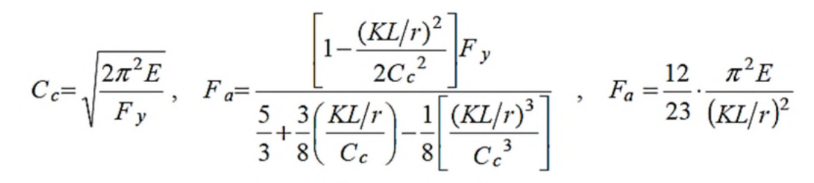

# SS-2023-2 題目正本

> 本檔只記錄**考卷上寫了什麼、圖上畫了什麼**，不含任何解法。解析見同資料夾 `SS-2023-2.md`。
> 判讀清單經使用者確認前，狀態為「待確認」；確認後本檔原則上不再修改（改動須回考卷原圖並記 log）。

| 項目 | 內容 |
|------|------|
| 考卷 | `raw/exams/SS-2023_鋼結構設計.pdf` 第 2 頁（頁次 2－2），第二題 |
| 考年 | 民國 112 年（2023） |
| 配分 | 25 分（㈠ 15、㈡ 10） |
| 附圖 | 無；題內參考公式為圖片，截圖 `SS-2023-2-eqn-1.png` |
| 判讀狀態 | **已確認**（2026-11-02 使用者確認，含「不確定」項之解讀；轉錄同日，PyMuPDF 110 dpi 全頁＋公式 200 dpi 局部目視，盲讀後才比對既有解析） |

## 1. 考卷原文（逐字）

> 二、有一 H 型鋼柱承受靜載軸壓 PD、活載軸壓 PL。柱長 650 cm，假設 $K_x = K_y = 1.0$。柱斷面為 H400×300×14×21，斷面性質 $A = 182$ cm²，$I_x = 52510$ cm⁴，$I_y = 9840$ cm⁴，$r_x = 17$ cm，$r_y = 7.4$ cm。鋼材 $F_y = 3.5$ tf/cm²，$E = 2040$ tf/cm²。
> ㈠請依 ASD 規範判斷挫屈型態。（15 分）
> ㈡柱長應該修改為多少？才能讓本題之挫屈型態位於柱標稱強度曲線圖上，彈性挫屈與非彈性挫屈之交界點？（10 分）
> ※參考公式：請自行選擇適合的公式，並檢查其正確性，若有問題應自行修正。

## 2. 考卷給的公式、附表與參數

- 題文：$L = 650$ cm，$K_x = K_y = 1.0$，H400×300×14×21，$A = 182$ cm²，$I_x = 52510$ cm⁴，$I_y = 9840$ cm⁴，$r_x = 17$ cm，$r_y = 7.4$ cm，$F_y = 3.5$ tf/cm²，$E = 2040$ tf/cm²。
- 題內參考公式（圖片，照錄）：

$$C_c = \sqrt{\frac{2\pi^2E}{F_y}},\qquad F_a = \frac{\left[1 - \dfrac{(KL/r)^2}{2C_c^2}\right]F_y}{\dfrac53 + \dfrac38\left(\dfrac{KL/r}{C_c}\right) - \dfrac18\left[\dfrac{(KL/r)^3}{C_c^3}\right]},\qquad F_a = \frac{12}{23}\cdot\frac{\pi^2E}{(KL/r)^2}$$

  公式**未標適用範圍**（$KL/r$ 與 $C_c$ 的分界考卷沒寫）。

  
- $P_D$、$P_L$ **只有符號、沒有數值**。
- 卷首注意事項：㈠可用計算器、㈡不必抄題、㈢除專門名詞或數理公式外應使用本國文字作答。

## 3. 附圖

本題無附圖（同頁第三題的梁斷面圖與本題無關；第三題另給 $E_y = 2050$，不用於本題）。

## 4. 判讀清單

「把握」標**不確定**者請優先確認；解讀類項目（題目用字的意思）另標「解讀」。

| # | 項目 | 判讀 | 圖上／題文依據 | 把握 |
|---|------|------|---------------|------|
| 1 | $P_D$、$P_L$ | 無數值，㈠只判斷挫屈型態，不做載重檢核 | 題文 | 確定（解讀） |
| 2 | 柱長與 $K$ | 兩軸無支長度都是 650 cm，$K_x = K_y = 1.0$ | 題文 | 確定 |
| 3 | $r$ | 直接用題給 $r_x = 17$、$r_y = 7.4$ cm（不由斷面尺寸重算） | 題文 | 確定（解讀） |
| 4 | 「挫屈型態」 | 以控制軸 $KL/r$ 與 $C_c$ 比較：$KL/r \le C_c$ 非彈性、$> C_c$ 彈性 | 題文＋參考公式 | 確定（解讀） |
| 5 | ㈡「交界點」 | 控制軸 $KL/r = C_c$；兩軸 $K$ 相同，以弱軸 $r_y$ 反求 $L$ | 題文 | 確定（解讀） |
| 6 | 斷面標示 | H400×300×14×21 ＝ $d \times b_f \times t_w \times t_f$（mm） | 國內 H 型鋼標示慣例 | 確定 |

---

*轉錄：2026-11-02（SS-U1-1 題目正本推廣・批 3）｜確認：2026-11-02 使用者確認*
