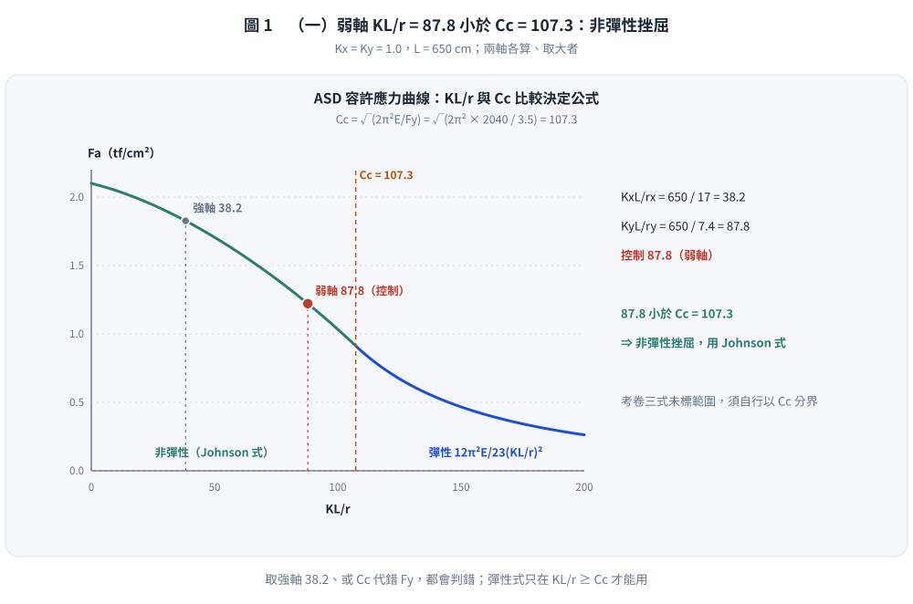
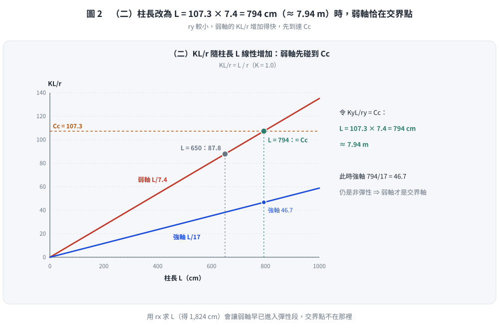

# 考題編號：SS-2023-2

**主分類：** `SS-U1-1` 拉力及壓力桿件
**副分類：** 無
**設計法：** ASD
**標籤：** `壓力桿件` `ASD` `整體挫屈` `彈性挫屈` `非彈性挫屈` `Cc` `有效長細比` `柱強度曲線` `挫屈型態` `交界點`

---

## 1. 題目（考卷原文見題目正本）

> 考卷原文、公式／附表、附圖與判讀清單（已確認）見 [`SS-2023-2-problem.md`](SS-2023-2-problem.md)。本節只列**解題時最容易讀錯的地方**與本解使用的記號；題意以題目正本為準。

### 常見誤讀

| 項目 | 正確判讀 | 常見誤讀 |
|------|---------|---------|
| $P_D$、$P_L$ | 沒有數值，只判斷挫屈型態 | 自行假設載重做檢核 |
| $r$ | 用題給 $r_x = 17$、$r_y = 7.4$ cm | 由斷面尺寸重算 |
| 控制軸 | $K_x = K_y$，弱軸 $KL/r_y = 87.8$ 控制 | 只算強軸 38.2 |
| 交界點 | $KL/r = C_c = 107.5$ → $L = C_c\,r_y$ | 以 $r_x$ 反求 |

**本解記號：** $L = 650$ cm；$K = 1.0$；$r_x = 17$、$r_y = 7.4$ cm；$F_y = 3.5$、$E = 2040$ tf/cm²；$C_c = 107.5$。

---

## 2. 考題核心精神與出題者意圖 (Core Concepts & Examiner's Intent)

**核心觀念：以 Cc（臨界細長比）為分界，KL/r < Cc 為非彈性挫屈，KL/r > Cc 為彈性挫屈**

ASD 柱設計的核心判斷：
- 計算 $C_c = \sqrt{2\pi^2 E/F_y}$（與材料相關，與幾何無關）
- 計算 $KL/r$（取弱軸或大值，即控制長細比）
- 比較：$KL/r$ vs $C_c$

物理意義：
- $C_c$ 對應「**彈性挫屈強度 = 降伏強度的一半**」的臨界長細比（$F_{cr} = F_y/2$ 時）
- $KL/r < C_c$：Euler 挫屈應力 > $F_y/2$，殘留應力影響顯著 → **非彈性挫屈**（Johnson 曲線）
- $KL/r > C_c$：Euler 挫屈應力 < $F_y/2$，材料仍彈性 → **彈性挫屈**（Euler 曲線）

**出題者測驗重點：**
1. 能計算 $C_c$（使用 $F_y$ 和 $E$ 的正確單位）
2. 能判斷弱軸控制（$r_y < r_x$ → $KL/r_y > KL/r_x$）
3. 能反推交界點對應的柱長（令 $KL/r = C_c$，解 L）

---

## 3. 解題戰略地圖與陷阱分析 (Strategic Roadmap & Trap Analysis)

**作戰計畫：**
1. 計算 $C_c$
2. 計算兩軸的 $KL/r$，取大值（弱軸控制）
3. 比較 $KL/r$ 與 $C_c$，判斷挫屈型態
4. 反推交界點柱長：令 $KL/r_{\min} = C_c$，解 L

**關鍵陷阱：**

> ⚠️ **陷阱1：弱軸判斷**
> $r_y = 7.4 \text{ cm} < r_x = 17 \text{ cm}$，弱軸（y 軸）產生較大的 $KL/r$，**弱軸控制**。

> ⚠️ **陷阱2：題目說「參考公式請自行選擇並檢查正確性」**
> 考卷提供了兩個 $F_a$ 公式，第一個用於 $KL/r \leq C_c$（非彈性），第二個用於 $KL/r > C_c$（彈性）。判斷挫屈型態後，**只需寫出應使用哪個公式**，不需實際代入計算 $F_a$（題目只問判斷）。

> ⚠️ **陷阱3：交界點反推時，用弱軸 $r_y$ 還是強軸 $r_x$？**
> 弱軸控制 → 交界點條件 $KL/r_y = C_c$，用 $r_y = 7.4 \text{ cm}$ 反推。

---

## 3.5 變數層次分析（Variable Hierarchy Analysis）

> 複習提示：解題後，在每個卡住的知識點「卡關?」欄標記 `⚠`；第二次複習時只看有 `⚠` 的項目。

**最終目標：** ①算 Cc 及 KL/r 判斷 ASD 挫屈型態；②反推使 KL/r = Cc 的交界點柱長

### 主要公式（$\boxed{\phantom{x}}$ = 未知，待推導）

$$\boxed{C_c} = \sqrt{\frac{2\pi^2 E}{F_y}}, \quad \boxed{KL/r} = K \times L / r_{min}$$
$$KL/r \lessgtr C_c \Rightarrow \text{非彈性 / 彈性挫屈}$$
$$L_{交界} = C_c \times r_{min} / K$$

### L1：題目直接給定

| 符號 | 數值 | 說明 |
|------|------|------|
| $L$ | 650 cm | 柱長 |
| $K_x = K_y$ | 1.0 | 有效長度係數 |
| $r_x$ | 17 cm | 強軸迴轉半徑 |
| $r_y$ | 7.4 cm | 弱軸迴轉半徑 |
| $F_y$ | 3.5 tf/cm² | 降伏強度 |
| $E$ | 2040 tf/cm² | 彈性模數 |

### L2：需知識點推導

**Step 1：臨界細長比 Cc**

| 符號 | 公式 / 來源 | 卡關? |
|------|------------|:-----:|
| $C_c$ | $\sqrt{2\pi^2 \times 2040 / 3.5} = \sqrt{11548} = 107.5$ | |

**Step 2：控制細長比（弱軸）**

| 符號 | 公式 / 來源 | 卡關? |
|------|------------|:-----:|
| $KL/r_x$ | $1.0 \times 650 / 17 = 38.2$ | |
| $KL/r_y$ | $1.0 \times 650 / 7.4 = 87.8$（控制）⚠ 常見卡關 | |

**Step 3：判斷挫屈型態**

| 判斷 | 公式 / 來源 | 卡關? |
|------|------------|:-----:|
| $KL/r_y = 87.8 < C_c = 107.5$ | → 非彈性挫屈（用第一段公式）| |

**Step 4：反推交界點柱長**

| 符號 | 公式 / 來源 | 卡關? |
|------|------------|:-----:|
| 條件 | $KL/r_y = C_c$，即 $L = C_c \times r_y / K$ | |
| $L_{交界}$ | $107.5 \times 7.4 / 1.0 = 795.5$ cm ≈ **7.95 m** | |

### L3：深層知識（不懂就卡住）

| 知識點 | 說明 | 卡關? |
|--------|------|:-----:|
| 弱軸 $r_y < r_x$ → 弱軸控制（較大 KL/r）| 取兩軸中較大的 KL/r 作為設計控制值 | |
| $C_c$ 是非彈性/彈性挫屈的**分界**（非最大細長比）| $C_c$ ≈ 107，最大容許細長比是 200，兩者不同 | |
| 交界點反推用弱軸 $r_y$（非強軸）| 因為弱軸控制，設 $KL/r_y = C_c$ 反推 $L$ | |
| ASD $F_a$ 公式選擇（兩段）| $KL/r \leq C_c$ 用拋物線；$KL/r > C_c$ 用 Euler（12/23）| |

## 4. 步驟化詳細計算過程 (Step-by-Step Detailed Calculation)

### 一、計算臨界細長比 $C_c$

$$C_c = \sqrt{\frac{2\pi^2 E}{F_y}} = \sqrt{\frac{2 \times \pi^2 \times 2040}{3.5}} = \sqrt{\frac{2 \times 9.870 \times 2040}{3.5}} = \sqrt{\frac{40{,}283}{3.5}} = \sqrt{11{,}509} = \boxed{107.3}$$

---

### 二、計算各軸有效長細比

$$\frac{KL}{r_x} = \frac{1.0 \times 650}{17} = 38.2$$

$$\frac{KL}{r_y} = \frac{1.0 \times 650}{7.4} = 87.8$$

**控制長細比（取大值）：**
$$\left(\frac{KL}{r}\right)_{\text{控制}} = 87.8 \quad \text{（弱軸 y 軸控制）}$$

---

### 三、判斷挫屈型態

$$\frac{KL}{r} = 87.8 \quad \text{vs} \quad C_c = 107.3$$

$$87.8 < 107.3$$

$$\boxed{\Rightarrow \text{非彈性挫屈（Inelastic Buckling）}}$$

應使用**非彈性挫屈公式**（Johnson 曲線）：
$$F_a = \frac{\left[1 - \dfrac{(KL/r)^2}{2C_c^2}\right]F_y}{\dfrac{5}{3} + \dfrac{3}{8}\left(\dfrac{KL/r}{C_c}\right) - \dfrac{1}{8}\left(\dfrac{KL/r}{C_c}\right)^3}$$

*圖 1　（一）弱軸 $KL/r = 87.8$ 小於 $C_c = 107.3$：非彈性挫屈，用 Johnson 式。這張圖攔的是取強軸細長比 38.2、$C_c$ 代錯，或 $KL/r$ 小於 $C_c$ 卻用彈性式。*

---

### 四、求彈性/非彈性挫屈交界點的柱長

交界點條件：
$$\frac{KL}{r} = C_c = 107.3$$

弱軸控制，令 $K_y L / r_y = C_c$：

$$\frac{1.0 \times L}{7.4} = 107.3$$

$$\boxed{L = 107.3 \times 7.4 = 794 \text{ cm} \approx 7.94 \text{ m}}$$

**驗算：**
$$\frac{KL}{r_y} = \frac{1.0 \times 794}{7.4} = 107.3 = C_c \checkmark$$

$$\frac{KL}{r_x} = \frac{1.0 \times 794}{17} = 46.7 < C_c \quad \text{（強軸仍為非彈性，弱軸才是控制軸）} \checkmark$$

*圖 2　（二）$L = 107.3 \times 7.4 = 794$ cm（≈ 7.94 m）時弱軸恰在交界點，此時強軸 46.7 仍在非彈性段。這張圖攔的是用 $r_x$ 求交界柱長（得 1,824 cm），或忘了驗算另一軸。*

---

## 5. 關鍵爭議點與進階探討 (Critical Issues & Advanced Discussion)

### Cc 的物理意義

$C_c$ 對應**彈性挫屈臨界應力 $F_e$ 等於 $F_y/2$ 時**的長細比：

$$F_e = \frac{\pi^2 E}{(KL/r)^2} = \frac{F_y}{2}$$

$$\Rightarrow (KL/r)^2 = \frac{2\pi^2 E}{F_y} \Rightarrow KL/r = \sqrt{\frac{2\pi^2 E}{F_y}} = C_c$$

殘留應力通常在 $0.3F_y$（軋延 H 型鋼）到 $0.5F_y$（焊接 H 型鋼）之間。以 $F_y/2$ 作分界，是取用 0.5Fy 殘留應力的保守值，確保：
- 當 $KL/r > C_c$：$F_e < F_y/2$，即使有殘留應力，截面在挫屈前仍完全彈性
- 當 $KL/r < C_c$：$F_e > F_y/2$，殘留應力導致截面提前局部降伏（非彈性挫屈）

### ASD vs LRFD 的對應關係

| 概念 | ASD | LRFD |
|------|-----|------|
| 分界判斷 | $KL/r$ vs $C_c$ | $\lambda_c$ vs $1.5$ |
| 非彈性公式 | Johnson 曲線 | $F_{cr} = 0.658^{\lambda_c^2}F_y$ |
| 彈性公式 | Euler $\times 12/23$ | $F_{cr} = 0.877/\lambda_c^2 \times F_y$ |
| 安全係數 | 內含於 $F_a$ 公式（FS ≈ 1.67~1.92）| 顯式 $\phi_c = 0.85$ |

### 本題柱的挫屈效率分析

$KL/r_y = 87.8$，$C_c = 107.3$，比值 = 87.8/107.3 = 0.82。

柱位於非彈性區域的**中間段**，距交界點還有相當距離。若繼續增長至 7.94m（+22%），才到達交界點。這說明本題原始柱長（6.5m）在非彈性區設計屬於常見範圍，並非接近極限狀態。

*修正日期：2026-11-02（§1 全文重述改為指向題目正本 `SS-2023-2-problem.md`（已確認）＋常見誤讀＋本解記號；解題內容與答案不變）*

---

*圖解補繪：2026-11-03（向量圖 2 張，腳本 `gen_SS-2023-2.py`，改輸入可原地重跑；SVG 供 wiki／PDF，2× PNG 供 pptx／影片）*
