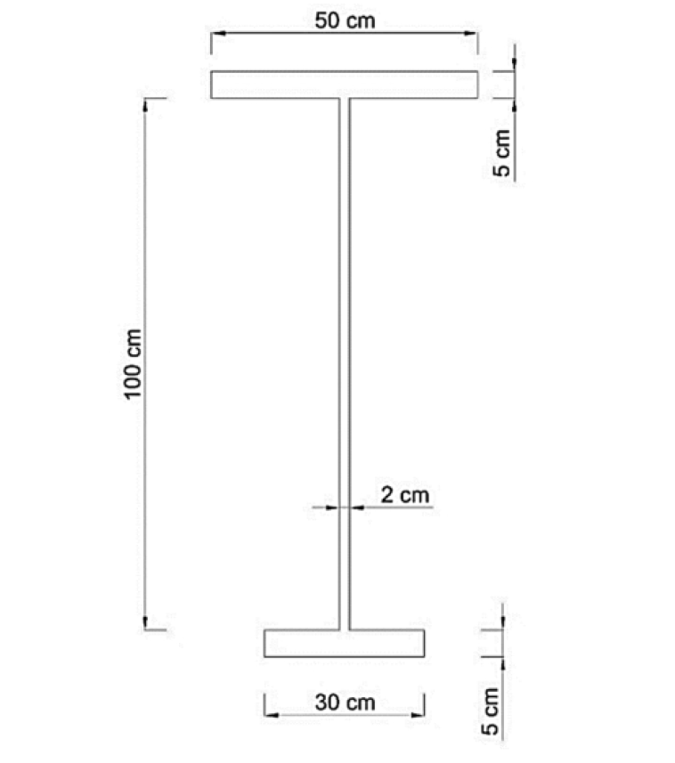

# SS-2023-3 題目正本

> 本檔只記錄**考卷上寫了什麼、圖上畫了什麼**，不含任何解法。解析見同資料夾 `SS-2023-3.md`。
> 判讀清單經使用者確認前，狀態為「待確認」；確認後本檔原則上不再修改（改動須回考卷原圖並記 log）。

| 項目 | 內容 |
|------|------|
| 考卷 | `raw/exams/SS-2023_鋼結構設計.pdf` 第 2 頁，第三題 |
| 考年 | 民國 112 年（2023） |
| 配分 | 25 分（10＋15） |
| 附圖 | 1 張（梁斷面），`SS-2023-3-fig-1.png`（考卷此圖為內嵌點陣圖 311×546 px） |
| 判讀狀態 | **已確認**（2026-11-02 使用者確認，含「不確定」項之解讀；轉錄同日，PyMuPDF 110 dpi 全頁＋關鍵尺寸 220–400 dpi 局部目視，盲讀後才比對既有解析） |

## 1. 考卷原文（逐字）

> 三、下圖為一梁斷面，鋼之 $F_y = 2.5\ \text{tf/cm}^2$，$E_y = 2050\ \text{tf/cm}^2$，假設此梁有完全的側支撐，試求此斷面之㈠降伏彎矩（10 分）；㈡塑性彎矩。（15 分）

## 2. 考卷給的公式、附表與參數

無。同頁第二題下方的 ASD 柱公式（$C_c$、兩個 $F_a$）屬第二題。

## 3. 附圖

*圖面文字照錄：50 cm；5 cm；100 cm；2 cm；30 cm；5 cm。*

## 4. 判讀清單

「把握」標**不確定**者請優先確認；解讀類項目（題目用字的意思）另標「解讀」。

| # | 項目 | 判讀 | 圖上／題文依據 | 把握 |
|---|------|------|---------------|------|
| 1 | 上翼板 | 寬 50 cm、厚 5 cm | 上方尺寸線；右上 5 cm 一對界線 | 確定 |
| 2 | 下翼板 | 寬 30 cm、厚 5 cm | 下方尺寸線；右下 5 cm 一對界線 | 確定 |
| 3 | 腹板厚 | 2 cm | 一對箭頭夾腹板 | 確定 |
| 4 | 100 cm | **腹板淨高**（上翼板底至下翼板頂）；全深 110 cm 為推得值 | 左側尺寸線上界線對齊上翼板底、下界線對齊下翼板頂（400 dpi）；圖上比例 5 cm 翼板 ≈ 100 cm 的 1/20 吻合 | 確定 |
| 5 | 寬翼板位置 | 寬 50 在上、窄 30 在下 | 斷面圖 | 確定 |
| 6 | $E_y$ | 即彈性模數 $E$（考卷寫作 $E_y$） | 題文（解讀） | 確定 |
| 7 | 彎曲方向 | 題目未指定正負彎矩；兩問都只與斷面有關 | 題文 | 確定 |

---

*轉錄：2026-11-02（U2-1 題目／解答拆分試做）｜確認：2026-11-02 使用者確認*
