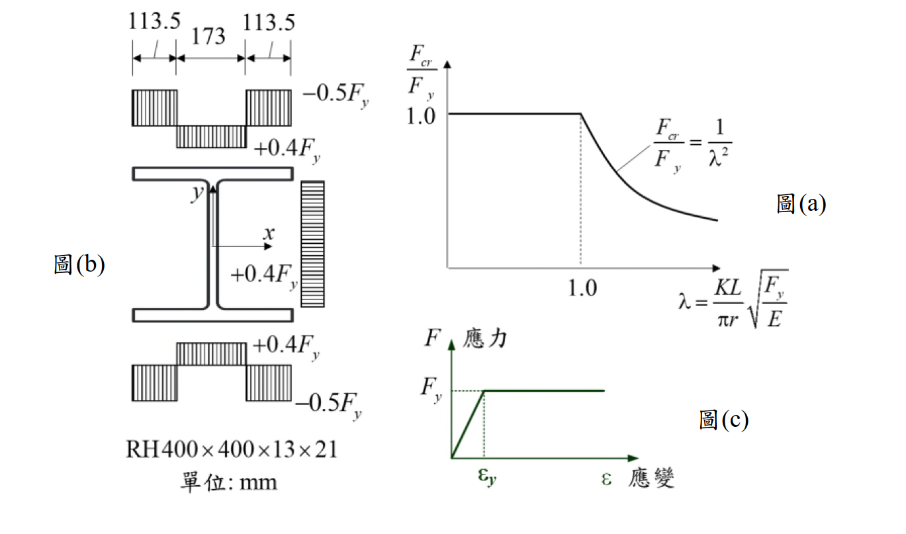

# SS-2024-1 題目正本

> 本檔只記錄**考卷上寫了什麼、圖上畫了什麼**，不含任何解法。解析見同資料夾 `SS-2024-1.md`。
> 判讀清單經使用者確認前，狀態為「待確認」；確認後本檔原則上不再修改（改動須回考卷原圖並記 log）。

| 項目 | 內容 |
|------|------|
| 考卷 | `raw/exams/SS-2024_鋼結構設計.pdf` 第 1 頁（頁次 4－1），第一題 |
| 考年 | 民國 113 年（2024） |
| 配分 | 25 分 |
| 附圖 | 1 張（圖(a) 理想挫屈強度曲線、圖(b) 殘餘應力分布、圖(c) 應力–應變），`SS-2024-1-fig-1.png` |
| 判讀狀態 | **已確認**（2026-11-02 使用者確認，含「不確定」項之解讀；轉錄同日，PyMuPDF 110 dpi 全頁＋圖(b) 300 dpi 局部目視，盲讀後才比對既有解析） |

## 1. 考卷原文（逐字）

> 一、型鋼桿件中若存在殘餘應力可能導致桿件軸向壓力強度下降，在無殘餘應力之理想狀態下，桿件之挫屈強度曲線可由下方 $\dfrac{F_{cr}}{F_y}$ 對應 $\lambda = \dfrac{KL}{\pi r}\sqrt{\dfrac{F_y}{E}}$ 如圖(a)所示。試考慮一斷面為 RH400×400×13×21 之受壓桿件，假設其斷面因製程過程所導致之殘餘應力分布，如圖(b)所示，包含殘餘壓應力 $0.5F_y$ 及殘餘拉應力 $0.4F_y$。假設其鋼材之應力-應變關係為完全彈塑性，如圖(c)所示，而斷面之慣性矩 $I_x = 66{,}600$ cm⁴，$I_y = 22{,}400$ cm⁴。針對此具殘餘應力影響之受壓桿件，繪製該斷面強軸（$x$ 軸）挫屈方向之挫屈強度曲線圖（$\dfrac{F_{cr}}{F_y} \sim \lambda$ 圖），圖中須標註曲線之函數方程式，並標註圖中轉折點之坐標數值。（25 分）
>
> 參考公式：$\lambda = \dfrac{KL}{\pi r}\sqrt{\dfrac{F_y}{E}}$，$\dfrac{F_{cr}}{F_y} = \dfrac{1}{\lambda^2}$，$\dfrac{F_{cr}}{F_y} = 1 - \dfrac14\lambda^2$，$\dfrac{F_{cr}}{F_y} = 0.658^{\lambda^2}$，$\dfrac{F_{cr}}{F_y} = \dfrac{0.877}{\lambda^2}$

## 2. 考卷給的公式、附表與參數

- 題文：RH400×400×13×21；殘餘壓應力 $0.5F_y$、殘餘拉應力 $0.4F_y$；$I_x = 66{,}600$ cm⁴，$I_y = 22{,}400$ cm⁴；完全彈塑性。
- 參考公式五條（照錄於 §1），未標各式適用範圍。
- **沒有給 $F_y$、$E$ 的數值，也沒有給 $A$、$r$**（答案以 $F_{cr}/F_y$ 與 $\lambda$ 無因次表示）。
- 卷首「（註：題目所列之計算公式僅供參考應自負確認與勘誤責任，另視設計需求可自行假設適用的條件等）」。
- 卷首注意事項：㈠可用計算器、㈡不必抄題、㈢除專門名詞或數理公式外應使用本國文字作答。

## 3. 附圖

*圖面文字照錄：113.5；173；113.5；−0.5Fy；+0.4Fy；y；x；+0.4Fy；+0.4Fy；−0.5Fy；RH400×400×13×21；單位: mm；圖(b)；$F_{cr}/F_y$；1.0；$F_{cr}/F_y = 1/\lambda^2$；1.0；$\lambda = \frac{KL}{\pi r}\sqrt{F_y/E}$；圖(a)；F 應力；$F_y$；$\varepsilon_y$；ε 應變；圖(c)。*

## 4. 判讀清單

「把握」標**不確定**者請優先確認；解讀類項目（題目用字的意思）另標「解讀」。

| # | 項目 | 判讀 | 圖上／題文依據 | 把握 |
|---|------|------|---------------|------|
| 1 | 翼板分段 | 400 mm 翼寬分為 113.5＋173＋113.5，上下翼板相同 | 圖(b) 尺寸線（300 dpi） | 確定 |
| 2 | 正負號 | 負號為壓（−0.5$F_y$ 在兩端）、正號為拉（+0.4$F_y$ 在翼板中央） | 題文「殘餘壓應力 $0.5F_y$ 及殘餘拉應力 $0.4F_y$」 | 確定 |
| 3 | 腹板 | 腹板全高均勻 +0.4$F_y$（拉）；腹板淨高取 $400 - 2(21) = 358$ mm | 圖(b) 腹板右側應力塊 | 確定（解讀） |
| 4 | 自平衡 | 翼板淨壓 $2 \times 21 \times [2(113.5)(0.5) - 173(0.4)] \approx 1861$ mm²$F_y$ ≈ 腹板拉 $358 \times 13 \times 0.4 \approx 1862$ mm²$F_y$，自平衡 | 由圖(b) 數值計算 | 確定 |
| 5 | 強軸 | $x$ 軸水平（平行翼板），強軸挫屈用 $I_x$ | 圖(b) 座標軸＋題文 | 確定 |
| 6 | 斷面積 | 題未給，由板尺寸計算、不計圓角 | 題文 | 確定（解讀） |
| 7 | 圖(a) 的角色 | 理想（無殘餘應力）曲線，轉折點 (1.0, 1.0)；本題要畫的是有殘餘應力的曲線 | 題文＋圖(a) | 確定 |
| 8 | 參考公式 | 五條供選用，不一定全部適用（例如 $0.658^{\lambda^2}$、$0.877/\lambda^2$ 為規範曲線，非本題推導曲線） | 卷首註「僅供參考」 | 不確定 → 使用者確認 |

---

*轉錄：2026-11-02（SS-U1-1 題目正本推廣・批 3）｜確認：2026-11-02 使用者確認*
