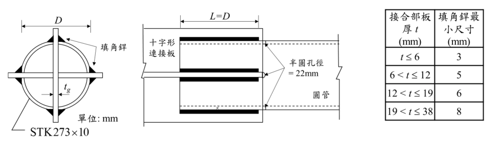

# SS-2024-2 題目正本

> 本檔只記錄**考卷上寫了什麼、圖上畫了什麼**，不含任何解法。解析見同資料夾 `SS-2024-2.md`。
> 判讀清單經使用者確認前，狀態為「待確認」；確認後本檔原則上不再修改（改動須回考卷原圖並記 log）。

| 項目 | 內容 |
|------|------|
| 考卷 | `raw/exams/SS-2024_鋼結構設計.pdf` 第 2 頁（頁次 4－2），第二題 |
| 考年 | 民國 113 年（2024） |
| 配分 | 25 分（㈠ 15、㈡ 10） |
| 附圖 | 1 張（圓管斷面、側視圖、填角銲最小尺寸表），`SS-2024-2-fig-1.png` |
| 判讀狀態 | **已確認**（2026-11-02 使用者確認，含「不確定」項之解讀；轉錄同日，PyMuPDF 110 dpi 全頁＋附圖 300 dpi 局部目視，盲讀後才比對既有解析） |

## 1. 考卷原文（逐字）

> 二、下圖所示為一中空鋼管斷面拉力桿件之端部與十字形連接板之接頭，桿件預計使用 A500 Grade 50 鋼材之 STK273×10 圓管，管外徑尺寸 $D = 273$ mm，並於鋼管外側採用 E70 系列銲條之縱向填角銲道與連接板相連接，如圖所示。
> ㈠以極限設計法求此桿件之設計強度（$\phi_tT_n$），請詳述可能之極限狀態種類。（15 分）
> ㈡依前一小題之所得之設計強度為銲接之設計力，設計此接頭之銲道尺寸。（10 分）
> 其中 A500 Grade 50 鋼材之 $F_y = 2.3$ tf/cm²，$F_u = 3.1$ tf/cm²。圓管之斷面積 $A_g = 82.6$ cm²，十字形連接板厚 $t_g = 20$ mm。
> 參考公式：$U = 1 - \dfrac{\bar{x}}{L}$，$\bar{x} = \dfrac{D}{\pi}$（半圓管），$U = \dfrac{3L^2}{3L^2 + W^2}$

## 2. 考卷給的公式、附表與參數

- 題文：STK273×10，$D = 273$ mm，$F_y = 2.3$、$F_u = 3.1$ tf/cm²，$A_g = 82.6$ cm²，$t_g = 20$ mm，E70 銲條。
- 參考公式三條（照錄於 §1），未說明 $W$ 是什麼、第二條何時適用。
- 附圖內「填角銲最小尺寸」表：接合部板厚 $t \le 6$ → 3；$6 < t \le 12$ → 5；$12 < t \le 19$ → 6；$19 < t \le 38$ → 8（mm）。
- **沒有給 $\phi_t$、銲材強度 $F_{EXX}$ 數值與銲道 $\phi$**。
- 卷首「（註：題目所列之計算公式僅供參考應自負確認與勘誤責任，另視設計需求可自行假設適用的條件等）」。
- 卷首注意事項：㈠可用計算器、㈡不必抄題、㈢除專門名詞或數理公式外應使用本國文字作答。

## 3. 附圖

*圖面文字照錄：D；填角銲；$t_g$；單位: mm；STK273×10；L=D；十字形連接板；半圓孔徑 = 22mm；圓管；接合部板厚 t (mm)；填角銲最小尺寸 (mm)；t ≤ 6｜3；6 < t ≤ 12｜5；12 < t ≤ 19｜6；19 < t ≤ 38｜8。*

## 4. 判讀清單

「把握」標**不確定**者請優先確認；解讀類項目（題目用字的意思）另標「解讀」。

| # | 項目 | 判讀 | 圖上／題文依據 | 把握 |
|---|------|------|---------------|------|
| 1 | 銲道數 | 十字形板四支各在管外兩側一道，共 **8 道**縱向填角銲 | 斷面圖 8 個三角形（300 dpi） | 確定 |
| 2 | 銲長 | 每道 $L = D = 273$ mm | 側視圖尺寸線 | 確定 |
| 3 | 開槽 | 管端沿四支板開 4 道槽，槽端為半圓、孔徑（槽寬）22 mm，槽端在銲道區之外 | 側視圖箭頭與虛線 | 確定（解讀） |
| 4 | 管壁厚 | 10 mm（STK273×10） | 斷面標示 | 確定 |
| 5 | 極限狀態範圍 | 桿件全斷面降伏、槽端淨斷面斷裂（扣開槽、乘 $U$）；連接板的極限狀態是否也要列 | 題文「此桿件之設計強度」 | 不確定 → 使用者確認：只算桿件：全斷面降伏、槽端淨斷面斷裂（本解另列管壁剪力撕裂） |
| 6 | 用哪條 $U$ | $U = 1 - \bar{x}/L$ 配半圓管 $\bar{x} = D/\pi$；第二條 $U = 3L^2/(3L^2+W^2)$ 中 $W$ 的意義與是否適用 | 參考公式未說明 | 不確定 → 使用者確認：用 $U = 1 - \bar{x}/L$、$\bar{x} = D/\pi$；第二條不用（同本解） |
| 7 | 最小銲腳查表用的 $t$ | 以較薄者（管壁 10 mm）或較厚者（連接板 20 mm）查表 | 表頭「接合部板厚」未指明 | 不確定 → 使用者確認：以較厚板（連接板 20 mm）查表 → 8 mm（同本解） |
| 8 | ㈡ 設計力 | 以㈠所得 $\phi_tT_n$ 為 8 道銲道合計的設計力 | 題文 | 確定（解讀） |
| 9 | 未給係數 | $\phi_t$、$F_{EXX}$（E70）、銲道 $\phi$ 依規範自取並註明 | 題文未給 | 確定（解讀） |

---

*轉錄：2026-11-02（SS-U1-1 題目正本推廣・批 3）｜確認：2026-11-02 使用者確認*
