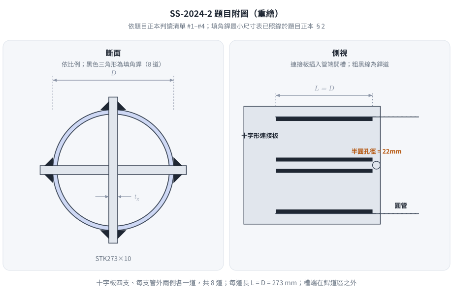
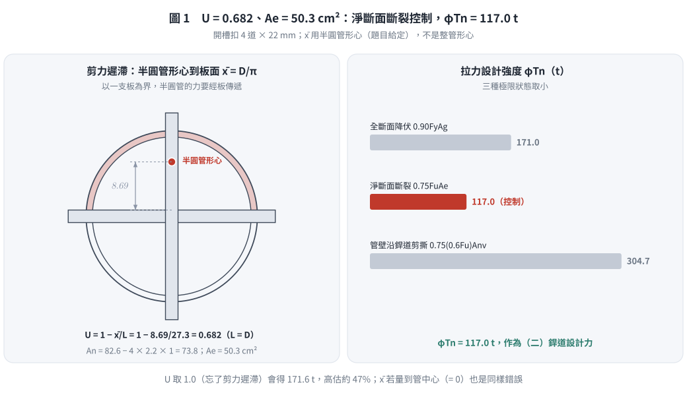
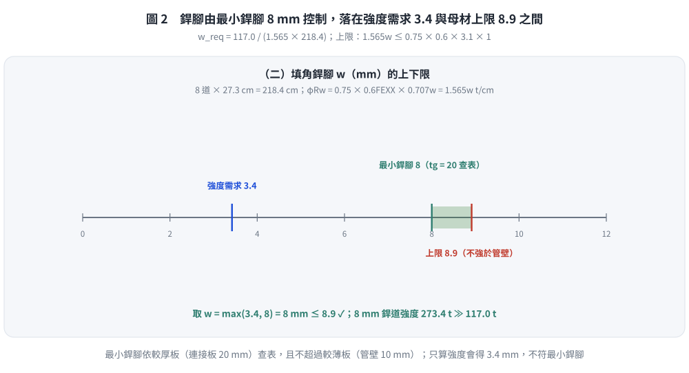

# 考題編號：SS-2024-2

**主分類：** `SS-U1-1` 拉力及壓力桿件
**副分類：** `SS-U1-4` 接合之分析與設計
**設計法：** LRFD
**標籤：** `拉力桿件` `圓管HSS` `縱向填角銲` `剪力遲滯` `U值` `半圓管` `淨截面斷裂` `銲道設計` `開槽淨面積`

---

## 1. 題目（考卷原文見題目正本）

> 考卷原文、公式／附表、附圖與判讀清單（已確認）見 [`SS-2024-2-problem.md`](SS-2024-2-problem.md)。本節只列**解題時最容易讀錯的地方**與本解使用的記號；題意以題目正本為準。



*圖 1　題目附圖重繪（依題目正本判讀清單 #1–#4；填角銲最小尺寸表見題目正本 §2）。斷面圖畫出 8 個銲道三角形、側視圖標出 $L = D$ 與槽端位置，攔下把銲道算成 4 道或把開槽當成在銲道區內的誤讀。*

### 常見誤讀

| 項目 | 正確判讀 | 常見誤讀 |
|------|---------|---------|
| 銲道數 | 四支板 × 管外兩側 = 8 道，每道 $L = D = 273$ mm | 算成 4 道 |
| 開槽 | 4 道槽、槽寬 22 mm，槽端淨斷面要扣 | 以為無孔、$A_n = A_g$ |
| $U$ | 用 $U = 1 - \bar{x}/L$、$\bar{x} = D/\pi$；第二條 $3L^2/(3L^2+W^2)$ 不用（使用者確認） | 套第二條 |
| 最小銲腳 | 以接合部較厚板（連接板 20 mm）查表 → 8 mm（使用者確認）；若以較薄板（管壁 10 mm）查表為 5 mm | 未說明用哪片板厚查表 |

**本解記號：** $D = 27.3$、$t = 1.0$ cm；$A_g = 82.6$ cm²；$F_y = 2.3$、$F_u = 3.1$ tf/cm²；$t_g = 20$ mm；槽寬 22 mm；$F_{EXX} = 4.92$ tf/cm²（E70）。

---

## 2. 考題核心精神與出題者意圖 (Core Concepts & Examiner's Intent)

**核心觀念：** 開槽圓管（slotted HSS）以縱向銲接到連接板時，受拉桿件要檢核三件事：全斷面降伏、槽端淨斷面斷裂（扣開槽面積＋剪力遲滯 $U$）、管壁沿銲道的剪力撕裂；接頭本身再檢核銲道強度與最小銲腳。

**出題者測驗重點：**
- **開槽要扣**：管子被開了 4 道 22 mm 寬的槽，槽端那個斷面的淨面積 $A_n = A_g - 4 \times 2.2 \times t$。
- **$\bar{x} = D/\pi$**：題目指定以半圓管形心距計算剪力遲滯。
- **銲道數量**：四支板 × 兩側 = 8 道。
- **最小銲腳**：查表，以接合部板厚判斷。

---

## 3. 解題戰略地圖與陷阱分析 (Strategic Roadmap & Trap Analysis)

**作戰計畫：**
```
（一）設計強度
  Step 1  全斷面降伏（GSY）：0.90 Fy Ag
  Step 2  淨斷面斷裂（NSF）：An = Ag − 4·(22 mm)·t；x̄ = D/π；U = 1 − x̄/L
          → 0.75 Fu U An
  Step 3  管壁沿銲道剪力撕裂：0.75 × 0.6Fu × (8·L·t)（不控制）
  Step 4  取最小值 → NSF 控制，φtTn ≈ 117 t

（二）銲道設計
  Step 5  8 道，總長 8L = 218.4 cm
  Step 6  所需銲腳：Tu ÷ (φ·0.6FEXX·0.707 × 8L)
  Step 7  最小銲腳：查表（tg = 20 mm → 8 mm）
  Step 8  上限：銲道強度不超過管壁母材剪力強度
  Step 9  取 8 mm
```

**陷阱分析：**

| 陷阱 | 說明 | 對策 |
|------|------|------|
| ❶ 忘了扣開槽 | 「縱向銲接、沒有螺栓孔」不等於 $A_n = A_g$；開槽端的斷面少了 4 個 22 mm 寬的槽 | $A_n = A_g - 4 \times 2.2 \times 1.0 = 73.8$ cm² |
| ❷ 銲道數量算錯 | 每支板穿出管壁時兩側各有一道銲 | 斷面圖數三角形：8 個 |
| ❸ $\bar{x}$ 誤用 $D/2$ | 半圓形心到直徑面距離是 $2r/\pi = D/\pi$ | $\bar{x} = D/\pi = 8.69$ cm |
| ❹ 誤用 $U = 3L^2/(3L^2+W^2)$ | 該式是**板件**縱向銲（AISC 表 D3.1 第 4 列），圓管不適用 | 圓管用 $1 - \bar{x}/L$ |
| ❺ $\phi$ 混用 | 斷裂 0.75、降伏 0.90 | |

---

## 3.5 變數層次分析（Variable Hierarchy Analysis）

> 複習提示：解題後，在每個卡住的知識點「卡關?」欄標記 `⚠`；第二次複習時只看有 `⚠` 的項目。

**最終目標：** STK273×10 開槽圓管十字形銲接接頭：①求設計拉力強度 ②設計填角銲腳尺寸

### 主要公式（$\boxed{\phantom{x}}$ = 未知，待推導）

**（一）設計拉力強度**
$$\phi_t T_{n,GSY} = 0.90 F_y A_g$$
$$\boxed{A_n} = A_g - n_{槽}\,b_{槽}\,t,\quad \boxed{U} = 1 - \frac{D/\pi}{L},\quad \phi_t T_{n,NSF} = 0.75 F_u U A_n$$
$$\boxed{\phi_t T_n} = \min(T_{GSY}, T_{NSF}, T_{剪力撕裂})$$

**（二）填角銲尺寸**
$$w_{req} = \frac{T_u}{\phi(0.6F_{EXX})(0.707) \times 8L},\quad w = \max(w_{req}, w_{min}) \le w_{max}$$

### L1：題目直接給定

| 符號 | 數值 | 說明 |
|------|------|------|
| $D$ | 27.3 cm | 圓管外徑 |
| $t$ | 1.0 cm | 圓管壁厚 |
| $A_g$ | 82.6 cm² | 圓管毛斷面積 |
| $F_y$、$F_u$ | 2.3、3.1 tf/cm² | A500 Gr.50 |
| $t_g$ | 20 mm | 十字形連接板厚 |
| $L$ | $D = 27.3$ cm | 銲道長度 |
| 槽寬 | 22 mm | 「半圓孔徑」 |
| 銲條 | E70 | $F_{EXX} = 70$ ksi $= 4.92$ tf/cm² |

### L2：需知識點推導

| 符號 | 公式 / 來源 | 卡關? |
|------|------------|:-----:|
| $\phi_tT_{n,GSY}$ | $0.90 \times 2.3 \times 82.6 = 171.0$ t | |
| $A_n$ | $82.6 - 4 \times 2.2 \times 1.0 = 73.8$ cm² ⚠ 常漏扣 | |
| $\bar{x}$ | $27.3/\pi = 8.69$ cm | |
| $U$ | $1 - 8.69/27.3 = 0.682$ | |
| $\phi_tT_{n,NSF}$ | $0.75 \times 3.1 \times 0.682 \times 73.8 = 117.0$ t | |
| 剪力撕裂 | $0.75 \times 0.6 \times 3.1 \times (8 \times 27.3 \times 1.0) = 304.7$ t | |
| 銲道總長 | $8 \times 27.3 = 218.4$ cm ⚠ 8 道非 4 道 | |
| $\phi R_w$ | $0.75 \times 0.6 \times 4.92 \times 0.707 = 1.566$ t/cm per cm 銲腳 | |
| $w_{req}$ | $117.0/(1.566 \times 218.4) = 0.34$ cm | |
| $w_{min}$ | 8 mm（$t_g = 20$ mm） | |

### L3：深層知識（不懂就卡住）

| 知識點 | 說明 | 卡關? |
|--------|------|:-----:|
| 開槽圓管淨面積 | 槽端斷面扣除槽寬 × 管厚；AISC 表 D3.1 第 5 列「單一同心板的圓管」 | |
| 半圓管 $\bar{x} = D/\pi$ | 半圓弧形心到直徑面距離 $2r/\pi$ | |
| $U$ 的適用長度 | 圓管：$L \ge 1.3D$ 時 $U = 1$；$D \le L < 1.3D$ 時 $U = 1 - \bar{x}/L$ | |
| 填角銲強度 | $\phi R_n = 0.75 \times 0.6F_{EXX} \times 0.707w \times L_w$ | |

---

## 4. 步驟化詳細計算過程 (Step-by-Step Calculation)

### （一）拉力桿件設計強度與極限狀態

#### 極限狀態種類

1. **全斷面降伏（GSY）**：管身遠離接頭處整個斷面降伏，變形過大。
2. **淨斷面斷裂（NSF）**：在槽端斷面，扣除開槽後的有效淨面積斷裂；因只有部分斷面（板附近）直接傳力，需以剪力遲滯係數 $U$ 折減。
3. **管壁沿銲道剪力撕裂**：管壁沿 8 道銲道邊緣受剪撕裂（純剪力面的塊狀撕裂，無拉力面）。
4. 接頭的**銲道斷裂**與**連接板**強度屬接頭設計，在（二）及連接板設計中檢核。

#### Step 1：全斷面降伏

$$\phi_t T_n = 0.90 \times 2.3 \times 82.6 = 171.0\ \text{t}$$

#### Step 2：淨斷面斷裂

開槽淨面積（4 道槽，各寬 2.2 cm）：

$$A_n = 82.6 - 4 \times 2.2 \times 1.0 = 73.8\ \text{cm}^2$$

剪力遲滯（題目給定半圓管形心距）：

$$\bar{x} = \frac{D}{\pi} = \frac{27.3}{\pi} = 8.69\ \text{cm},\qquad U = 1 - \frac{8.69}{27.3} = 0.682$$

（$L = D$，落在 $D \le L < 1.3D$ 區間，正是 $1 - \bar{x}/L$ 的適用範圍。）

$$A_e = U A_n = 0.682 \times 73.8 = 50.3\ \text{cm}^2$$

$$\phi_t T_n = 0.75 \times 3.1 \times 50.3 = 117.0\ \text{t}$$

#### Step 3：管壁沿銲道剪力撕裂

$$A_{nv} = 8 \times 27.3 \times 1.0 = 218.4\ \text{cm}^2,\qquad \phi R_n = 0.75 \times 0.6 \times 3.1 \times 218.4 = 304.7\ \text{t}$$

#### Step 4：控制

| 極限狀態 | $\phi_t T_n$（t） |
|---------|:---:|
| 全斷面降伏 | 171.0 |
| **淨斷面斷裂（控制）** | **117.0** |
| 管壁沿銲道剪力撕裂 | 304.7 |

$$\boxed{\phi_t T_n = 117.0\ \text{t（淨斷面斷裂控制）}}$$



*圖 1　剪力遲滯：半圓管形心到板面 $\bar x = D/\pi = 8.69$ cm，$U = 0.682$、$A_e = 50.3$ cm²，淨斷面斷裂控制 $\phi_tT_n = 117.0$ t。這張圖攔的是 $U$ 取 1.0、$\bar x$ 量到管中心、開槽沒扣，或只算全斷面降伏。*

---

### （二）銲道尺寸設計

設計力 $T_u = 117.0$ t。

#### Step 5：銲道幾何

十字形板的四支板各在管壁穿出處兩側銲接，共 **8 道**，每道 $L_w = 27.3$ cm：

$$\sum L_w = 8 \times 27.3 = 218.4\ \text{cm}$$

#### Step 6：單位長度銲道強度

$$F_{EXX} = 70\ \text{ksi} = 4.92\ \text{tf/cm}^2$$

$$\phi R_w = 0.75 \times 0.6F_{EXX} \times 0.707w = 1.566w\ \ \text{(t/cm，}w\text{ 以 cm 計)}$$

#### Step 7：所需銲腳

$$w_{req} = \frac{117.0}{1.566 \times 218.4} = 0.342\ \text{cm} = 3.4\ \text{mm}$$

#### Step 8：最小銲腳

接合部為管壁 10 mm 與連接板 20 mm。依考卷所附表以接合部板厚查：$t_g = 20$ mm 落在 $19 < t \le 38$ → **8 mm**；且 8 mm 不超過較薄板（管壁 10 mm）厚度。

#### Step 9：上限檢核（銲道不強於管壁母材）

每道銲的管壁母材剪力強度：$0.75 \times 0.6 \times 3.1 \times 1.0 = 1.395$ t/cm

$$1.566w \le 1.395 \Rightarrow w \le 0.89\ \text{cm} = 8.9\ \text{mm}$$

#### Step 10：結論

$$w = \max(3.4,\ 8) = 8\ \text{mm} \le 8.9\ \text{mm}\ \checkmark$$

$$\boxed{w = 8\ \text{mm（最小銲腳控制），8 道，每道 } L = 273\ \text{mm}}$$

8 mm 銲道強度：$1.566 \times 0.8 \times 218.4 = 273.6$ t ≫ 117.0 t。



*圖 2　銲腳由最小銲腳 8 mm 控制，落在強度需求 3.4 mm 與母材上限 8.9 mm 之間。這張圖攔的是只算強度需求就取 3.4 mm、最小銲腳查較薄板，或忘了銲道不強於母材的上限。（單位長度銲道強度係數精確為 0.75 × 0.6 × 4.92 × 0.707 = 1.565，解析寫 1.566，結論不變。）*

---

## 5. 結果彙整與驗算 (Summary & Verification)

| 項目 | 數值 |
|------|------|
| $A_n$（扣 4 槽） | $73.8\ \text{cm}^2$ |
| $\bar{x} = D/\pi$ | $8.69\ \text{cm}$ |
| $U$ | $0.682$ |
| $A_e$ | $50.3\ \text{cm}^2$ |
| 全斷面降伏 | $171.0$ t |
| **淨斷面斷裂（控制）** | **$117.0$ t** |
| 銲道總長（8 道） | $218.4$ cm |
| 所需銲腳 | $3.4$ mm |
| **設計銲腳** | **8 mm（最小銲腳控制）** |

**雙路徑驗算：** 以 $\phi_tT_n = 0.75F_u(A_g - A_{槽})(1 - 1/\pi)$ 一式重算：$0.75 \times 3.1 \times 73.8 \times 0.6817 = 116.97$ t ✔。

**與舊版解析的差異：**

| 項目 | 舊解 | 本解 | 原因 |
|---|:---:|:---:|---|
| $A_n$ | 82.6（「無孔」） | 73.8 | 原圖「半圓孔徑 22 mm」為開槽，需扣除 |
| $\phi_tT_n$ | 130.8 t | **117.0 t** | |
| 銲道數 | 4 道 | **8 道** | 斷面圖每支板兩側各一道 |
| 所需銲腳 | 7.66 mm | 3.4 mm | 設計力變小、銲道數加倍 |
| 設計銲腳 | 8 mm | 8 mm | 皆為最小銲腳控制 |

---

## 6. 依最新規範（AISC 360-16／-22）對照

| 項目 | 考卷 | AISC 360-16／-22 |
|:---|:---|:---|
| 圓管剪力遲滯 | $U = 1 - \bar{x}/L$，$\bar{x} = D/\pi$ | 表 D3.1 第 5 列：$L \ge 1.3D$ → $U = 1.0$；$D \le L < 1.3D$ → $U = 1 - \bar{x}/L$，$\bar{x} = D/\pi$（相同） |
| 開槽淨面積 | — | §B4.3：開槽 HSS 之淨面積扣除槽寬 × 厚度 |
| 最小銲腳 | 考卷表以接合部板厚查 | 表 J2.4 自 360-10 起以**較薄**接合件厚度查：管壁 10 mm → 5 mm |
| 本題銲腳 | 8 mm | 依 360-16 最小 5 mm，所需 3.4 mm → 取 5 mm |

**觀察：** 若銲道長度加長到 $L \ge 1.3D = 35.5$ cm，$U = 1.0$，NSF 提高到 $0.75 \times 3.1 \times 73.8 = 171.6$ t，與全斷面降伏 171.0 t 幾乎相同——這就是規範設定 1.3D 門檻的用意。

---

*修正日期：2026-11-01（依考卷原圖：「半圓孔徑 22 mm」為圓管開槽，原解以「無孔」取 $A_n = A_g$，更正為扣除 4 道槽之 $A_n = 73.8$ cm²，$\phi_tT_n$ 由 130.8 t 更正為 **117.0 t**；斷面圖每支板兩側各一道銲，銲道由 4 道更正為 **8 道**，所需銲腳 7.66 → 3.4 mm，設計銲腳仍為 8 mm；補管壁剪力撕裂檢核、極限狀態說明與 §6 對照；更正 $F_{EXX}$ 筆誤 49 → 4.92 tf/cm²）*
*圖解補繪：2026-11-03（向量圖 2 張，腳本 `gen_SS-2024-2.py`，改輸入可原地重跑；SVG 供 wiki／PDF，2× PNG 供 pptx／影片）*
*驗證狀態：unverified*

*修正日期：2026-11-02（§1 全文重述改為指向題目正本 `SS-2024-2-problem.md`（已確認）＋常見誤讀＋本解記號；解題內容與答案不變）*

*修正日期：2026-11-03（§1 補入題目附圖重繪 `figs/SS-2024-2-fig-1-problem.svg`（依已確認的題目正本判讀清單，腳本 `gen_SS-2024-2.py`，可重跑）；解題內容與答案不變）*
