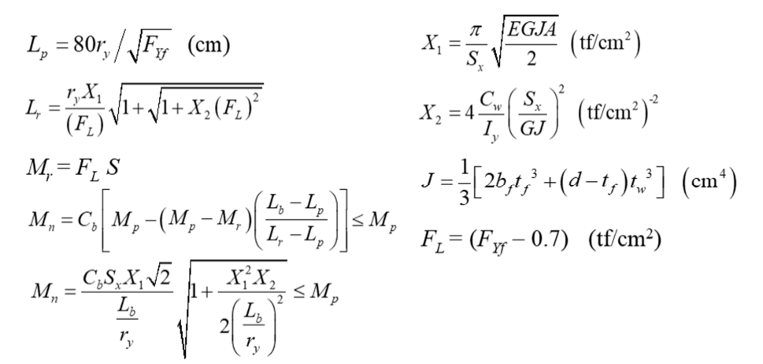
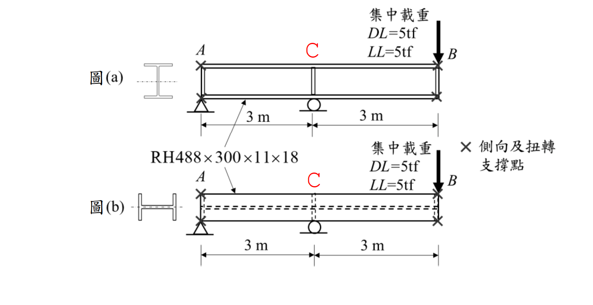

# SS-2024-3 題目正本

> 本檔只記錄**考卷上寫了什麼、圖上畫了什麼**，不含任何解法。解析見同資料夾 `SS-2024-3.md`。
> 判讀清單經使用者確認前，狀態為「待確認」；確認後本檔原則上不再修改（改動須回考卷原圖並記 log）。

| 項目 | 內容 |
|------|------|
| 考卷 | `raw/exams/SS-2024_鋼結構設計.pdf` 第 3 頁（頁次 4－3），第三題 |
| 考年 | 民國 113 年（2024） |
| 配分 | 25 分 |
| 附圖 | 1 張（圖(a) 強軸、圖(b) 弱軸），`SS-2024-3-fig-1.png`；題內參考公式為圖片，截圖 `SS-2024-3-eqn-1.png` |
| 判讀狀態 | **待確認**（轉錄 2026-11-02，PyMuPDF 110 dpi 全頁＋附圖 300 dpi 局部目視，盲讀後才比對既有解析） |

## 1. 考卷原文（逐字）

> 三、依下圖示梁採用 RH488 × 300 × 11 × 18 斷面及 SN490B 鋼材，假設此斷面為結實斷面，其降伏應力 $F_y$ = 2.35 tf/cm² 及 $F_u$ = 4.0 tf/cm²，並分別以斷面強軸與弱軸承受一集中載重。兩者之支承條件相同，滾支承並無面外束制，且 A 及 B 處翼板皆有設置充分側向支撐，試檢核此梁是否可以承擔如圖(a)及圖(b)所示之 5 tf 靜載重及 5 tf 活載重。檢核時忽略梁自重，並以下方公式估算 $C_b$ 值。（25 分）
>
> $$C_b = \frac{12.5M_{max}}{2.5M_{max} + 3M_A + 4M_B + 3M_C} \le 3.0$$
>
> 參考公式：（圖片，照錄於 §2）

## 2. 考卷給的公式、附表與參數

- 題文：RH488×300×11×18；SN490B，$F_y = 2.35$、$F_u = 4.0$ tf/cm²；結實斷面；DL = LL = 5 tf；忽略自重；$C_b$ 公式。
- 題內參考公式（圖片，照錄）：

$$L_p = 80r_y\big/\sqrt{F_{Yf}}\ \text{(cm)},\qquad L_r = \frac{r_yX_1}{(F_L)}\sqrt{1 + \sqrt{1 + X_2(F_L)^2}},\qquad M_r = F_LS$$
$$M_n = C_b\left[M_p - (M_p - M_r)\left(\frac{L_b - L_p}{L_r - L_p}\right)\right] \le M_p,\qquad M_n = \frac{C_bS_xX_1\sqrt2}{L_b/r_y}\sqrt{1 + \frac{X_1^2X_2}{2(L_b/r_y)^2}} \le M_p$$
$$X_1 = \frac{\pi}{S_x}\sqrt{\frac{EGJA}{2}}\ (\text{tf/cm}^2),\quad X_2 = 4\frac{C_w}{I_y}\left(\frac{S_x}{GJ}\right)^2\ (\text{tf/cm}^2)^{-2},\quad J = \frac13\left[2b_ft_f^3 + (d - t_f)t_w^3\right]\ (\text{cm}^4),\quad F_L = (F_{Yf} - 0.7)\ (\text{tf/cm}^2)$$

  
- **沒有給斷面性質**（$A$、$I_x$、$I_y$、$S_x$、$Z_x$、$r_y$、$C_w$）**與 $E$、$G$、載重組合係數、$\phi_b$**。
- 卷首「（註：題目所列之計算公式僅供參考應自負確認與勘誤責任，另視設計需求可自行假設適用的條件等）」；注意事項㈠可用計算器、㈡不必抄題、㈢除專門名詞或數理公式外應使用本國文字作答。

## 3. 附圖

*圖面文字照錄：集中載重 DL=5tf LL=5tf；A；C；B；3 m；3 m；RH488×300×11×18；× 側向及扭轉支撐點；圖(a)；圖(b)。*

## 4. 判讀清單

「把握」標**不確定**者請優先確認；解讀類項目（題目用字的意思）另標「解讀」。

| # | 項目 | 判讀 | 圖上／題文依據 | 把握 |
|---|------|------|---------------|------|
| 1 | 支承與載重 | A 鉸支、C 滾支（距 A 3 m）、B 為外伸自由端（距 C 3 m），載重在 B | 附圖 300 dpi | 確定 |
| 2 | 側撐 | 只有 A、B；C 無面外束制 → 強軸 $L_b = 6$ m（A 至 B） | 「×」只在 A、B＋題文 | 確定 |
| 3 | 彎曲軸 | 圖(a) 強軸、圖(b) 弱軸，支承與載重相同 | 附圖斷面示意 | 確定 |
| 4 | $C_b$ 式的 $M_A$、$M_B$、$M_C$ | 無支撐段 1/4、1/2、3/4 點彎矩，**不是**圖上 A、B、C 點的彎矩 | 規範公式慣例（圖上代號與式中代號重名） | 確定（解讀） |
| 5 | 斷面性質 | 題未給，查 RH488×300×11×18 型鋼表或由尺寸計算 | 題文 | 確定（解讀） |
| 6 | $E$、$G$ | 題未給，依規範（2040、790 tf/cm²）自取 | 題文未給 | 確定（解讀） |
| 7 | 載重組合 | 1.2D＋1.6L（係數題未給） | 題文 | 不確定（解讀） |
| 8 | 弱軸 | 弱軸彎曲無 LTB，$M_{ny}$ 依斷面決定 | 題文「結實斷面」 | 確定（解讀） |

---

*轉錄：2026-11-02（SS-U1-2 題目正本推廣・批 2）*
