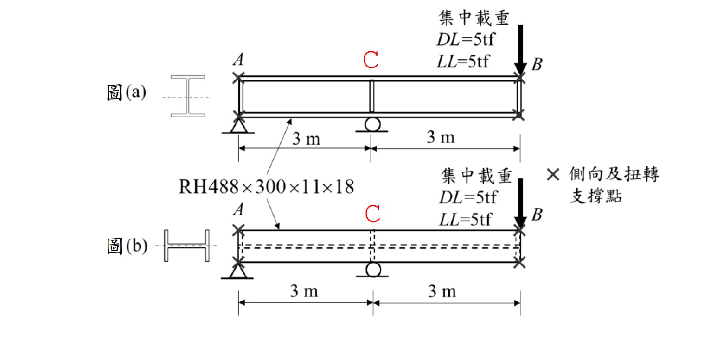
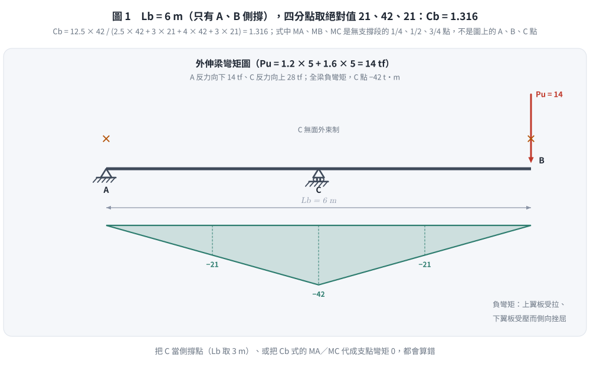
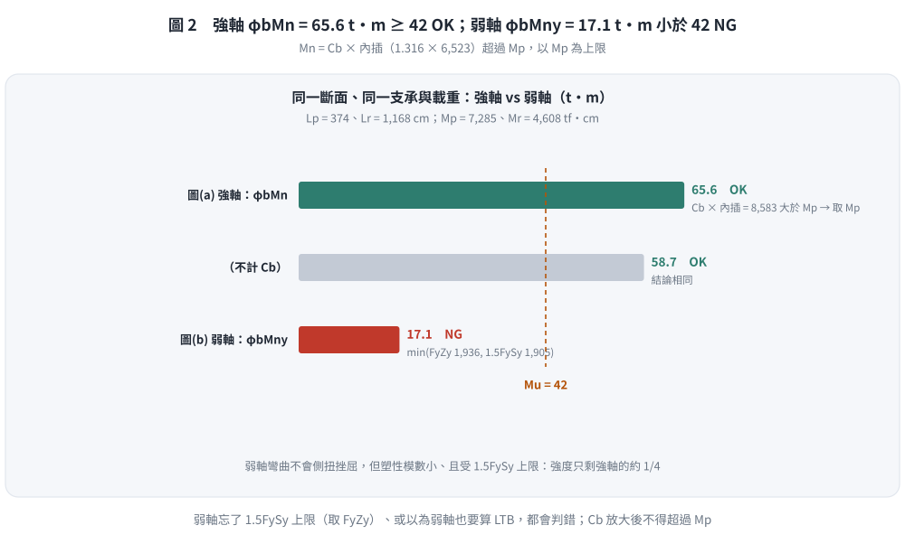

# 考題編號：SS-2024-3

**主分類：** `SS-U1-2` 梁桿件
**設計法：** LRFD
**標籤：** `梁桿件` `LTB側扭挫屈` `非彈性LTB` `Cb係數` `強弱軸比較` `弱軸彎曲` `SN490B` `結實斷面` `塑性彎矩` `外伸梁`

---

## 1. 原始題目重述 (Problem Restatement)

依下圖示梁採用 RH488×300×11×18 斷面及 SN490B 鋼材，假設此斷面為結實斷面，其降伏應力 $F_y = 2.35$ tf/cm² 及 $F_u = 4.0$ tf/cm²，並分別以斷面強軸與弱軸承受一集中載重。兩者之支承條件相同，滾支承並無面外束制，且 A 及 B 處翼板皆有設置充分側向支撐，試檢核此梁是否可以承擔如圖(a)及圖(b)所示之 5 tf 靜載重及 5 tf 活載重。檢核時忽略梁自重，並以下方公式估算 $C_b$ 值：$C_b = \dfrac{12.5M_{max}}{2.5M_{max} + 3M_A + 4M_B + 3M_C} \le 3.0$。（25 分）

考卷並附 $L_p = 80r_y/\sqrt{F_{yf}}$、$L_r$、$M_r = F_LS$、$M_n$（非彈性、彈性兩式）、$X_1$、$X_2$、$J = \frac13[2b_ft_f^3 + (d - t_f)t_w^3]$、$F_L = F_{yf} - 0.7$。



*圖說（依考卷原圖 400 dpi 目視判讀）：*
- *A 為**鉸支**（三角形）、C 為**滾支**（圓圈），C 距 A 3 m；B 在 C 右方 3 m，**無支承**，是外伸端，集中載重 $DL = LL = 5$ tf 作用在 **B 點**。*
- *「×」為側向及扭轉支撐點，只畫在 **A、B** 的上下翼板；題文「滾支承並無面外束制」→ C 不是側撐點 → 強軸 $L_b = 6$ m（A 至 B）。*
- *圖(a) 腹板垂直（強軸受彎）；圖(b) 腹板水平（弱軸受彎），支承與載重相同。*

---

## 2. 考題核心精神與出題者意圖 (Core Concepts & Examiner's Intent)

**核心觀念：** 外伸梁的彎矩圖、無側撐段跨越中間支承的 $C_b$，以及強軸（有 LTB）與弱軸（無 LTB）的對比。

**出題者測驗重點：**
- 讀出結構形式：A、C 是支承，B 是懸臂端 → 最大彎矩在 C（負彎矩，$P_u \times 3$ m）。
- 滾支承沒有面外束制 → 無側撐長度是 A 到 B 整段 6 m，不是 3 m。
- 用指定的四分點式算 $C_b$。
- 弱軸受彎不會 LTB，強度上限為 $M_{py} = \min(F_yZ_y,\ 1.5F_yS_y)$。

---

## 3. 解題戰略地圖與陷阱分析 (Strategic Roadmap & Trap Analysis)

**作戰計畫：**
```
Step 1  Pu = 1.2×5 + 1.6×5 = 14 tf
Step 2  外伸梁彎矩圖：M_A = 0、M_C = −Pu×3 = −42 t·m、M_B = 0（A→C→B 線性）
Step 3  斷面性質：Sx, Zx, ry, J, Cw, Sy, Zy
Step 4  圖(a) 強軸：Lb = 6 m（只 A、B 側撐）→ Lp, Lr → 非彈性段 → Cb（四分點 21、42、21）→ Mn ≤ Mp
Step 5  圖(b) 弱軸：Mn = min(FyZy, 1.5FySy)
Step 6  φbMn vs Mu = 42 t·m
```

**陷阱分析：**

| 陷阱 | 說明 | 對策 |
|------|------|------|
| ❶ 看成簡支梁 | C 是中間滾支，載重在外伸端 B；不是「跨中集中載重」 | 數支承符號、找載重箭頭位置 |
| ❷ $L_b$ 取 3 m | 題文明言滾支承無面外束制，× 只在 A、B | $L_b = 600$ cm |
| ❸ $C_b$ 的四分點 | 對 A–B 整段 6 m 取四分點：1.5 m、3 m、4.5 m 處 $|M| = 21, 42, 21$ | 用絕對值代入 |
| ❹ 弱軸上限 | $F_yZ_y$ 可能超過 $1.5F_yS_y$ | 取兩者小值 |

---

## 3.5 變數層次分析（Variable Hierarchy Analysis）

> 複習提示：解題後，在每個卡住的知識點「卡關?」欄標記 `⚠`；第二次複習時只看有 `⚠` 的項目。

**最終目標：** RH488×300×11×18 外伸梁，分別驗核強軸（LTB）與弱軸（無 LTB）之設計強度是否 ≥ $M_u = 42$ t·m

### 主要公式（$\boxed{\phantom{x}}$ = 未知，待推導）

$$\boxed{M_u} = P_u \times 3\ \text{m}\quad(\text{中間支承 C 的負彎矩})$$

$$\boxed{C_b} = \frac{12.5M_{max}}{2.5M_{max} + 3M_A + 4M_B + 3M_C},\qquad \boxed{M_{n,x}} = \min\!\left(C_b\!\left[M_p - (M_p - M_r)\frac{L_b - L_p}{L_r - L_p}\right],\ M_p\right)$$

$$\boxed{M_{n,y}} = \min(F_yZ_y,\ 1.5F_yS_y)$$

### L1：題目直接給定

| 符號 | 數值 | 說明 |
|------|------|------|
| 支承 | A 鉸、C 滾（無面外束制） | AC = 3 m |
| 外伸 | C→B 3 m，載重在 B | |
| 側撐 | A、B（上下翼板） | $L_b = 600$ cm |
| $P_{DL}$、$P_{LL}$ | 5、5 tf | |
| $F_y$ | 2.35 tf/cm² | SN490B（題給） |
| 斷面 | RH488×300×11×18 | 結實 |

### L2：需知識點推導

| 符號 | 公式 / 來源 | 卡關? |
|------|------------|:-----:|
| $P_u$ | $1.2(5) + 1.6(5) = 14$ tf | |
| $M_u$ | $14 \times 3 = 42$ t·m（C 點，負彎矩） | ⚠ |
| 四分點彎矩 | 1.5 m：21；3 m：42；4.5 m：21 t·m | |
| $C_b$ | $12.5 \times 42/(2.5 \times 42 + 3 \times 21 + 4 \times 42 + 3 \times 21) = 1.316$ | |
| $L_p$、$L_r$ | 374 cm、1,168 cm（$E = 2040$、$G = 810$） | |
| $M_{n,x}$ | $1.316 \times 65.2 = 85.8 > M_p = 72.85$ → $M_p$；$\phi_bM_n = 65.6$ t·m | |
| $M_{n,y}$ | $\min(19.36,\ 19.05) = 19.05$；$\phi_bM_n = 17.1$ t·m | |

### L3：深層知識（不懂就卡住）

| 知識點 | 說明 | 卡關? |
|--------|------|:-----:|
| 外伸梁彎矩圖 | 中間支承處負彎矩 $= P \times$ 外伸長度，兩端為零 | |
| 支承不等於側撐 | 滾支承只擋垂直位移，不擋翼板側移與扭轉 | |
| 弱軸無 LTB | 彎曲已在最弱方向，沒有更弱的方向可挫屈 | |
| 弱軸 $1.5F_yS_y$ 上限 | 形狀因子大（約 1.5），限制使用載重下的降伏 | |

---

## 4. 步驟化詳細計算過程 (Step-by-Step Calculation)

### 斷面性質計算

RH488×300×11×18：$h = 48.8\text{ cm}$，$b_f = 30\text{ cm}$，$t_w = 1.1\text{ cm}$，$t_f = 1.8\text{ cm}$

$$h_w = h - 2t_f = 48.8 - 3.6 = 45.2\text{ cm}$$

$$A = 2(b_f t_f) + h_w t_w = 2(30 \times 1.8) + 45.2 \times 1.1 = 108 + 49.7 = 157.7\text{ cm}^2$$

**強軸慣性矩：**

$$I_x = 2\left[\frac{b_f t_f^3}{12} + b_f t_f \left(\frac{h-t_f}{2}\right)^2\right] + \frac{t_w h_w^3}{12}$$
$$= 2(14.6 + 54 \times 23.5^2) + \frac{1.1 \times 45.2^3}{12} = 68{,}138\text{ cm}^4$$

$$S_x = I_x/(h/2) = 68{,}138/24.4 = 2{,}793\text{ cm}^3$$

**弱軸慣性矩：**

$$I_y = 2 \times \frac{t_f b_f^3}{12} + \frac{h_w t_w^3}{12} = 2 \times \frac{1.8 \times 30^3}{12} + 5 = 8{,}105\text{ cm}^4$$

$$r_y = \sqrt{I_y/A} = \sqrt{8{,}105/157.7} = 7.17\text{ cm}; \quad S_y = I_y/(b_f/2) = 8{,}105/15 = 540\text{ cm}^3$$

**扭轉常數與翹曲常數：**

$$J = \frac{1}{3}\left[2b_f t_f^3 + (d - t_f)t_w^3\right] = \frac{1}{3}[349.9 + 62.6] = 137.5\text{ cm}^4$$

$$C_w = \frac{I_y (h - t_f)^2}{4} = \frac{8{,}105 \times 47^2}{4} = 4{,}476{,}000\text{ cm}^6$$

**塑性斷面模數：**

$$Z_x = 2\left[b_f t_f \cdot \frac{h - t_f}{2} + \frac{t_w h_w^2}{8}\right] = 2(1{,}269 + 281) = 3{,}100\text{ cm}^3$$

$$Z_y = 2 \times \frac{t_f b_f^2}{4} + \frac{h_w t_w^2}{4} = 810 + 13.7 = 823.7\text{ cm}^3$$

---

### 設計用彎矩（外伸梁）

$$P_u = 1.2 \times 5 + 1.6 \times 5 = 14\ \text{tf}$$

取 A 點力矩：$R_C \times 3 = 14 \times 6 \Rightarrow R_C = 28$ tf（向上）、$R_A = 14$ tf（**向下**）。

| 位置 | 距 A (m) | $M$ (t·m) |
|------|:---:|:---:|
| A | 0 | 0 |
| A–C 中點 | 1.5 | $-21$ |
| C（滾支） | 3 | $\mathbf{-42}$ |
| C–B 中點 | 4.5 | $-21$ |
| B（外伸端） | 6 | 0 |

$$M_u = 42\ \text{t}\cdot\text{m}\quad(\text{C 點，上翼板受拉、下翼板受壓})$$



*圖 1　只有 A、B 側撐，$L_b = 6$ m；四分點彎矩取絕對值 21、42、21，$C_b = 1.316$。這張圖攔的是把 C 當側撐點（$L_b$ 取 3 m）、把 $C_b$ 式的 $M_A$、$M_C$ 代成支點彎矩 0，或 A 反力方向弄反。*

---

### 圖(a)：強軸彎曲檢核

**材料參數：** 考卷未給 $E$、$G$，取 $E = 2{,}040$ tf/cm²、$G = 810$ tf/cm²；$F_L = F_y - 0.7 = 1.65$ tf/cm²

$$L_p = \frac{80r_y}{\sqrt{F_y}} = \frac{80 \times 7.17}{\sqrt{2.35}} = 374\ \text{cm}$$

$$X_1 = \frac{\pi}{S_x}\sqrt{\frac{EGJA}{2}} = 150.6\ \text{tf/cm}^2,\qquad X_2 = 4\frac{C_w}{I_y}\left(\frac{S_x}{GJ}\right)^2 = 1.389\ (\text{cm}^2/\text{tf})^2$$

$$L_r = \frac{r_yX_1}{F_L}\sqrt{1 + \sqrt{1 + X_2F_L^2}} = 1{,}168\ \text{cm}$$

**判斷區段：** 只有 A、B 側撐，$L_b = 600$ cm；$L_p = 374 < L_b < L_r = 1{,}168$ → 非彈性 LTB

**$C_b$（A–B 整段，四分點取絕對值）：**

$$C_b = \frac{12.5 \times 42}{2.5 \times 42 + 3 \times 21 + 4 \times 42 + 3 \times 21} = \frac{525}{399} = 1.316 \le 3.0$$

**$M_n$：**

$$M_p = F_yZ_x = 2.35 \times 3{,}100 = 7{,}285\ \text{tf}\cdot\text{cm},\qquad M_r = F_LS_x = 1.65 \times 2{,}793 = 4{,}608\ \text{tf}\cdot\text{cm}$$

$$M_n = 1.316 \times \left[7{,}285 - 2{,}677 \times \frac{600 - 374}{1{,}168 - 374}\right] = 1.316 \times 6{,}523 = 8{,}584 > M_p$$

$$M_n = M_p = 7{,}285\ \text{tf}\cdot\text{cm},\qquad \phi_bM_n = 0.9 \times 72.85 = \boxed{65.6\ \text{t}\cdot\text{m} \ge M_u = 42\ \text{t}\cdot\text{m}\quad \text{OK}}$$

即使不計 $C_b$（取 1.0），$\phi_bM_n = 0.9 \times 65.2 = 58.7$ t·m 仍 ≥ 42，結論不受 $C_b$ 影響。

---

### 圖(b)：弱軸彎曲檢核

弱軸受彎不發生 LTB，強度為塑性彎矩，但不得大於 $1.5F_yS_y$：

$$F_yZ_y = 2.35 \times 823.7 = 1{,}936\ \text{tf}\cdot\text{cm},\qquad 1.5F_yS_y = 1.5 \times 2.35 \times 540.3 = 1{,}905\ \text{tf}\cdot\text{cm}$$

$$M_{n,y} = 1{,}905\ \text{tf}\cdot\text{cm},\qquad \phi_bM_{n,y} = 0.9 \times 19.05 = \boxed{17.1\ \text{t}\cdot\text{m} < 42\ \text{t}\cdot\text{m}\quad \text{NG}}$$



*圖 2　強軸 $\phi_bM_n = 65.6$ t·m ≥ 42 OK；弱軸 $\phi_bM_{ny} = 17.1$ t·m < 42 NG。這張圖攔的是 $C_b$ 放大後超過 $M_p$ 未截斷、弱軸漏了 $1.5F_yS_y$ 上限，或以為弱軸也要算 LTB。*

---

## 5. 結果彙整與驗算 (Summary & Verification)

| 方向 | $M_u$ (t·m) | $\phi_bM_n$ (t·m) | 利用率 | 結果 |
|------|:---:|:---:|:---:|:---:|
| **強軸（圖a）** | 42 | 65.6 | 64% | ✅ OK |
| **弱軸（圖b）** | 42 | 17.1 | 245% | ❌ NG |

**雙路徑驗算：** 以 C 點左側自由體：$M_C = R_A \times 3 = -14 \times 3 = -42$ t·m；右側：$M_C = -P_u \times 3 = -42$ t·m ✔。

**與舊版解析的差異：** 舊解把結構看成「A、B 簡支、跨中 C 受載」，得 $M_u = P_uL/4 = 21$ t·m。原圖 C 是中間滾支、載重在外伸端 B，$M_u$ 應為 **42 t·m**（兩倍）。$C_b$ 恰好相同（兩種彎矩圖在 A–B 段的形狀相同，只是一正一負、大小差一倍），強軸 OK／弱軸 NG 的結論也不變，但強軸利用率由 32% 變為 64%，弱軸由 121% 變為 245%。另舊解弱軸未檢查 $1.5F_yS_y$ 上限（1,936 → 1,905 tf·cm）。

---

## 6. 依最新規範（AISC 360-16／-22）對照

| 項目 | 考卷（我國極限設計法） | AISC 360-16 |
|:---|:---|:---|
| $L_p$ | $80r_y/\sqrt{F_y}$ = 374 cm | $1.76r_y\sqrt{E/F_y}$ = 372 cm |
| $L_r$ | $X_1$、$X_2$ 式，$F_L = F_y - 0.7$ | $r_{ts}$ 式，以 $0.7F_y$ 取代 $F_L$ |
| $C_b$ 上限 | 3.0（題目指定） | 四分點式（360-05 起），無 3.0 上限之明文，但 $M_n \le M_p$ |
| 弱軸 | $\min(F_yZ_y,\ 1.5F_yS_y)$ | §F6：$M_n = M_p = F_yZ_y \le 1.6F_yS_y$（結實翼板） |
| 本題 | 強軸 65.6、弱軸 17.1 t·m | 強軸仍為 $M_p$ 控制 65.6；弱軸 $\min(19.36, 20.32) = 19.36$ → 17.4 t·m，仍 NG |

---

*修正日期：2026-11-01（依考卷原圖：A 鉸支、C 為中間滾支（無面外束制）、載重在外伸端 B，原解誤作簡支梁跨中集中載重，$M_u$ 由 21 更正為 **42 t·m**；強軸 $\phi_bM_n = 65.6$ t·m OK、弱軸 17.1 t·m NG（補 $1.5F_yS_y$ 上限）；$L_r$ 改以 $G = 810$ 重算（1,168 cm）；新增雙路徑驗算與 §6 對照）*
*圖解補繪：2026-11-03（向量圖 2 張，腳本 `gen_SS-2024-3.py`，改輸入可原地重跑；SVG 供 wiki／PDF，2× PNG 供 pptx／影片）*
*驗證狀態：unverified*
