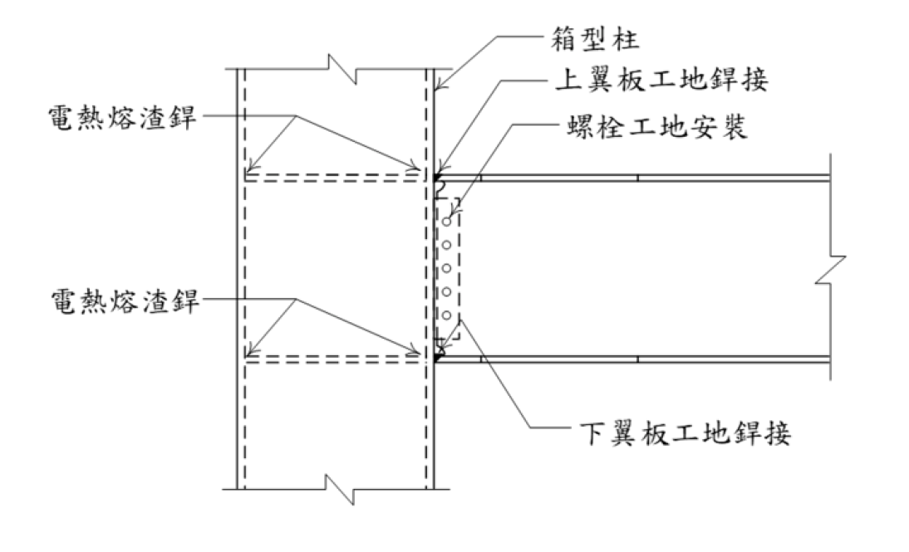

# SS-2024-4 題目正本

> 本檔只記錄**考卷上寫了什麼、圖上畫了什麼**，不含任何解法。解析見同資料夾 `SS-2024-4.md`。
> 判讀清單經使用者確認前，狀態為「待確認」；確認後本檔原則上不再修改（改動須回考卷原圖並記 log）。

| 項目 | 內容 |
|------|------|
| 考卷 | `raw/exams/SS-2024_鋼結構設計.pdf` 第 4 頁（頁次 4－4），第四題 |
| 考年 | 民國 113 年（2024） |
| 配分 | 25 分 |
| 附圖 | 1 張（箱型柱與 H 型梁接頭立面），`SS-2024-4-fig-1.png` |
| 判讀狀態 | **待確認**（轉錄 2026-11-02，PyMuPDF 110 dpi 全頁目視，盲讀後才比對既有解析） |

## 1. 考卷原文（逐字）

> 四、下圖為國內典型梁柱接頭型式，梁為 H 型鋼斷面，柱為箱型鋼斷面，試申論說明該類梁柱接頭內各式銲接及其相鄰母材可能產生之潛在破壞模式為何？其對應之預防方法與檢測方式為何？（25 分）

## 2. 考卷給的公式、附表與參數

- 本題**沒有給任何數值或公式**。
- 卷首「（註：題目所列之計算公式僅供參考應自負確認與勘誤責任，另視設計需求可自行假設適用的條件等）」；注意事項㈠可用計算器、㈡不必抄題、㈢除專門名詞或數理公式外應使用本國文字作答。

## 3. 附圖

*圖面文字照錄：箱型柱；上翼板工地銲接；螺栓工地安裝；電熱熔渣銲；電熱熔渣銲；下翼板工地銲接。*

## 4. 判讀清單

「把握」標**不確定**者請優先確認；解讀類項目（題目用字的意思）另標「解讀」。

| # | 項目 | 判讀 | 圖上／題文依據 | 把握 |
|---|------|------|---------------|------|
| 1 | 柱內虛線 | 內橫隔板，與上下梁翼板同高；「電熱熔渣銲」指隔板與柱壁的銲接 | 引線指向隔板兩端 | 確定（解讀） |
| 2 | 翼板工地銲接 | 梁翼板與柱面的全滲透開槽銲（圖未畫銲接符號，型式由慣例判斷） | 圖面文字 | 不確定（解讀） |
| 3 | 螺栓工地安裝 | 梁腹板以高拉力螺栓接剪力板；剪力板與柱面銲接未標示 | 圖面 | 確定（解讀） |
| 4 | 所問 | 各式銲接及相鄰母材的破壞模式、預防方法、檢測方式三項 | 題文 | 確定 |

---

*轉錄：2026-11-02（SS-U1-4 題目正本推廣・批 3）*
