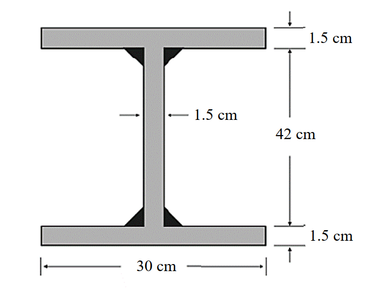

# SS-2025-1 題目正本

> 本檔只記錄**考卷上寫了什麼、圖上畫了什麼**，不含任何解法。解析見同資料夾 `SS-2025-1.md`。
> 判讀清單經使用者確認前，狀態為「待確認」；確認後本檔原則上不再修改（改動須回考卷原圖並記 log）。

| 項目 | 內容 |
|------|------|
| 考卷 | `raw/exams/SS-2025_鋼結構設計.pdf` 第 1 頁（頁次 2－1），第一題 |
| 考年 | 民國 114 年（2025） |
| 配分 | 25 分 |
| 附圖 | 1 張（銲接 H 型鋼斷面），`SS-2025-1-fig-1.png` |
| 判讀狀態 | **待確認**（轉錄 2026-11-02，PyMuPDF 110 dpi 全頁＋附圖 300 dpi 局部目視，盲讀後才比對既有解析） |

## 1. 考卷原文（逐字）

> 一、載重強度係數設計法（LRFD）結實梁，強軸彎矩強度計算：H 型鋼接鋼梁斷面如下圖，假設此梁有完全之側支撐，腹板（web）不會產生局部挫屈。假設銲接面積不計入斷面性質，若鋼材之 $F_y$ = 2.5 tf/cm² 及銲接殘餘應力為 1.16 tf/cm²，試求此梁斷面強軸之設計彎矩強度 $M_{nx}$。（25 分）

（「H 型鋼接鋼梁」照考卷原文，疑為「H 型銲接鋼梁」。）

## 2. 考卷給的公式、附表與參數

- 題文：$F_y = 2.5$ tf/cm²；銲接殘餘應力 1.16 tf/cm²；完全側撐；腹板不局部挫屈；銲道面積不計。
- 圖面：翼板寬 30 cm、厚 1.5 cm（上下）；腹板厚 1.5 cm；高度方向 1.5 cm／42 cm／1.5 cm 三段。
- 本題**沒有印公式**，也沒有給 $\phi_b$。
- 卷首注意事項：㈠可用計算器、㈡不必抄題、㈢除專門名詞或數理公式外應使用本國文字作答。

## 3. 附圖

*圖面文字照錄：1.5 cm；1.5 cm；42 cm；1.5 cm；30 cm。*

## 4. 判讀清單

「把握」標**不確定**者請優先確認；解讀類項目（題目用字的意思）另標「解讀」。

| # | 項目 | 判讀 | 圖上／題文依據 | 把握 |
|---|------|------|---------------|------|
| 1 | 42 cm | 腹板淨高（上下翼板之間），全深 $42 + 2(1.5) = 45$ cm | 右側三段尺寸線首尾相接（300 dpi） | 確定 |
| 2 | 翼板／腹板 | 翼板 30 × 1.5 cm（上下相同）；腹板厚 1.5 cm | 附圖 | 確定 |
| 3 | 側撐 | 完全側撐 → 不受 LTB 控制 | 題文 | 確定 |
| 4 | 翼板寬厚比 | 題稱「結實梁」，是否仍須驗算翼板 | 題文 | 確定（解讀） |
| 5 | 殘餘應力 1.16 | 僅與 $M_r$、$L_r$ 有關；本題完全側撐不用 | 題文 | 確定（解讀） |
| 6 | 「設計彎矩強度 $M_{nx}$」 | 用詞「設計」（乘 $\phi_b$）與符號 $M_{nx}$（標稱）不一致；兩者都寫出 | 題文 | 不確定（解讀） |

---

*轉錄：2026-11-02（SS-U1-2 題目正本推廣・批 2）*
