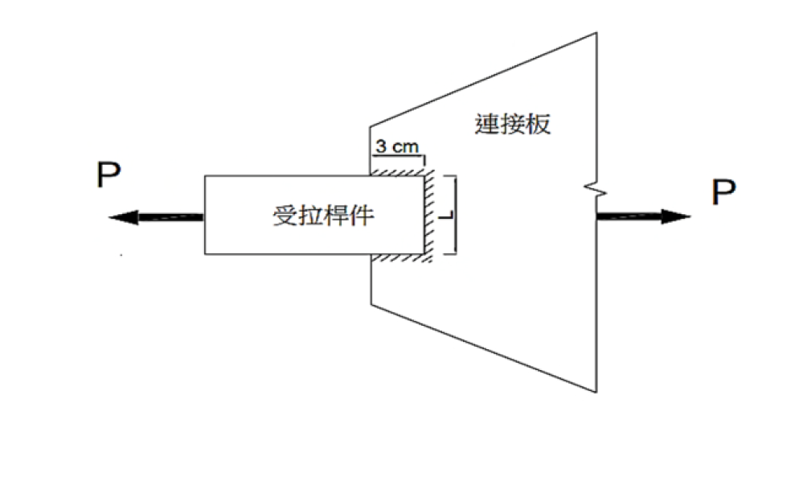

# SS-2025-2 題目正本

> 本檔只記錄**考卷上寫了什麼、圖上畫了什麼**，不含任何解法。解析見同資料夾 `SS-2025-2.md`。
> 判讀清單經使用者確認前，狀態為「待確認」；確認後本檔原則上不再修改（改動須回考卷原圖並記 log）。

| 項目 | 內容 |
|------|------|
| 考卷 | `raw/exams/SS-2025_鋼結構設計.pdf` 第 1 頁（頁次 2－1），第二題 |
| 考年 | 民國 114 年（2025） |
| 配分 | 25 分 |
| 附圖 | 1 張（銲接疊接），`SS-2025-2-fig-1.png` |
| 判讀狀態 | **已確認**（2026-11-02 使用者確認，含「不確定」項之解讀；轉錄同日，PyMuPDF 110 dpi 全頁＋銲道處 500 dpi 局部目視，盲讀後才比對既有解析） |

## 1. 考卷原文（逐字）

> 二、如圖示之銲接結合，受拉桿件寬度為 L cm，厚度為 2 cm，連接板厚度為 1 cm。假設銲道強度足夠，請依容許應力設計法（ASD）規範，計算 L 值最大或最小值應為何值，可使工作拉力 P 為最大？所有鋼材 $F_y = 2.5$ tf/cm²，$F_u = 4.1$ tf/cm²。（25 分）

## 2. 考卷給的公式、附表與參數

- 題文：受拉桿件寬 $L$ cm、厚 2 cm；連接板厚 1 cm；$F_y = 2.5$、$F_u = 4.1$ tf/cm²；銲道強度足夠。
- 圖面：縱向銲道（疊接）長 3 cm。
- 本題**沒有印任何公式**，也沒有給連接板寬度。
- 卷首注意事項：㈠可用計算器、㈡不必抄題、㈢除專門名詞或數理公式外應使用本國文字作答。

## 3. 附圖

*圖面文字照錄：P；受拉桿件；連接板；3 cm；L；P。*

## 4. 判讀清單

「把握」標**不確定**者請優先確認；解讀類項目（題目用字的意思）另標「解讀」。

| # | 項目 | 判讀 | 圖上／題文依據 | 把握 |
|---|------|------|---------------|------|
| 1 | 銲道配置 | 三面圍銲：上、下緣各一道縱向銲長 3 cm，端面一道橫向銲長 $L$ | 斜線陰影在上緣、端面、下緣（500 dpi） | 確定 |
| 2 | 3 cm | 疊接長度＝縱向銲道長度（自連接板左緣到桿件端面） | 尺寸線端點 | 確定 |
| 3 | $L$ | 受拉桿件寬度（端面旁的尺寸線） | 圖＋題文 | 確定 |
| 4 | 板厚 | 受拉桿件 2 cm、連接板 1 cm | 題文 | 確定 |
| 5 | 「工作拉力」 | ASD 容許拉力（使用載重，不乘載重係數） | 題文＋指定 ASD | 確定（解讀） |
| 6 | 「L 值最大或最小值」 | 求使 $P$ 最大的 $L$ 界限（板寬與縱向銲長的關係決定 $U$ 或適用條件） | 題文 | 不確定 → 使用者確認 |
| 7 | 端面橫向銲道的作用 | 縱向＋橫向並用時，是否仍以縱向銲長與板寬比決定 $U$ | 圖上有橫向銲道 | 不確定 → 使用者確認：仍依縱向銲長 $l = 3$ cm 與板寬比定 $U$（同本解） |
| 8 | 連接板 | 厚 1 cm 比桿件薄、寬度未給，是否需檢核 | 題文未給寬度 | 不確定 → 使用者確認：不控制，不列為必答（本解 §5.4） |

---

*轉錄：2026-11-02（SS-U1-1 題目正本推廣・批 3）｜確認：2026-11-02 使用者確認*
