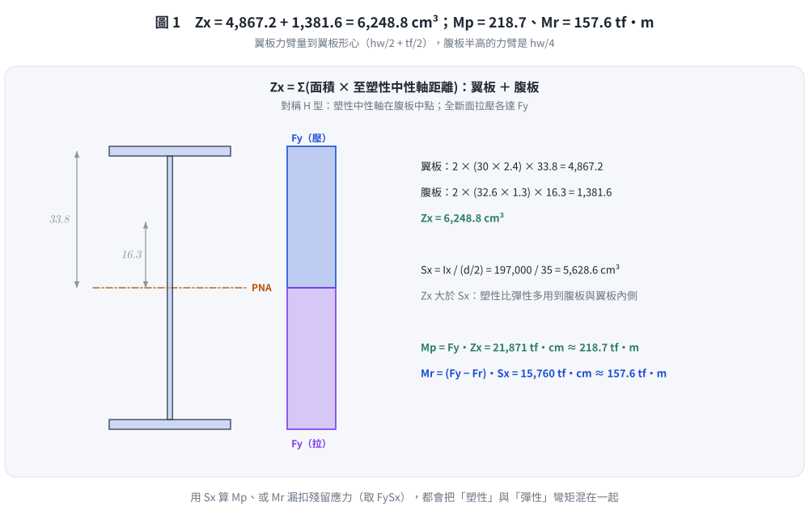
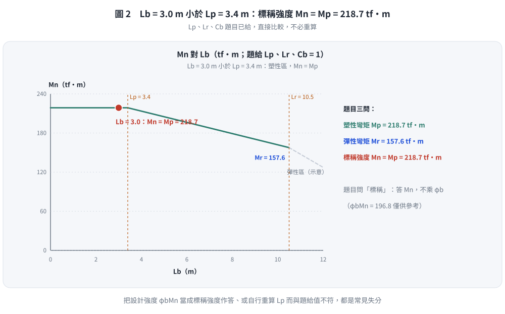

# 考題編號：SS-2025-3

**主分類：** `SS-U1-2` 梁桿件
**副分類：** `SS-U2-1` 塑性分析與設計
**設計法：** LRFD
**標籤：** `梁桿件` `撓曲構材` `LTB側扭挫屈` `塑性彎矩Mp` `彈性限制彎矩Mr` `Lp` `Lr` `熱軋斷面` `殘留應力` `φbMn`

---

## 1. 題目（考卷原文見題目正本）

> 考卷原文、公式／附表、附圖與判讀清單（已確認）見同資料夾 `SS-2025-3-problem.md`（題目瀏覽頁最上方「📄 題目正本」區塊）。本節只列**解題時最容易讀錯的地方**與本解使用的記號；題意以題目正本為準。

### 常見誤讀

| 項目 | 正確判讀 | 常見誤讀 |
|------|---------|---------|
| $L_p$、$L_r$、$C_b$ | **題目直接給定** 3.4 m、10.5 m、1 | 自行以公式重算 $L_p$（舊版解析用 AISC 式得 2.92 m） |
| 「標稱彎矩強度」 | 答 $M_n$，不乘 $\phi_b$ | 答設計強度 $\phi_bM_n$（舊版解析即如此） |
| 「彈性彎矩強度」 | $M_r = (F_y - F_r)S_x$ | $M_y = F_yS_x$（題目有給 $F_r$） |

**本解記號：** RH700×300×13×24：$d = 70$、$b_f = 30$、$t_w = 1.3$、$t_f = 2.4$ cm；$I_x = 197{,}000$ cm⁴；$L_b = 3.0$ m；$F_y = 3.5$、$F_r = 0.7$ tf/cm²。

---

## 2. 考題核心精神與出題者意圖 (Core Concepts & Examiner's Intent)

**核心觀念：LRFD 梁的三段式 LTB 設計流程**

本題考查完整的梁設計流程：
1. 計算 $Z_x$（需要理解塑性中性軸和塑性斷面模數的幾何意義）
2. 計算 $M_p$ 和 $M_r$（確立 LTB 曲線的上下界）
3. 比較 $L_b$ 與 $L_p$，確定 LTB 控制類型
4. 最終得出**標稱**彎矩強度 $M_n$（題目沒有要求設計強度 $\phi_bM_n$）

**出題者給出 $M_r$ 的用意：** 要求學生知道 $M_r = (F_y - F_r)S_x$（殘留應力使彈性限制彎矩降低），理解殘留應力在 LTB 曲線中的角色——$M_r$ 是 LTB 非彈性段和彈性段的分界點（在 $L_r$ 處的 $M_n$）。

**出題者給出 $F_r = 0.7$ tf/cm²（非 1.16 tf/cm²）的暗示：** 熱軋斷面，殘留應力較銲接組合斷面小。

---

## 3. 解題戰略地圖與陷阱分析 (Strategic Roadmap & Trap Analysis)

**步驟規劃：**
1. 由斷面標示推算幾何尺寸 → 計算 $Z_x$、$S_x$
2. 計算 $M_p = F_y Z_x$
3. 計算 $M_r = (F_y - F_r) S_x$
4. 以題給 $L_p = 3.4$ m 與 $L_b = 3.0$ m 比較（題目已給 $L_p$、$L_r$、$C_b$，不必自行計算）
5. 確認 $L_b < L_p$ → 塑性區 → $M_n = M_p$（**標稱**強度，不乘 $\phi_b$）

**關鍵陷阱：**

> ⚠️ **陷阱1：$S_x$ 的計算基準**
> $S_x = I_x / (d/2)$，其中 $d$ 是**全深**（包含兩翼板厚）= 70 cm。故 $S_x = 197{,}000 / 35 = 5{,}628.6$ cm³，不是用 $h_w/2 = 32.6$ cm。

> ⚠️ **陷阱2：$Z_x$ vs $S_x$ 的計算式**
> $Z_x$ 的翼板形心距 = $h_w/2 + t_f/2$（到塑性中性軸），而不是 $d/2$（那是彈性計算中 $S_x$ 的基準）。

> ⚠️ **陷阱3：$F_r$ 的角色**
> $F_r$ 不直接影響 $M_p$（$M_p = F_y Z_x$ 與殘留應力無關），只影響 $M_r = (F_y - F_r)S_x$（彈性範圍受殘留應力限制）。

> ⚠️ **陷阱0：題目給了就用題目的，問什麼答什麼**
> 本題直接給 $L_p = 3.4$ m、$L_r = 10.5$ m、$C_b = 1$——自行以公式重算 $L_p$ 只會引入不一致（舊版解析即誤用 AISC 的 $1.76r_y\sqrt{E/F_y}$ 算得 2.92 m）。題目求「**標稱**彎矩強度」，答 $M_n$；同年第一題寫「設計彎矩強度」才要乘 $\phi_b$。

> ⚠️ **陷阱4：$M_r$ 的應用場合**
> 本題 $L_b < L_p$，最終 $M_n = M_p$，$M_r$ 本身不直接代入 $M_n$ 公式，但仍需計算作為 LTB 線性插值公式的下界（萬一 $L_b$ 介於 $L_p$ 和 $L_r$ 之間時才用到插值：$M_n = M_p - (M_p - M_r)(L_b - L_p)/(L_r - L_p)$）。

---

## 3.5 變數層次分析（Variable Hierarchy Analysis）

> 複習提示：解題後，在每個卡住的知識點「卡關?」欄標記 `⚠`；第二次複習時只看有 `⚠` 的項目。

**最終目標：** 由 RH700×300×13×24 斷面計算 $M_p$、$M_r$，以題給 $L_p$ 判定 LTB 區間，求標稱彎矩強度 $M_n$

### 主要公式（$\boxed{\phantom{x}}$ = 未知，待推導）

**Step 1：斷面模數**
$$\boxed{S_x} = \frac{I_x}{d/2}, \quad \boxed{Z_x} = 2 b_f t_f \!\left(\frac{h_w}{2}+\frac{t_f}{2}\right) + \frac{t_w h_w^2}{4}$$

**Step 2：上下界彎矩**
$$\boxed{M_p} = F_y \boxed{Z_x}, \quad \boxed{M_r} = (F_y - F_r)\boxed{S_x}$$

**Step 3：LTB 判斷**
$$L_b = 3.0\text{ m} \stackrel{?}{<} L_p = 3.4\text{ m（題給）} \quad \Rightarrow M_n = M_p$$

**Step 4：標稱強度**
$$\boxed{M_n} = \boxed{M_p}\quad(L_b \le L_p)$$

### L1：題目直接給定

| 符號 | 數值 | 說明 |
|------|------|------|
| $d$ | 700 mm = 70 cm | 全深 |
| $b_f$ | 300 mm = 30 cm | 翼板寬 |
| $t_w$ | 13 mm = 1.3 cm | 腹板厚 |
| $t_f$ | 24 mm = 2.4 cm | 翼板厚 |
| $I_x$ | 197,000 cm⁴ | 強軸慣性矩 |
| $L_b$ | 3.0 m | 無側向支撐長度 |
| $L_p$ | 3.4 m | 題給 |
| $L_r$ | 10.5 m | 題給 |
| $C_b$ | 1 | 題給 |
| $F_y$ | 3.5 tf/cm² | 降伏強度 |
| $F_r$ | 0.7 tf/cm² | 殘留應力（熱軋斷面） |

### L2：需知識點推導

**Step 1：斷面幾何性質**

| 符號 | 公式 / 來源 | 卡關? |
|------|------------|:-----:|
| $h_w$ | $d - 2t_f = 70 - 4.8 = 65.2$ cm | |
| $S_x$ | $I_x/(d/2) = 197000/35 = 5628.6$ cm³ | |
| $Z_{x,\text{flange}}$ | $2 \times 72 \times (32.6+1.2) = 4867.2$ cm³ | |
| $Z_{x,\text{web}}$ | $2 \times 42.38 \times 16.3 = 1381.6$ cm³ ⚠ 常見卡關 | |
| $Z_x$ | $4867.2 + 1381.6 = 6249$ cm³ | |

**Step 2：上下界彎矩**

| 符號 | 公式 / 來源 | 卡關? |
|------|------------|:-----:|
| $M_p$ | $3.5 \times 6248.8 = 21871$ tf·cm | |
| $M_r$ | $(3.5-0.7) \times 5629 = 15760$ tf·cm | |

**Step 3：LTB 判斷**

| 符號 | 公式 / 來源 | 卡關? |
|------|------------|:-----:|
| 判斷 | $L_b = 3.0 < L_p = 3.4$ m（題給）→ 塑性區 | |
| $M_n$ | $= M_p = 21{,}871$ tf·cm ≈ 218.7 tf·m（標稱，不乘 $\phi_b$） | |

### L3：深層知識（不懂就卡住）

| 知識點 | 說明 | 卡關? |
|--------|------|:-----:|
| $S_x$ 用全深 $d$（非 $h_w$） | $S_x = I_x/(d/2)$，$d$ 含翼板；$h_w$ 只是腹板淨高 | |
| $Z_x$ 翼板形心距 = $h_w/2 + t_f/2$ | 翼板形心到塑性中性軸（腹板中點），含半個翼板厚 | |
| $M_r = (F_y - F_r)S_x$，$F_r$ 是殘留應力 | 殘留應力使翼板端部提前降伏；$M_r$ 是 LTB 非彈性段下界 | |
| $F_r$ 不影響 $M_p$，只影響 $M_r$ 和 $L_r$ | $M_p = F_y Z_x$ 與殘留應力無關 | |
| LTB 三段判斷邏輯 | $L_b < L_p$：塑性；$L_p < L_b < L_r$：插值；$L_b > L_r$：彈性 LTB | |

## 4. 步驟化詳細計算過程 (Step-by-Step Detailed Calculation)

### Step 1：計算斷面幾何性質

**斷面標示（RH700×300×13×24，d×bf×tw×tf，mm）：**

| 符號 | 數值 |
|------|------|
| 全深 $d$ | 700 mm = 70 cm |
| 翼板寬 $b_f$ | 300 mm = 30 cm |
| 腹板厚 $t_w$ | 13 mm = 1.3 cm |
| 翼板厚 $t_f$ | 24 mm = 2.4 cm |
| 腹板淨高 $h_w = d - 2t_f$ | 700 - 48 = 652 mm = **65.2 cm** |

---

### Step 2：計算彈性斷面模數 $S_x$

$$S_x = \frac{I_x}{d/2} = \frac{197{,}000}{70/2} = \frac{197{,}000}{35} = \mathbf{5{,}628.6 \text{ cm}^3}$$

---

### Step 3：計算塑性斷面模數 $Z_x$

**塑性斷面模數 = 中性軸上下各部分面積 × 形心至塑性中性軸距離之總和**

對對稱 H 型鋼（塑性中性軸在腹板中點）：

$$Z_x = Z_{x,\text{flange}} + Z_{x,\text{web}}$$

**翼板貢獻（上下各一，形心距中性軸 = $h_w/2 + t_f/2$）：**
$$Z_{x,\text{flange}} = 2 \times (b_f \cdot t_f) \times \left(\frac{h_w}{2} + \frac{t_f}{2}\right)$$
$$= 2 \times (30 \times 2.4) \times \left(\frac{65.2}{2} + \frac{2.4}{2}\right)$$
$$= 2 \times 72 \times (32.6 + 1.2) = 2 \times 72 \times 33.8 = 4{,}867.2 \text{ cm}^3$$

**腹板貢獻（上下各半，形心距中性軸 = $h_w/4$）：**
$$Z_{x,\text{web}} = 2 \times \left(\frac{h_w}{2} \cdot t_w\right) \times \frac{h_w}{4}$$
$$= 2 \times (32.6 \times 1.3) \times \frac{65.2}{4}$$
$$= 2 \times 42.38 \times 16.3 = 2 \times 690.8 = 1{,}381.6 \text{ cm}^3$$

**總塑性斷面模數：**
$$Z_x = 4{,}867.2 + 1{,}381.6 = \mathbf{6{,}248.8 \approx 6{,}249 \text{ cm}^3}$$

*圖 1　$Z_x$ = 翼板 4,867.2 ＋ 腹板 1,381.6 = 6,248.8 cm³；$M_p = F_yZ_x = 218.7$ tf·m，$M_r = (F_y - F_r)S_x = 157.6$ tf·m。這張圖攔的是翼板力臂取 $d/2$、漏了腹板、用 $S_x$ 算 $M_p$，或 $M_r$ 沒扣殘留應力。*

---

### Step 4：計算 $M_p$ 和 $M_r$

**塑性彎矩 $M_p$：**
$$M_p = F_y \times Z_x = 3.5 \times 6{,}248.8 = \mathbf{21{,}871 \text{ tf}\cdot\text{cm} \approx 218.7 \text{ tf}\cdot\text{m}}$$

**彈性限制彎矩 $M_r$（殘留應力限制翼板端部最大彈性應力為 $F_y - F_r$）：**
$$M_r = (F_y - F_r) \times S_x = (3.5 - 0.7) \times 5{,}628.6 = 2.8 \times 5{,}628.6 = \mathbf{15{,}760 \text{ tf}\cdot\text{cm} \approx 157.6 \text{ tf}\cdot\text{m}}$$

---

### Step 5：確認 LTB 控制區間

$L_p = 3.4$ m、$L_r = 10.5$ m、$C_b = 1$ 為**題目給定**，直接比較：

$$L_b = 3.0 \text{ m} < L_p = 3.4 \text{ m} \quad \Rightarrow \quad \text{無側扭挫屈（LTB 不控制）}$$

$$\boxed{M_n = M_p}$$

---

### Step 6：標稱彎矩強度 $M_n$

$$M_n = M_p = 3.5 \times 6{,}248.8 = \boxed{21{,}871\ \text{tf}\cdot\text{cm} \approx 218.7\ \text{tf}\cdot\text{m}}$$

（題目求**標稱**強度，答 $M_n$。若另問設計強度，才是 $\phi_bM_n = 0.9 \times 21{,}871 = 19{,}684$ tf·cm ≈ 196.8 tf·m，僅供參考。）

*圖 2　$L_b = 3.0$ m 小於 $L_p = 3.4$ m，標稱強度 $M_n = M_p = 218.7$ tf·m。這張圖攔的是把設計強度 $\phi_bM_n$ 當成所求的標稱強度，或自行重算 $L_p$、$L_r$。*

---

### 計算彙整

| 項目 | 計算式 | 數值 |
|------|--------|------|
| $S_x$ | $I_x / (d/2) = 197000/35$ | 5,628.6 cm³ |
| $Z_x$ | $Z_{flange} + Z_{web}$ | 6,249 cm³ |
| **$M_p$** | $F_y \cdot Z_x = 3.5 \times 6248.8$ | **21,871 tf·cm ≈ 218.7 tf·m** |
| **$M_r$** | $(F_y - F_r) \cdot S_x = 2.8 \times 5629$ | **15,760 tf·cm ≈ 157.6 tf·m** |
| LTB 判斷 | $L_b = 3.0m < L_p = 3.4m$ | 無 LTB |
| **$M_n$（題目所求）** | $= M_p$（$L_b \le L_p$）| **21,871 tf·cm ≈ 218.7 tf·m** |
| $\phi_b M_n$（參考） | $0.9 \times M_n$ | 19,684 tf·cm ≈ 196.8 tf·m |

---

## 5. 關鍵爭議點與進階探討 (Critical Issues & Advanced Discussion)

### LRFD 梁設計三段式 LTB 公式回顧

依梁的側向無支撐長度 $L_b$ 與 $L_p$、$L_r$ 的關係，分三個強度區間：

| 區間 | 條件 | $M_n$ 公式 |
|------|------|-----------|
| 塑性區 | $L_b \leq L_p$ | $M_n = M_p = F_y Z_x$ |
| 非彈性 LTB | $L_p < L_b \leq L_r$ | $M_n = M_p - (M_p - M_r)\dfrac{L_b - L_p}{L_r - L_p}$ |
| 彈性 LTB | $L_b > L_r$ | $M_n = M_{cr}$（彈性臨界彎矩）|

本題 $L_b = 3.0$ m 小於題給 $L_p = 3.4$ m，故屬**塑性區**，$M_n = M_p$，無需使用插值公式。

> 💡 **臨界觀察：** 如果 $L_b$ 再增加約 400mm（達到 3.4m），設計強度就開始線性下降。本題的設計點非常靠近 $L_p$ 邊界，提醒工程師側向支撐間距的敏感性。

### $M_p$ 與 $M_r$ 的物理意義

$$M_p = F_y Z_x \quad \longleftarrow \quad \text{全截面降伏（最高強度）}$$
$$M_r = (F_y - F_r) S_x \quad \longleftarrow \quad \text{翼板端部應力達 } F_y - F_r \text{（殘留壓應力佔滿彈性餘裕）}$$

殘留應力 $F_r$ 的存在，使翼板端部比理想情況提前進入降伏，縮短了非彈性 LTB 的範圍：$L_r$ 對應的 $M_n = M_r$（而非 $M_y = F_y S_x$）。

### $Z_x/S_x$ 的形狀因子意義

$$\text{形狀因子} = \frac{Z_x}{S_x} = \frac{6{,}249}{5{,}629} \approx 1.11$$

此值（約 1.10～1.15 for 寬翼 H 型鋼）代表：截面從最外緣纖維首次降伏（$M_y$）到完全塑性化（$M_p$），強度增加約 11%。LRFD 利用此 11% 的強度儲備，比 ASD 更充分地利用材料。

### 考場安全答法

1. 列出斷面尺寸，計算 $h_w = 70 - 2(2.4) = 65.2$ cm
2. $S_x = 197000/35 = 5629$ cm³
3. $Z_x = 2(30 \times 2.4 \times 33.8) + 2(32.6 \times 1.3 \times 16.3) = 4867 + 1382 = 6249$ cm³
4. $M_p = 3.5 \times 6248.8 = 21871$ tf·cm（218.7 tf·m）
5. $M_r = 2.8 \times 5629 = 15760$ tf·cm（157.6 tf·m）
6. $L_b = 3.0$ m $< L_p = 3.4$ m（題給）→ $M_n = M_p$ = 21,871 tf·cm ≈ **218.7 tf·m**（標稱強度，即本題答案）

*修正日期：2026-11-02（依考卷 114 年第三題原文與已確認之 `SS-2025-3-problem.md`：原重述漏抄題給 $L_p = 3.4$ m、$L_r = 10.5$ m、$C_b = 1$，§4 改以 AISC 式 $1.76r_y\sqrt{E/F_y}$ 自算 $L_p$ = 2.92 m 又改回 3.4 m；且題目求「**標稱**彎矩強度」，原答設計強度 $\phi_bM_n$ = 196.8 tf·m，更正為 **$M_n = M_p$ = 21,871 tf·cm ≈ 218.7 tf·m**。$Z_x$ 以封閉式與分塊法雙路徑重算皆 6,248.8 cm³，$M_r$ = 15,760 tf·cm 不變；$M_p$ 統一以 $Z_x$ = 6,248.8 計為 21,871 tf·cm（原 6,249 取整得 21,871.5／21,872 並存））*

*修正日期：2026-11-02（§1 全文重述改為指向題目正本 `SS-2025-3-problem.md`（已確認）＋常見誤讀＋本解記號，避免題意兩份不同步；解題內容與答案不變）*

---

*圖解補繪：2026-11-03（向量圖 2 張，腳本 `gen_SS-2025-3.py`，改輸入可原地重跑；SVG 供 wiki／PDF，2× PNG 供 pptx／影片）*
